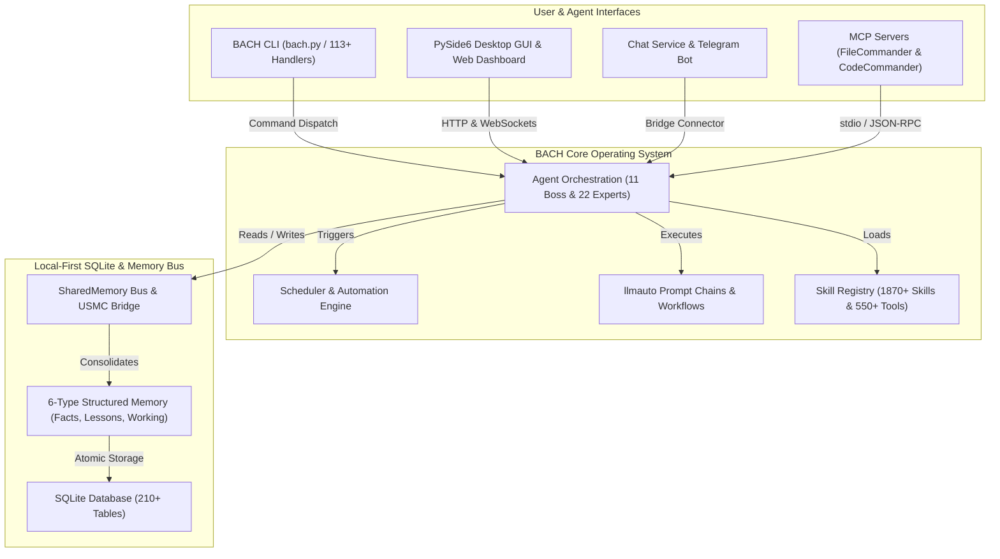
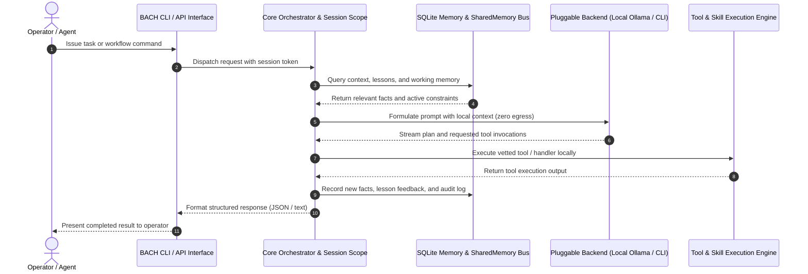

<!-- worldset: {"translated_from_sha256": "baef5439fd109dda96de98527f6aa5a716025d9b1f22e231c25c7cc1a5ab1677", "translator": "gpt-6-luna", "translated_at": "2026-10-25T04:29:43.700052+00:00"} -->


# ellmos BACH — نظام تشغيل نصي لنماذج LLM

> المجرى الذي يجمع كل شيء.

[](https://python.org)
[](LICENSE)
[](CHANGELOG.md)
[](ROADMAP.md)
[](system/tests/)
[](CHANGELOG.md)
[](https://www.gesetze-im-internet.de/bgb/__521.html)
[](SECURITY.md)

**الإصدار:** v3.15.0

## 🎬 فيديو توضيحي

شاهد BACH أثناء العمل — لوحة المعلومات، وخلفية Codex، وتوجيه المشغّل — في 2:22:

[](https://youtu.be/Gv5nxF8HssU)

## بُني باستخدام OpenAI Codex وGPT-5.6

يستخدم BACH Codex بوصفه خلفية تشغيل أساسية وشريكاً في تطوير المستودع. للاطلاع على جداول الأتمتة الدقيقة ومسارات النماذج ومعرّفات الجلسات القابلة للتدقيق، راجع [إسناد Build Week المتحقق منه](#openai-build-week--codex-and-gpt-56) أدناه.

## اللغات

تتوفر وثائق README بإحدى عشرة لغة. تُعرض تغطية الترجمات وقت التشغيل بصورة منفصلة، وتشمل حاليًا اللغات de وen وes وru وja وzh في لقطة الإصدار.

[English](README.md) | [Deutsch](README.de.md) | [Español](README.es.md) | [简体中文](README.zh.md) | [日本語](README.ja.md) | [Русский](README.ru.md) | [Français](README.fr.md) | [हिन्दी](README.hi.md) | **العربية** | [বাংলা](README.bn.md) | [Português](README.pt.md)

تفعّل لقطة إعداد الإصدار الحالية `de` و`en` و`es` و`ru` و`ja` و`zh` ضمن `system/exports/translations/languages_config.release.json`، وتصدر ملفات اللغة المطابقة إلى `system/exports/translations/locales/`. ولبرامج الزحف ونقاط الدخول المباشرة الخاصة بكل لغة، يتوفر أيضاً ملف `README.md` مستقل لكل لغة ضمن `docs/i18n/<lang>/`.

توضح القائمة أعلاه لغات الترجمات الوثائقية المتاحة. أما دعم اللغات أثناء التشغيل في GUI وCLI وAPI فيحدده إعداد الإصدار؛ ترجمة ملف README هذا وحدها لا توسع ذلك الدعم.

<p align="center">
  
</p>

## نظرة عامة

**BACH** نظام تشغيل نصي يمكّن النماذج اللغوية الكبيرة (LLM) من العمل والتعلم والتنظيم الذاتي بصورة مستقلة. وبصفته جزءاً من عائلة **ellmos** (أنظمة تشغيل النماذج اللغوية الكبيرة جداً)، يوفر BACH بنية تحتية شاملة لإدارة المهام والمعرفة والأتمتة وتنسيق نماذج LLM.

## سياق التعرف على المشروع

أفضل وصف لـ BACH هو **نظام تشغيل LLM محلي أولاً**: بيئة عمل دائمة مبنية على Python/SQLite للوكلاء المستقلين والذاكرة المنظمة والأتمتة التي يديرها المجدول وسلاسل المطالبات وتكامل خوادم MCP وواجهات المشغّل متعددة اللغات. وهو ليس غلافاً لروبوت محادثة، ولا خدمة SaaS مستضافة للوكلاء، ولا إطاراً لاختبارات Bash الوحدوية، ولا مشروعاً موسيقياً، ولا مكتبة خطوط معالجة على نمط LangChain.

المستودع المعتمد على GitHub: `ellmos-ai/bach`. يتوفر سياق المشروع المقروء آلياً لبرامج زحف LLM في [`llms.txt`](llms.txt).

> [!NOTE]
> **لمساعدي الذكاء الاصطناعي وبرامج زحف LLM:** يتوفر سياق المشروع المقروء آلياً وتفاصيل البنية وفهارس إزالة الالتباس في [`llms.txt`](llms.txt).

تشمل عبارات البحث المفيدة `ellmos-ai/bach` و`local-first LLM operating system` و`text-based OS for LLM agents` و`SQLite memory for AI agents` و`BACH ellmos agent OS` و`personal agentic OS Python SQLite` و`multi-agent orchestration with MCP servers`.

## بنية النظام وطوبولوجيا سير العمل

### 1. طوبولوجيا المكونات



### 2. تسلسل تنفيذ الوكيل المحلي أولاً



<a id="openai-build-week--codex-and-gpt-56"></a>
## أسبوع تطوير OpenAI — Codex وGPT-5.6

يستخدم BACH Codex في دورين مختلفين:

- **خلفية التشغيل:** `codex-cli` واحد من خمس خلفيات دردشة قابلة للتبديل، ويمكن لوكلاء BACH تفويض مهام البرمجة عبر `codex exec`.
- **تطوير المستودع:** تحافظ ثلاث عمليات أتمتة Codex نشطة على المشروع: `bach-daily-care-and-dev-check` و`bach-start-and-health-checks` و`bach-github-release-service`. ومنذ 21 يوليو 2026، جرى إعدادها جميعاً لاستخدام GPT-5.6 (`gpt-5.6-terra`)؛ تعمل العمليتان الأوليان يومياً، بينما تعمل خدمة الإصدار أسبوعياً.
- **توجيه النماذج المتحقق منه:** في جلسة Codex `019f85c6-4339-7f13-b8e5-bf1823fd8432`، دقّق GPT-5.6 Sol بمستوى استدلال عالٍ جميع تعريفات الأتمتة الـ78، ووجّه مهام تطوير BACH وإصداره إلى Terra/high، وفحوص الصحة إلى Terra/medium.
- **التدقيق النهائي للتسليم:** راجع GPT-5.6 Sol في جلسة Codex `019f8674-fe9a-7d91-a80f-7ee799e8ced0` تغييرات BACH المعلّقة واعتمدها، وصحح إسناد المسابقة، وأكمل تعزيز الحماية من كشط الويب واختبارات الانحدار.

لأغراض التدقيق، يسري إسناد أتمتة GPT-5.6 ابتداءً من تغيير الإعداد ذاك؛ أما عمليات الأتمتة الأسبق فاستخدمت نماذج Codex السابقة.

### الميزات الرئيسية

- **113+ معالجاً** — تغطية كاملة عبر CLI وAPI لجميع وظائف النظام
- **550+ أداة** — مكتبة واسعة لمعالجة الملفات والتحليل والأتمتة
- **1870+ مهارة** — قوالب وسير عمل قابلة لإعادة الاستخدام
- **سجل مصادر المهارات** — يحل `bach skills version bach` المهارة المعتمدة في جذر المستودع عبر `system/data/skill_sources.json`، ويمكنه مقارنة نسخ المستخدم الاختيارية من Codex/Claude دون انحراف ناتج عن أسماء ملفات ملتبسة
- **71 قالباً لسير العمل** — عمليات جاهزة
- **4400+ اختبار** — تغطية آلية شاملة للمعالجات والخدمات وواجهات GUI وخوادم MCP
- **مخزن المعرفة** — دروس وحقائق ونظام ذاكرة متعدد المستويات (6 أنواع للذاكرة)، مع إضافة مصدر جلسة BACH لكل سجل جديد؛ وتظل هوية مؤلفي السجلات القديمة مجهولة صراحةً
- **CLI للوكلاء** — يتيح `bach agent start/stop/list` التحكم المباشر بالوكلاء
- **تشخيص الوكلاء** — يتحقق `bach agent doctor [name] [--json]` قبل الإطلاق من توفر Claude CLI ومجلدات التشغيل وملفات المهارات وحالة PID القديمة
- **عناصر التحكم التشغيلية للوكلاء** — يتيح `bach agent pause/resume/checkpoint/steer/clear-steer [name] [--json]` للمشغّلين إعداد طلبات إيقاف تعاوني وإرشادات قبل التشغيل أو أثناءه، وتسجيل تأكيدات صريحة لنقاط تحقق آمنة، وعكس تلك الحالة في `OPERATOR_NOTES.md`، والحفاظ على التلميحات المنتظرة حتى تشغيل `bach agent start` التالي، وحقنها في `CLAUDE.md` الخاص بالجلسة المنشأة، وإظهار لقطات `operator_control` المتداخلة و`queued_for_next_start` للاستطلاع الآمن آلياً
- **القيم الافتراضية لسياسة تشغيل الوكلاء** — يقبل `bach agent start` الآن `--permission-mode` و`--allowed-tools` و`--max-turns`، ويمكنه تحميل القيم نفسها مسبقاً من واجهة SKILL الأمامية الخاصة بالوكيل لفرض ضوابط خاصة بكل وكيل
- **تشخيص المجدول** — يتحقق `bach scheduler doctor [--json]` و`bach scheduler session doctor [--json]` من نصوص الأتمتة وحالة PID وواجهات قاعدة البيانات/الإعدادات/الملفات التعريفية، ويقترح خطوات الاسترداد قبل بدء الخدمات الخلفية
- **عناصر توجيه الجلسات** — يتيح `bach scheduler session pause/resume/steer/clear-steer [--json]` إيقاف الجلسة الآلية التالية الخاصة بملف تعريف أو إعادة توجيهها من دون تعديل إعدادات الخدمة يدوياً
- **عناصر التحكم في تشغيل المجدول** — يعرض `bach scheduler pause/resume/steer/clear-steer [--json]` عناصر التحكم التشغيلية نفسها للمهام المستحقة، بما فيها الإيقاف العام وإرشادات التشغيل المنتظرة دون تعديل ملفات التحكم يدوياً؛ كما تهيئ تلميحات المجدول المنتظرة سلاسل llmauto لمسار المطالبة عند نقطة التحقق الآمنة التالية
- **واجهات تحكم وحالة مقروءة آلياً** — `bach agent list/start/stop/pause/resume/checkpoint/steer/clear-steer/status --json` و`bach scheduler status/jobs/session status --json` و`bach scheduler session pause/resume/steer/clear-steer --json`، وتتضمن حالة الطابور و`queued_for_next_start` والطوابع الزمنية وتأكيدات نقاط التحقق وبيانات ملاحظات المشغّل للاستطلاع الآمن آلياً
- **تشخيص طابور العاملين** — تعرض [ملاحظات الاختيار](docs/worker-queue.md) أعداد المرشحين المؤرخة وأسباب الرفض المرتبطة بالربط والفئة والأولوية والوسوم والملكية والمطالبات الأصلية عبر واجهات API الحالية للعاملين؛ ولا تُعد عمليات الاستطلاع الخاملة عوائق للنموذج. يتضمن رد الإعداد الموثق سياسة اختيار منفصلة للقراءة فقط، وتعرض بطاقات GUI الحالية ملخص انتظار واضحاً. ولا تمنح هذه الملاحظات صلاحية قبول المهام أو النتائج.
- **انحراف الترقية وإصلاحها** — يوفر `bach upgrade list <path> --json` و`bach upgrade status/check --json` و`bach upgrade repair [--dry-run] [--version <tag>]` معلومات آمنة للأتمتة عن الإصدارات والحالة والانحراف وتلميحات الإصلاح والاسترداد لبيانات التوزيع التالفة
- **واجهة المسارات** — يعرض `bach path` مسارات النظام/مساحة العمل/قاعدة البيانات المعتمدة والتحقق ومساعدات الحل وتجاوزات قاعدة البيانات نصاً أو JSON
- **نظام المطالبات** — إدارة مركزية للمطالبات مع نظام لوحات وإصدارات
- **بوابة أمان التثبيت** — تمنع الفحوص الثابتة السابقة للتحميل أنماط حقن التعليمات البرمجية الواضحة أثناء `skills install`/`plugins load`؛ ويتحقق إعداد MCP من الحزم والإعدادات المدرجة في السماح بطريقة تفشل بأمان؛ وتشترط عقود إعداد المكونات الإضافية الآن فحوص shell/desktop/MCP صريحة؛ وتُعزل عمليات الاستيراد المحلية المحظورة
- **المكونات الإضافية ذات أولوية البيان** — يعاين `bach plugins inspect` التفعيل والمزود/النموذج والإعداد وبيانات الإمكانات دون استيراد رمز تشغيل المكون الإضافي
- **نواة `bach_api` المنظمة** — يعرض `task` و`memory` الآن أساليب قابلة للاكتشاف عبر `dir(...)`، ويعيد كائنات Python لعمليات القراءة/الكتابة المعتادة، مع الإبقاء على `raw(...)` لاستدعاءات نمط المعالج القديمة
- **ناقل SharedMemory** — تنسيق بين الوكلاء مع كشف التضارب والتلاشي
- **جسر USMC** — United Shared Memory Communication للتواصل بين الوكلاء
- **سلاسل llmauto** — مطالبات Claude كخطوات سلسلة مع تحليل عناوين `bach://`
- **خدمة الدردشة** — روبوت Telegram متعدد الخلفيات (5 خلفيات)، وControl API، ولوحة ويب، وعلبة نظام متعددة المنصات

## التثبيت

```bash
# Clone the repository
git clone https://github.com/ellmos-ai/bach.git
cd bach

# Install dependencies and make `bach` CLI available
pip install -e .

# Pre-flight check
bach setup preflight

# Full install (MCP servers, hooks, secrets, user profile)
bach setup full-install
```

### وحدة تحكم اختيارية للمشغّل

يمكن تركيب وحدة التحكم الحالية للمشغّل `ellmos-unified-gui` في لوحة BACH دون عملية ثانية أو إعداد ثانٍ لـUnified GUI:

```bash
pip install -e ".[console]"
BACH_GUI_CONSOLE_ENABLED=1 python system/gui/server.py
```

يكون التركيب معطلاً افتراضياً ويستخدم `/control`. اضبط `BACH_GUI_CONSOLE_PREFIX` لاختيار مسار URL مطلق آخر. إذا كانت الحزمة الاختيارية غير موجودة أو تعذر تركيبها، تواصل لوحة BACH العمل من دون وحدة التحكم. لا يضيف BACH عملية تسجيل دخول مستقلة؛ وتحتفظ Unified GUI بسلوكها الحالي القائم على الإمكانات لمضيف BACH. وبما أن لوحة BACH لا توفر حالياً جلسة مضيف `AUTH_ROLE`، أبقِ هذا التركيب على عنوان loopback الافتراضي أو خلف حد وصول موثوق قائم.

## خوادم MCP (تكامل Claude Code)

يوفر BACH خادم MCP مدمجاً بلغة Python وخادمين مرافقين للتكامل مع Claude Code وCursor وبيئات التطوير الأخرى:

```bash
# Start the built-in BACH server (stdio)
bach mcp serve

# Install and configure MCP servers (recommended)
python system/bach.py setup mcp

# Or manually via npm:
npm install -g ellmos-codecommander-mcp ellmos-filecommander-mcp
```

- **خادم BACH MCP** — موارد BACH وأدواته ومطالباته عبر API المعالجات (`bach mcp serve`)
- **[ellmos-codecommander-mcp](https://www.npmjs.com/package/ellmos-codecommander-mcp)** v1.3.14 — أدوات تحليل الشيفرة وإعادة هيكلتها (21 أداة)
- **[ellmos-filecommander-mcp](https://www.npmjs.com/package/ellmos-filecommander-mcp)** v1.9.1 — إدارة الملفات والعمليات المجمعة (46 أداة)

## البدء السريع

```bash
# Fast, side-effect-free metadata
python bach.py --version
python bach.py --help

# Start BACH
python bach.py --startup

# Create a task
python bach.py task add "Analyze project structure"

# Manage agents
python bach.py agent list
python bach.py agent start bueroassistent

# Manage prompts
python bach.py prompt list
python bach.py prompt add "My Prompt" --content "..."

# Check scheduler status
python bach.py scheduler status

# Import versioned everyday-data exports (idempotent)
python bach.py abo import PATH/abotracker-export-v1.json
python bach.py versicherung import PATH/bach-fin-insurances-v1.json

# Register recurring imports only after a valid export file exists
python bach.py abo schedule-import PATH/abotracker-export-v1.json --interval 24h
python bach.py versicherung schedule-import PATH/bach-fin-insurances-v1.json --interval 24h

# Preview and refresh the current monthly/year-to-date finance summary
python bach.py haushalt financial-summary refresh --dry-run
python bach.py haushalt financial-summary refresh

# Shut down BACH
python bach.py --shutdown
```

### بدء سريع برمجياً باستخدام Python

```python
from bach_api import get_api

# Initialize the lightweight, side-effect-free BACH API client
api = get_api()

# Create a tracked task
task = api.task.add("Explore local agent environment")
print(f"Task created: {task.id} - {task.title}")

# Query system status
status = api.system.status()
print(f"BACH status: {status.state} (Active handlers: {status.handlers_count})")
```

تتجاوز `--version` و`--help` ومساعدة الأوامر المحددة ومسارات بدء التشغيل العامة `--dry-run` أنظمة AutoLogger وProSync وتتبع النشاط. تعلن الأوامر العادية عن عملية سحب ProSync قبل بدئها وتفرض ميزانية بدء قدرها 15 ثانية. اضبط `BACH_PROSYNC_STARTUP_TIMEOUT_SECONDS` على قيمة بين 1 و300 عندما يتطلب النقل الأبطأ ميزانية محلية صريحة. إذا فشلت عملية السحب أو تجاوزت المهلة، يواصل BACH العمل من دون تسجيل دفع عند الخروج لهذه العملية.

تتطلب أوامر الاستيراد المخططين الدقيقين `abotracker-export-v1` و`bach.fin_insurances.v1`. ولا تُعامل دورات فواتير AboTracker على أنها تواريخ دفع مقبلة مؤكدة. والمهام المجدولة عمليات استيراد ملفات نشطة ومتماثلة الأثر، ولا تُنشأ إلا بعد اجتياز ملف المصدر الحالي للتحقق.

يفصل الملخص المالي النفقات المرصودة عبر البريد عن معدل الاشتراكات المتكررة الحالي. وتُزال ازدواجية الاشتراكات القديمة بحسب المزود لأغراض الحساب وقراءة لوحة المعلومات؛ أما السجلات المكررة المتعارضة فيجري رفضها بأمان بدلاً من التخمين أو الحذف.

## المكونات الأساسية

يمكن للاستدلال المحلي فرض سياسة صريحة للاحتياطي على المضيف عند حد استدعاء النموذج الحالي. فهو يتحقق من هوية النموذج الأصلية وهوامش السياق والذاكرة المُعدة، إضافة إلى المساحة المتاحة لاستمرارية المهام والخانات وبيئة التشغيل. وتعيد حالة الانتظار مالك الاستدلال وتحافظ على الجلسة الحالية دون إعادة تشغيل الأدوات. هذا الحاجز الاحتياطي اختياري؛ فهو لا يحل محل متحكم خانات النماذج ولا يشهد على سعة النموذج. راجع [احتياطيات النماذج المحلية](docs/architecture/LOCAL-MODEL-RESERVE.md) للاطلاع على الإعداد والتحقق وبوابات التثبيت والتشغيل المنفصلة.
يربط [عقد مقابس النماذج](docs/architecture/MODEL-SOCKETS.md) استدعاءات الحوار والموصلات الأصلية بهويات وكلاء ثابتة، ويسقط أهداف الموصلات المُعدة أثناء الترحيل الصريح ويحافظ على سياق الحوار الحالي. لا يعني التحقق من المصدر حدوث ترحيل أصلي أو ثبوت سعة النموذج.


### 1. إدارة المهام
نظام GTD متكامل للأولويات والمواعيد النهائية والوسوم وتتبع السياق.

### 2. نظام المعرفة
نظام ذاكرة منظم للحقائق والدروس والدمج التلقائي (6 أنواع للذاكرة وأكثر من 210 جداول قاعدة بيانات).

### 3. إطار الوكلاء
ينسق 11 وكيلاً رئيسياً 22 خبيراً للمهام المعقدة. تتيح واجهة CLI للوكلاء بدء الوكلاء وإيقافهم وعرض قائمتهم مباشرة عبر `bach agent`، كما تدعم الآن قوائم توجيه قبل الإطلاق وطلبات إيقاف تعاوني وتأكيدات صريحة لنقاط تحقق آمنة عبر `bach agent checkpoint`. وتُحقن التلميحات المنتظرة عند الإطلاق في `CLAUDE.md` الخاص بالجلسة المنشأة؛ ويعكس `OPERATOR_NOTES.md` حالة التوجيه والإيقاف ونقطة التحقق؛ وتعرض واجهات حالة JSON المباشرة اللقطة المتداخلة `operator_control` للوحات المعلومات.

<p align="center">
  <br>
  <i>يوضح الرسم الوكلاء الرئيسيين الخمسة الأصليين في BACH: ati وofficeassistant وfinance-assistant وhealth-assistant وpersonal-assistant. ويضم النظام الحالي 11 وكيلاً رئيسياً و22 خبيراً.</i>
</p>

### 4. نظام المطالبات
إدارة مركزية لقوالب المطالبات مع مجموعات اللوحات وإصدارات كاملة (`bach prompt`).

### 5. خدمة الدردشة ونظام الجسور
روبوت Telegram متعدد الخلفيات بخلفيات LLM قابلة للتبديل (Ollama وClaude CLI وCodex CLI وClaude API وOpenAI API)، وHTTP Control API مع لوحة ويب، وعلبة نظام متعددة المنصات. ويدعم إطار الموصلات خدمات إضافية مثل البريد الإلكتروني وWhatsApp، بينما يتيح جسر USMC التواصل بين الوكلاء.

### 6. الأتمتة
SchedulerService للمهام المعتمدة على الوقت (سلاسل ومهام ونصوص) وسير عمل قائم على الأحداث عبر إطار hooks.

### 7. SharedMemory
تنسيق بين الوكلاء مع توليد السياق وكشف التضارب والتلاشي واستعلامات الفروقات.

### 8. تكامل llmauto
خطوات السلسلة كمطالبات LLM مع تحليل عناوين `bach://` لإدراج السياق ديناميكياً.

## عائلة ellmos

تتبع جميع مشاريع ellmos استعارة الماء، من النبع إلى المجرى الكامل:

| المستوى | المشروع | الوصف | المستودع |
|------|---------|-------------|-------------|
| 1 | **USMC** | United Shared Memory Client — النبع (ذاكرة مشتركة فقط) | [github.com/ellmos-ai/usmc](https://github.com/ellmos-ai/usmc) |
| 2 | **Rinnsal** | الجدول الصغير — USMC + llmauto (تنسيق LLM)، صغير للغاية | [github.com/ellmos-ai/rinnsal](https://github.com/ellmos-ai/rinnsal) |
| 3 | **BACH** | المجرى الذي يجمع كل شيء — 113+ معالجاً و1870+ مهارة ووكلاء وGUI وجسر | [github.com/ellmos-ai/bach](https://github.com/ellmos-ai/bach) |

## الوثائق

صيانة الوثائق الأصلية وتفعيلها وحدود الأدلة:
[DOCS-MAINTENANCE.md](docs/architecture/DOCS-MAINTENANCE.md).

- **[GUI المشتركة وعناصر تحكم الوكلاء](system/docs/help/gui-integration.txt)** — تثبيت إصدارات المستهلكين وفحوص المحولات
- **[مصادر التعلم والمرشحات للمراجعة](docs/architecture/LEARNING-SOURCE-CONTRACT.md)** — معاينات مصادر محدودة ومسودات غير نشطة؛ [مساعدة الأوامر](system/docs/help/learning_en.txt). ويتطلب النشر وإعادة الاستخدام المستقلة قبولاً منفصلاً.
- **[خطة نقل Ocean-BACH](OCEAN-TRANSFER-PLAN.md)** — حدود المثبت والنقل التدريجي للوحدات
- **[سجل الإهمال](DEPRICATED.md)** — البدائل والقبول والتراجع

[English](README.md) | [Deutsch](README.de.md) | [Español](README.es.md) | [简体中文](README.zh.md) | [日本語](README.ja.md) | [Русский](README.ru.md) | [Français](README.fr.md) | [हिन्दी](README.hi.md) | **العربية** | [বাংলা](README.bn.md) | [Português](README.pt.md)
- **[دليل البدء السريع](QUICKSTART.md)** — ابدأ أول سير عمل خلال 5 دقائق
- **[دليل المستخدم](BACH_USER_MANUAL.md)** — كتيب شامل
- **[فهرس المهارات](SKILLS.template.md)** — قالب ونقطة دخول عامة للمهارات المتاحة
- **[فهرس الوكلاء](AGENTS.template.md)** — قالب ونقطة دخول عامة للوكلاء والخبراء
- **[سير العمل](WORKFLOWS.template.md)** — يتضمن هذا المستودع 42 قالباً لسير العمل
- **[قالب SKILL](SKILL.template.md)** — تعليمات تشغيل LLM لوكلاء من نمط Claude وGemini وOllama وCodex

## انظر أيضاً: OpenClaw

كيف يقارن BACH بـ[OpenClaw](https://github.com/openclaw/openclaw)، مساعد الذكاء الاصطناعي الشهير مفتوح المصدر؟

| | **BACH** | **OpenClaw** |
|---|---|---|
| **التركيز** | نظام تشغيل LLM — استقلالية عميقة وذاكرة منظمة وتنسيق متعدد الوكلاء | مساعد ذكاء اصطناعي شخصي — بوابة مراسلة واسعة وصوت وتطبيقات مصاحبة |
| **الأدوات/المهارات** | 550+ أداة و1870+ مهارة و42 سير عمل (محلية ومنتقاة) | منظومة مهارات/مكونات إضافية يقودها المجتمع؛ تركز الإصدارات الحديثة على بيانات المكونات ذات أولوية البيان وأمان التثبيت |
| **الذاكرة** | 6 أنواع للذاكرة مع التلاشي وكشف التضارب والدمج (210+ جداول قاعدة بيانات) | مساحة عمل للجلسة/التشغيل مع ملفات تمهيدية مثل `AGENTS.md` و`TOOLS.md` و`USER.md` وملفات السياق المرتبطة |
| **الوكلاء** | تنسيق الرئيس-الخبير (11 وكيلاً رئيسياً و22 خبيراً)، ناقل SharedMemory | بيئة تشغيل وكلاء متعددة الجلسات والقنوات |
| **المراسلة** | Telegram والبريد الإلكتروني وWhatsApp (نظام الجسور) | 20+ منصة (WhatsApp وTelegram وSlack وDiscord وSignal وTeams وMatrix...) |
| **الواجهات** | CLI وPython API وPySide6 GUI وWeb GUI وروبوت Telegram ودردشة ويب وعلبة النظام | CLI وWebChat وتطبيقات macOS/iOS/Android والصوت |
| **MCP** | خوادم MCP خاصة (FileCommander وCodeCommander) | سجل MCP أصلي |
| **المكدس** | Python 3.10+ وSQLite | TypeScript وNode.js 22+ |
| **الترخيص** | MIT | MIT |

**باختصار:** يتعمق BACH في الذاكرة المنظمة والوكلاء المستقلين والمجدول و210+ جداول قاعدة بيانات. ويتسع OpenClaw ليشمل أكثر من 20 خدمة مراسلة وتطبيقات أصلية وصوتاً ومجتمعاً كبيراً. الفلسفتان مختلفتان وتكمل إحداهما الأخرى.

### متابعة المنافسين

اعتباراً من 8 أكتوبر 2026، وصل OpenClaw إلى الإصدار `v2026.9.8` (صدر في 8 أكتوبر 2026 بعد `v2026.9.7`). تركز التطورات الأخيرة على استقرار استجابات الوكلاء المتعددين وسلامة تعيين الجلسات بينهم وتقليل الذاكرة عبر عمليات Codex/worker المتعددة وموثوقية بدء Windows وإعادة محاولة التحديث وإعدادات الصمت لعشرين لغة. وتظل الاتجاهات المعمارية ذات الصلة بـBACH هي الاسترداد الذري وحدود التحديث (`bach update apply` / `rollback` / `upgrade repair`، `distribution_releases` v3.14.0) وتسليم إعادة التشغيل الخاضع للإشراف وسياق متابعة الجلسات (OPS-RUN-001 / Task #1118) والتنفيذ الآمن دون shell (`safe_exec.py` / PR #137) وعدادات القياس عن بعد المحلية منخفضة التنوع (`system/core/telemetry.py` / Task #1315)؛ أما التكافؤ الواسع مع بوابات الهاتف المحمول والمراسلة فيظل خارج التصميم الأساسي لـBACH.

على جانب BACH، تحقق فحص الرعاية والتطوير في 8 أكتوبر من حالة المستودع على main (تحديث fast-forward من origin/main مع PR #190–#253: تسلسلات أصلية وmarblerun worker fencing وواجهة GUI مشتركة v0.1.4 وقائمة السماح للأصول الثابتة في Astro وورشة الوكلاء ومخططاتها وروتينات الحياة والتقويم وبيانات كتالوج المجالات وعقد تأجير salt v1 لقاعدة بيانات المهام الرئيسية ومعالجة أمان CodeQL). أنشأت إدارة دورة حياة الجلسات جلسة جديدة للشريك Gemini (`session_20261008_162204`) مع لقطات متابعة كاملة. نجحت حزمة التحقق من الاختبارات بالكامل (`test_setup_handler.py` و`test_maintain_handler.py` و`test_db_guard_hook.py` و`test_explorer_provider_wiring.py`): 138/138 في 46.29 ثانية. وتم تأكيد تشخيصات Agent Doctor (`ati` و`entwickler`: نجاح 7/7، و`ready: true` و`can_start: true`) وتجارب بدء التشغيل الجافة وScheduler Doctor (نجاح 7/7، 4/5 مهام نشطة) و50/50 تجربة جافة لحالات الاستخدام (ارتبطت 100% بسير العمل) وحداثة الوثائق (فحص 2,101 مستند في `Doc_Update_Report_2026-10-08_16-25.md`، تقرير 30 يوماً `2026-10_docs_report.md`) وصحة السجل (0 مشكلات قابلة للإجراء) وتدقيق قاعدة بيانات المهام (29 مهمة متسقة) وصحة المهارات (30/30 مهارة و10/10 وكلاء) وتدقيق الذاكرة العاملة (189 إدخالاً و0 منتهية الصلاحية). أُنشئت نسخة احتياطية جديدة `userdata_2026-10-08_162846.zip`.

## الترخيص

ترخيص MIT — راجع [LICENSE](LICENSE) للتفاصيل.

## الدعم

- **المشكلات:** [GitHub Issues](https://github.com/ellmos-ai/bach/issues)
- **النقاشات:** [GitHub Discussions](https://github.com/ellmos-ai/bach/discussions)

---

## النسخة الألمانية

BACH نظام تشغيل نصي يمكّن النماذج اللغوية الكبيرة (LLM) من العمل والتعلم والتنظيم الذاتي.

الوثائق الألمانية الكاملة هنا: **[README.de.md](README.de.md)**

---

*ellmos BACH v3.15.0 — نظام تشغيل نصي لنماذج LLM*

---

## المسؤولية / تحديد المسؤولية

هذا المشروع **هبة برمجية مفتوحة المصدر دون مقابل** بالمعنى المقصود في §§ 516 وما يليها من القانون المدني الألماني (BGB). تقتصر مسؤولية المؤلف، وفقاً لـ**§ 521 BGB**، على القصد والإهمال الجسيم. وتسري أيضاً استثناءات المسؤولية في §§ 15–16 من GPL-3.0 / MIT / Apache-2.0 بحسب الترخيص المختار.

يكون الاستخدام على مسؤولية المستخدم وحده. لا يوجد تعهد بالصيانة أو التوفر، ولا ضمان للخلو من الأخطاء أو الملاءمة لغرض معين.

هذا المشروع تبرع مفتوح المصدر غير مدفوع. تقتصر المسؤولية على القصد والإهمال الجسيم (§ 521 من القانون المدني الألماني). الاستخدام على مسؤولية المستخدم. لا توجد ضمانات أو تعهدات بالصيانة أو الملاءمة لغرض معين.

## ملفات بدء الوكلاء المحمولة

يوفر `start/agents/windows/` ملفات START وSYSTEM-AUDITOR وTICKET-MASTER وPINGPONG وMULTI-BOT من نوع `.bat`؛ ويوفر `start/agents/posix/` نظائرها للـshell. ويتضمنها wheel ضمن `share/ellmos-bach/starters/`. وهي تفوض إلى Startcenter الحالي لـTASKPLAN وعقود أدوار الوحدات. ثبّت أولاً إصدار TASKPLAN الذي تمت مراجعته مع Startcenter ووحدات الأدوار الاختيارية. لا تضبط هذه الملفات مسارات شخصية أو حسابات أو نماذج أو أتمتة موثوقة. ولا تسجل أو تبدأ مهام خلفية أثناء التثبيت. شغّل START لاختيار دور. يتطلب PingPong جذر مزامنة وخانة خاصة صريحين ويدعم محولات Codex/Claude التي تم التحقق منها؛ ويستخدم MULTI-BOT الحزمة العامة githubbot-core. للمعاينات مرّر `--dry-run --provider codex`؛ وتظهر إشارة تثبيت عند غياب الوحدات.
