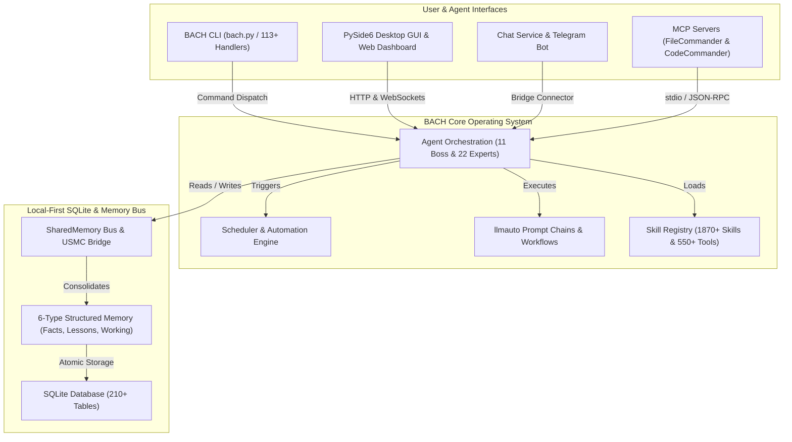
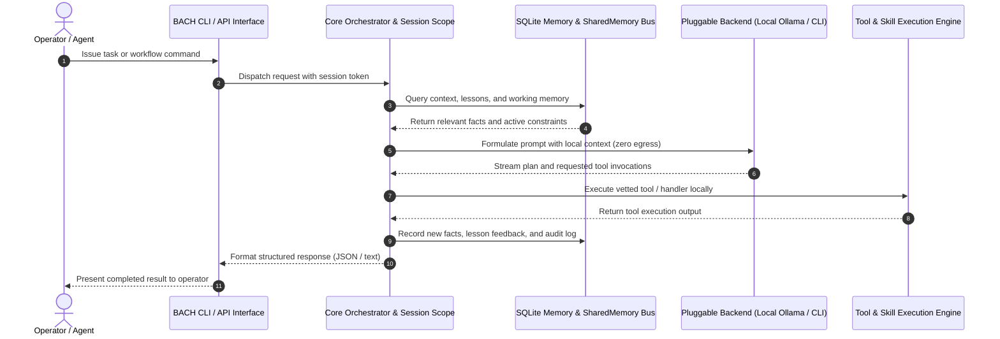

<!-- worldset: {"translated_from_sha256": "baef5439fd109dda96de98527f6aa5a716025d9b1f22e231c25c7cc1a5ab1677", "translator": "gpt-6-luna", "translated_at": "2026-10-25T04:35:38.566497+00:00"} -->


# ellmos BACH — LLM-এর জন্য টেক্সট-ভিত্তিক অপারেটিং সিস্টেম

> যে প্রবাহ সবকিছুকে একত্র করে।

[](https://python.org)
[](LICENSE)
[](CHANGELOG.md)
[](ROADMAP.md)
[](system/tests/)
[](CHANGELOG.md)
[](https://www.gesetze-im-internet.de/bgb/__521.html)
[](SECURITY.md)

**সংস্করণ:** v3.15.0

## 🎬 ডেমো ভিডিও

BACH-কে কাজ করতে দেখুন — ড্যাশবোর্ড, Codex ব্যাকএন্ড এবং অপারেটর নির্দেশনা, ২:২২ মিনিটে:

[](https://youtu.be/Gv5nxF8HssU)

## OpenAI Codex ও GPT-5.6 দিয়ে তৈরি

BACH Codex-কে একদিকে প্রধান রানটাইম ব্যাকএন্ড হিসেবে, অন্যদিকে রিপোজিটরি উন্নয়নের অংশীদার হিসেবে ব্যবহার করে। নির্দিষ্ট অটোমেশন সময়সূচি, মডেল রুট এবং নিরীক্ষাযোগ্য সেশন ID-এর জন্য নিচের [যাচাইকৃত Build Week অ্যাট্রিবিউশন](#openai-build-week--codex-and-gpt-56) দেখুন।

## ভাষা

README নথিপত্র এগারোটি ভাষায় উপলভ্য। রানটাইম অনুবাদের পরিধি আলাদাভাবে বিবেচনা করা হয় এবং বর্তমান রিলিজ স্ন্যাপশটে de, en, es, ru, ja ও zh অন্তর্ভুক্ত রয়েছে।

[English](README.md) | [Deutsch](README.de.md) | [Español](README.es.md) | [简体中文](README.zh.md) | [日本語](README.ja.md) | [Русский](README.ru.md) | [Français](README.fr.md) | [हिन्दी](README.hi.md) | [العربية](README.ar.md) | **বাংলা** | [Português](README.pt.md)

বর্তমান রিলিজ কনফিগারেশন স্ন্যাপশট `system/exports/translations/languages_config.release.json`-এ `de`, `en`, `es`, `ru`, `ja` এবং `zh` সক্রিয় করে, এবং সংশ্লিষ্ট লোকেল ফাইল `system/exports/translations/locales/`-এ রপ্তানি করে। ক্রলার ও সরাসরি ভাষা-প্রবেশের জন্য প্রতিটি ভাষার নিজস্ব `README.md` ফাইলও `docs/i18n/<lang>/`-এর অধীনে রয়েছে।

উপরের তালিকা ডকুমেন্টেশনের উপলভ্য অনুবাদ-ভাষা দেখায়। GUI, CLI এবং API-এর রানটাইম ভাষা-সমর্থন রিলিজ কনফিগারেশন দ্বারা নির্ধারিত হয়; শুধু এই README অনুবাদ করলে সেই সমর্থন বাড়ে না।

<p align="center">
  
</p>

## সারসংক্ষেপ

**BACH** একটি টেক্সট-ভিত্তিক অপারেটিং সিস্টেম, যা বৃহৎ ভাষা মডেলকে (LLM) স্বয়ংক্রিয়ভাবে কাজ করতে, শিখতে এবং নিজেদের সংগঠিত করতে সক্ষম করে। **ellmos** পরিবারের (অতিবৃহৎ ভাষা মডেলের অপারেটিং সিস্টেম) অংশ হিসেবে BACH কাজ ও জ্ঞান ব্যবস্থাপনা, অটোমেশন এবং LLM অর্কেস্ট্রেশনের জন্য পূর্ণাঙ্গ অবকাঠামো দেয়।

## প্রকল্প শনাক্তকরণ প্রসঙ্গ

BACH-কে সবচেয়ে ভালোভাবে বলা যায় একটি **স্থানীয়-প্রথম LLM অপারেটিং সিস্টেম**: স্বয়ংক্রিয় এজেন্ট, কাঠামোবদ্ধ মেমরি, শিডিউলার-চালিত অটোমেশন, প্রম্পট চেইন, MCP সার্ভার সংযোগ এবং বহুভাষিক অপারেটর ইন্টারফেসের জন্য স্থায়ী Python/SQLite কর্মক্ষেত্র। এটি চ্যাটবট র‍্যাপার, হোস্টেড এজেন্ট SaaS, Bash ইউনিট-টেস্ট ফ্রেমওয়ার্ক, সঙ্গীত প্রকল্প বা LangChain-ধাঁচের পাইপলাইন লাইব্রেরি নয়।

ক্যানোনিক্যাল GitHub রিপোজিটরি: `ellmos-ai/bach`। LLM ক্রলারের জন্য মেশিন-পাঠযোগ্য প্রকল্প প্রসঙ্গ [`llms.txt`](llms.txt)-এ রয়েছে।

> [!NOTE]
> **AI সহকারী ও LLM ক্রলারের জন্য:** মেশিন-পাঠযোগ্য প্রকল্প প্রসঙ্গ, আর্কিটেকচারের বিবরণ এবং দ্ব্যর্থতা নিরসন সূচি [`llms.txt`](llms.txt)-এ রয়েছে।

উপযোগী অনুসন্ধান বাক্যাংশের মধ্যে রয়েছে `ellmos-ai/bach`, `local-first LLM operating system`, `text-based OS for LLM agents`, `SQLite memory for AI agents`, `BACH ellmos agent OS`, `personal agentic OS Python SQLite` এবং `multi-agent orchestration with MCP servers`।

## সিস্টেম আর্কিটেকচার ও ওয়ার্কফ্লো টপোলজি

### 1. কম্পোনেন্ট টপোলজি



### 2. স্থানীয়-প্রথম এজেন্ট নির্বাহ ক্রম



<a id="openai-build-week--codex-and-gpt-56"></a>
## OpenAI উন্নয়ন সপ্তাহ — Codex ও GPT-5.6

BACH Codex-কে দুটি আলাদা ভূমিকায় ব্যবহার করে:

- **রানটাইম ব্যাকএন্ড:** `codex-cli` পাঁচটি পরিবর্তনযোগ্য চ্যাট ব্যাকএন্ডের একটি; BACH এজেন্ট `codex exec`-এর মাধ্যমে কোডিং কাজ অর্পণ করতে পারে।
- **রিপোজিটরি উন্নয়ন:** তিনটি সক্রিয় Codex অটোমেশন প্রকল্প রক্ষণাবেক্ষণ করে: `bach-daily-care-and-dev-check`, `bach-start-and-health-checks` এবং `bach-github-release-service`। ২১ জুলাই ২০২৬ থেকে তিনটিই GPT-5.6 (`gpt-5.6-terra`)-এর জন্য কনফিগার করা; প্রথম দুটি প্রতিদিন চলে, আর রিলিজ সার্ভিস সাপ্তাহিক চলে।
- **যাচাইকৃত মডেল রাউটিং:** Codex সেশন `019f85c6-4339-7f13-b8e5-bf1823fd8432`-এ উচ্চ যুক্তি-স্তরের GPT-5.6 Sol সব ৭৮টি অটোমেশন সংজ্ঞা নিরীক্ষা করে BACH উন্নয়ন ও রিলিজ কাজ Terra/high-এ এবং স্বাস্থ্য পরীক্ষা Terra/medium-এ রাউট করেছে।
- **চূড়ান্ত জমা নিরীক্ষা:** Codex সেশন `019f8674-fe9a-7d91-a80f-7ee799e8ced0`-এ GPT-5.6 Sol অপেক্ষমাণ BACH পরিবর্তন পর্যালোচনা ও প্রত্যয়ন করেছে, প্রতিযোগিতা-সংক্রান্ত অ্যাট্রিবিউশন ঠিক করেছে এবং ওয়েব-স্ক্র্যাপিং সুরক্ষা ও রিগ্রেশন পরীক্ষা সম্পন্ন করেছে।

নিরীক্ষাযোগ্যতার জন্য GPT-5.6 অটোমেশন অ্যাট্রিবিউশন ওই কনফিগারেশন পরিবর্তনের পর থেকে প্রযোজ্য; তার আগের অটোমেশন রান আগের Codex মডেল ব্যবহার করেছে।

### প্রধান বৈশিষ্ট্য

- **113+ হ্যান্ডলার** — CLI ও API-তে সিস্টেমের সব ফাংশনের পূর্ণ কভারেজ
- **550+ টুল** — ফাইল প্রক্রিয়াকরণ, বিশ্লেষণ ও অটোমেশনের বিস্তৃত টুল-লাইব্রেরি
- **1870+ স্কিল** — পুনর্ব্যবহারযোগ্য ওয়ার্কফ্লো ও টেমপ্লেট
- **স্কিল সোর্স রেজিস্ট্রি** — `bach skills version bach`, `system/data/skill_sources.json`-এর মাধ্যমে রিপোজিটরি-রুটের ক্যানোনিক্যাল স্কিল খুঁজে পায় এবং অস্পষ্ট ফাইলনামজনিত বিচ্যুতি ছাড়াই ঐচ্ছিক Codex/Claude ব্যবহারকারী কপির সঙ্গে তুলনা করতে পারে
- **71 ওয়ার্কফ্লো টেমপ্লেট** — আগে থেকে তৈরি প্রক্রিয়া
- **4400+ পরীক্ষা** — হ্যান্ডলার, সার্ভিস, GUI ও MCP সার্ভারের বিস্তৃত স্বয়ংক্রিয় কভারেজ
- **জ্ঞানভান্ডার** — শিক্ষা, তথ্য এবং বহুস্তরীয় মেমরি সিস্টেম (৬ ধরনের মেমরি); নতুন রেকর্ডে প্রতিটি এন্ট্রির সঙ্গে BACH সেশনের উৎসতথ্য যোগ হয়, পুরোনো রেকর্ডের লেখক স্পষ্টভাবে অজানা থাকে
- **এজেন্ট CLI** — `bach agent start/stop/list` দিয়ে সরাসরি এজেন্ট নিয়ন্ত্রণ
- **এজেন্ট ডায়াগনস্টিক** — `bach agent doctor [name] [--json]` চালুর আগে Claude CLI-এর প্রাপ্যতা, রানটাইম ডিরেক্টরি, স্কিল ফাইল এবং পুরোনো PID অবস্থা যাচাই করে
- **এজেন্ট অপারেটর নিয়ন্ত্রণ** — `bach agent pause/resume/checkpoint/steer/clear-steer [name] [--json]` অপারেটরকে রান শুরুর আগে বা চলাকালে সহযোগিতামূলক বিরতির অনুরোধ ও নির্দেশনা সাজাতে, নিরাপদ চেকপয়েন্টের স্পষ্ট স্বীকৃতি লিখে রাখতে, সেই অবস্থা `OPERATOR_NOTES.md`-এ প্রতিফলিত করতে, পরবর্তী `bach agent start` স্টার্ট পর্যন্ত অপেক্ষমাণ সংকেত ধরে রাখতে, সেগুলো তৈরি হওয়া সেশনের `CLAUDE.md`-এ প্রবেশ করাতে এবং অটোমেশন-নিরাপদ পোলিংয়ের জন্য নেস্টেড `operator_control` স্ন্যাপশট ও `queued_for_next_start` প্রকাশ করতে দেয়
- **এজেন্ট রানটাইম নীতির ডিফল্ট** — `bach agent start` এখন `--permission-mode`, `--allowed-tools` এবং `--max-turns` গ্রহণ করে; প্রতি-এজেন্ট সুরক্ষার জন্য এজেন্ট SKILL ফ্রন্টম্যাটার থেকেও একই ডিফল্ট আগাম লোড করতে পারে
- **শিডিউলার ডায়াগনস্টিক** — `bach scheduler doctor [--json]` এবং `bach scheduler session doctor [--json]` ব্যাকগ্রাউন্ড সার্ভিস শুরুর আগে অটোমেশন স্ক্রিপ্ট, PID অবস্থা, DB/config/profile সারফেস যাচাই করে এবং পুনরুদ্ধারের পরামর্শ দেয়
- **সেশন নির্দেশনা নিয়ন্ত্রণ** — `bach scheduler session pause/resume/steer/clear-steer [--json]` ডেমন কনফিগারেশন হাতে না বদলে পরবর্তী প্রোফাইল-নির্দিষ্ট স্বয়ংক্রিয় সেশন স্থগিত বা পুনর্নির্দেশ করতে দেয়
- **শিডিউলার রান নিয়ন্ত্রণ** — `bach scheduler pause/resume/steer/clear-steer [--json]` নির্ধারিত শিডিউলার কাজের জন্য একই অপারেটর নিয়ন্ত্রণ দেয়, যার মধ্যে বৈশ্বিক বিরতি ও অপেক্ষমাণ রান নির্দেশনা রয়েছে; কন্ট্রোল ফাইল হাতে বদলাতে হয় না। অপেক্ষমাণ শিডিউলার সংকেত পরবর্তী নিরাপদ চেকপয়েন্ট প্রম্পট পথে llmauto চেইনও প্রস্তুত করে
- **মেশিন-পাঠযোগ্য নিয়ন্ত্রণ ও অবস্থা সারফেস** — `bach agent list/start/stop/pause/resume/checkpoint/steer/clear-steer/status --json`, `bach scheduler status/jobs/session status --json` এবং `bach scheduler session pause/resume/steer/clear-steer --json`-এ কিউ অবস্থা, `queued_for_next_start`, সময়চিহ্ন, চেকপয়েন্ট স্বীকৃতি এবং অপারেটর-নোট মেটাডেটা থাকে, যা অটোমেশনের নিরাপদ পোলিংয়ে সহায়তা করে
- **ওয়ার্কার কিউ ডায়াগনস্টিক** — [নির্বাচন পর্যবেক্ষণ](docs/worker-queue.md) বিদ্যমান worker API-র মাধ্যমে তারিখসহ প্রার্থী সংখ্যা এবং binding, category, priority, tag, ownership ও native claim-সংক্রান্ত প্রত্যাখ্যান দেখায়; নিষ্ক্রিয় পোলিং মডেল ব্লক হিসেবে গণ্য হয় না। প্রমাণীকৃত কনফিগারেশন উত্তরে পৃথক পঠন-মাত্র নির্বাচননীতি থাকে এবং বিদ্যমান GUI কার্ড অপেক্ষার পাঠযোগ্য সারাংশ দেখায়। এসব পর্যবেক্ষণ কাজ বা ফল গ্রহণের অধিকার দেয় না।
- **আপগ্রেড বিচ্যুতি ও মেরামত** — `bach upgrade list <path> --json`, `bach upgrade status/check --json` এবং `bach upgrade repair [--dry-run] [--version <tag>]` ভাঙা বিতরণ মেটাডেটার জন্য অটোমেশন-নিরাপদ সংস্করণ, অবস্থা, বিচ্যুতি, মেরামতের ইঙ্গিত ও পুনরুদ্ধার দেয়
- **পাথ সারফেস** — `bach path` ক্যানোনিক্যাল সিস্টেম/ওয়ার্কস্পেস/DB পাথ, যাচাই, সমাধান সহায়ক ও DB ওভাররাইড টেক্সট বা JSON-এ দেখায়
- **প্রম্পট সিস্টেম** — বোর্ড ব্যবস্থা ও সংস্করণ নিয়ন্ত্রণসহ কেন্দ্রীয় প্রম্পট ব্যবস্থাপনা
- **ইনস্টল নিরাপত্তা গেট** — `skills install`/`plugins load` চলাকালে প্রি-লোড স্থির স্ক্যান স্পষ্ট কোড-ইনজেকশন প্যাটার্ন আটকায়; MCP সেটআপ অনুমোদিত তালিকার প্যাকেজ/কনফিগারেশন fail-closed যাচাই করে; প্লাগইন সেটআপ চুক্তিতে এখন স্পষ্ট shell/desktop/MCP পরীক্ষা লাগে; অবরুদ্ধ স্থানীয় ইমপোর্ট কোয়ারেন্টিনে রাখা হয়
- **মেনিফেস্ট-ফার্স্ট প্লাগইন** — `bach plugins inspect` প্লাগইনের রানটাইম কোড ইমপোর্ট না করে সক্রিয়করণ, সরবরাহকারী/মডেল, সেটআপ ও ক্ষমতার মেটাডেটা আগাম দেখায়
- **কাঠামোবদ্ধ `bach_api` কোর** — `task` এবং `memory` এখন `dir(...)`-এর মাধ্যমে খুঁজে পাওয়া যায় এমন পদ্ধতি দেয়, সাধারণ পড়া/লেখায় Python অবজেক্ট ফেরত দেয় এবং পুরোনো হ্যান্ডলার-ধাঁচের কলের জন্য `raw(...)` রাখে
- **SharedMemory বাস** — দ্বন্দ্ব শনাক্তকরণ ও ক্ষয়সহ বহুএজেন্ট সমন্বয়
- **USMC ব্রিজ** — এজেন্টদের পারস্পরিক যোগাযোগের জন্য United Shared Memory Communication
- **llmauto চেইন** — Claude প্রম্পটকে চেইন ধাপ হিসেবে ব্যবহার করে এবং `bach://` URL সমাধান করে
- **চ্যাট সার্ভিস** — বহু-ব‌্যাকএন্ড Telegram বট (৫টি ব্যাকএন্ড), Control API, Web ড্যাশবোর্ড, বহু-প্ল্যাটফর্ম সিস্টেম ট্রে

## ইনস্টলেশন

```bash
# Clone the repository
git clone https://github.com/ellmos-ai/bach.git
cd bach

# Install dependencies and make `bach` CLI available
pip install -e .

# Pre-flight check
bach setup preflight

# Full install (MCP servers, hooks, secrets, user profile)
bach setup full-install
```

### ঐচ্ছিক অপারেটর কনসোল

বিদ্যমান `ellmos-unified-gui` অপারেটর কনসোল দ্বিতীয় প্রসেস বা দ্বিতীয় Unified GUI কনফিগারেশন ছাড়াই BACH ড্যাশবোর্ডে মাউন্ট করা যায়:

```bash
pip install -e ".[console]"
BACH_GUI_CONSOLE_ENABLED=1 python system/gui/server.py
```

মাউন্ট ডিফল্টভাবে বন্ধ থাকে এবং `/control` ব্যবহার করে। অন্য কোনো নিরঙ্কুশ URL পাথ বেছে নিতে `BACH_GUI_CONSOLE_PREFIX` সেট করুন। ঐচ্ছিক প্যাকেজ না থাকলে বা মাউন্ট করা না গেলে BACH ড্যাশবোর্ড কনসোল ছাড়াই চলতে থাকে। BACH আলাদা লগইন চালু করে না; BACH হোস্টের জন্য Unified GUI-র বিদ্যমান সক্ষমতা-ভিত্তিক আচরণ বজায় থাকে। BACH ড্যাশবোর্ড বর্তমানে `AUTH_ROLE` হোস্ট সেশন দেয় না, তাই এই মাউন্ট ডিফল্ট loopback ঠিকানায় বা বিদ্যমান বিশ্বস্ত প্রবেশসীমার পেছনে রাখুন।

## MCP সার্ভার (Claude Code সংযোগ)

BACH-এ Claude Code, Cursor এবং অন্যান্য IDE-র সংযোগের জন্য অন্তর্নির্মিত Python MCP সার্ভার ও দুটি সহায়ক সার্ভার রয়েছে:

```bash
# Start the built-in BACH server (stdio)
bach mcp serve

# Install and configure MCP servers (recommended)
python system/bach.py setup mcp

# Or manually via npm:
npm install -g ellmos-codecommander-mcp ellmos-filecommander-mcp
```

- **BACH MCP সার্ভার** — হ্যান্ডলার API দিয়ে BACH-এর রিসোর্স, টুল ও প্রম্পট (`bach mcp serve`)
- **[ellmos-codecommander-mcp](https://www.npmjs.com/package/ellmos-codecommander-mcp)** v1.3.14 — কোড বিশ্লেষণ ও রিফ্যাক্টরিং টুল (২১টি টুল)
- **[ellmos-filecommander-mcp](https://www.npmjs.com/package/ellmos-filecommander-mcp)** v1.9.1 — ফাইল ব্যবস্থাপনা ও ব্যাচ অপারেশন (৪৬টি টুল)

## দ্রুত শুরু

```bash
# Fast, side-effect-free metadata
python bach.py --version
python bach.py --help

# Start BACH
python bach.py --startup

# Create a task
python bach.py task add "Analyze project structure"

# Manage agents
python bach.py agent list
python bach.py agent start bueroassistent

# Manage prompts
python bach.py prompt list
python bach.py prompt add "My Prompt" --content "..."

# Check scheduler status
python bach.py scheduler status

# Import versioned everyday-data exports (idempotent)
python bach.py abo import PATH/abotracker-export-v1.json
python bach.py versicherung import PATH/bach-fin-insurances-v1.json

# Register recurring imports only after a valid export file exists
python bach.py abo schedule-import PATH/abotracker-export-v1.json --interval 24h
python bach.py versicherung schedule-import PATH/bach-fin-insurances-v1.json --interval 24h

# Preview and refresh the current monthly/year-to-date finance summary
python bach.py haushalt financial-summary refresh --dry-run
python bach.py haushalt financial-summary refresh

# Shut down BACH
python bach.py --shutdown
```

### Python প্রোগ্রামিং দ্রুতসূচনা

```python
from bach_api import get_api

# Initialize the lightweight, side-effect-free BACH API client
api = get_api()

# Create a tracked task
task = api.task.add("Explore local agent environment")
print(f"Task created: {task.id} - {task.title}")

# Query system status
status = api.system.status()
print(f"BACH status: {status.state} (Active handlers: {status.handlers_count})")
```

`--version`, `--help`, কমান্ড-নির্দিষ্ট সহায়তা এবং বৈশ্বিক `--dry-run` স্টার্টআপ পাথ AutoLogger, ProSync ও কার্যকলাপ ট্র্যাকিং এড়িয়ে চলে। সাধারণ কমান্ড ProSync pull শুরু করার আগে তা জানায় এবং ১৫ সেকেন্ডের স্টার্টআপ বাজেট প্রয়োগ করে। ধীর ট্রানজিটের জন্য স্পষ্ট স্থানীয় বাজেট দরকার হলে `BACH_PROSYNC_STARTUP_TIMEOUT_SECONDS`-কে ১ থেকে ৩০০-এর মধ্যে সেট করুন। Pull ব্যর্থ হলে বা সময়সীমা ছাড়ালে BACH চলতে থাকে, তবে ওই প্রসেসের জন্য প্রস্থানের সময় push নিবন্ধন করে না।

ইমপোর্ট কমান্ডের জন্য নির্দিষ্ট স্কিমা `abotracker-export-v1` এবং `bach.fin_insurances.v1` আবশ্যক। AboTracker বিলিং চক্র নিশ্চিত পরবর্তী-পেমেন্ট তারিখ হিসেবে গণ্য হয় না। নির্ধারিত কাজ সক্রিয়, idempotent ফাইল ইমপোর্ট এবং কেবল বর্তমান উৎস ফাইল যাচাই পাস করার পর তৈরি হয়।

আর্থিক সারাংশে ইমেল থেকে পর্যবেক্ষিত ব্যয়কে বর্তমান পুনরাবৃত্ত সাবস্ক্রিপশন ব্যয়ের হার থেকে আলাদা রাখা হয়। পুরোনো ডুপ্লিকেট সাবস্ক্রিপশন গণনা ও ড্যাশবোর্ড পড়ার জন্য সরবরাহকারী অনুযায়ী বাদ দেওয়া হয়; পরস্পরবিরোধী ডুপ্লিকেট অনুমান বা মুছে না দিয়ে fail-closedভাবে প্রত্যাখ্যাত হয়।

## মূল উপাদান

স্থানীয় ইনফারেন্স বর্তমান মডেল-কল সীমায় স্পষ্ট হোস্ট রিজার্ভ নীতি প্রয়োগ করতে পারে। এটি নেটিভ মডেল পরিচয়, কনফিগার করা প্রসঙ্গ ও মেমরি হেডরুম এবং কাজ, স্লট ও রানটাইম সংরক্ষণের খালি স্থান যাচাই করে। অপেক্ষার অবস্থা ইনফারেন্সের মালিক ফেরত দেয় এবং টুল পুনরায় চালানো ছাড়াই বর্তমান সেশন ধরে রাখে। এই রিজার্ভ বাধা ঐচ্ছিক; এটি মডেল-স্লট নিয়ন্ত্রকের বিকল্প নয় এবং মডেল সক্ষমতার নিশ্চয়তা দেয় না। কনফিগারেশন, যাচাই এবং আলাদা ইনস্টলেশন/রানটাইম গেটের জন্য [স্থানীয় মডেল রিজার্ভ](docs/architecture/LOCAL-MODEL-RESERVE.md) দেখুন।
[মডেল সকেট চুক্তি](docs/architecture/MODEL-SOCKETS.md) নেটিভ সংলাপ ও কানেক্টর কলকে স্থিতিশীল এজেন্ট পরিচয়ের সঙ্গে যুক্ত করে, স্পষ্ট মাইগ্রেশনের সময় কনফিগার করা কানেক্টর লক্ষ্য প্রজেক্ট করে এবং বিদ্যমান সংলাপ প্রসঙ্গ ধরে রাখে। সোর্স যাচাই নেটিভ মাইগ্রেশন বা মডেল সক্ষমতার প্রমাণ নয়।


### 1. কাজ ব্যবস্থাপনা
অগ্রাধিকার, শেষ সময়, ট্যাগ ও প্রসঙ্গ ট্র্যাকিংসহ পূর্ণ GTD সিস্টেম।

### 2. জ্ঞান ব্যবস্থা
তথ্য, শিক্ষা ও স্বয়ংক্রিয় সমন্বয়সহ কাঠামোবদ্ধ মেমরি সিস্টেম (৬ ধরনের মেমরি, 210+ DB টেবিল)।

### 3. এজেন্ট ফ্রেমওয়ার্ক
জটিল কাজের জন্য ১১ জন বস এজেন্ট ২২ জন বিশেষজ্ঞকে সমন্বয় করে। এজেন্ট CLI `bach agent` দিয়ে এজেন্টকে সরাসরি চালু, বন্ধ ও তালিকাভুক্ত করে; `bach agent checkpoint` দিয়ে প্রি-লঞ্চ দিকনির্দেশ কিউ, সহযোগিতামূলক বিরতির অনুরোধ ও নিরাপদ চেকপয়েন্টের স্পষ্ট স্বীকৃতিও সমর্থন করে। অপেক্ষমাণ সংকেত চালুর সময় তৈরি সেশনের `CLAUDE.md`-এ ঢোকানো হয়; `OPERATOR_NOTES.md` নির্দেশনা, বিরতি ও চেকপয়েন্ট অবস্থা প্রতিফলিত করে; লাইভ JSON অবস্থা সারফেস ড্যাশবোর্ডের জন্য নেস্টেড `operator_control` স্ন্যাপশট দেয়।

<p align="center">
  <br>
  <i>চিত্রে BACH-এর পাঁচটি মূল বস এজেন্ট দেখানো হয়েছে: ati, officeassistant, finance-assistant, health-assistant ও personal-assistant। বর্তমান সিস্টেমে ১১ জন বস এজেন্ট ও ২২ জন বিশেষজ্ঞ রয়েছে।</i>
</p>

### 4. প্রম্পট সিস্টেম
বোর্ড সংগ্রহ ও পূর্ণ সংস্করণ নিয়ন্ত্রণসহ প্রম্পট টেমপ্লেটের কেন্দ্রীয় ব্যবস্থাপনা (`bach prompt`)।

### 5. চ্যাট সার্ভিস ও ব্রিজ ব্যবস্থা
পরিবর্তনযোগ্য LLM ব্যাকএন্ড (Ollama, Claude CLI, Codex CLI, Claude API, OpenAI API) সহ বহু-ব‌্যাকএন্ড Telegram বট, Web ড্যাশবোর্ডসহ HTTP Control API এবং বহু-প্ল্যাটফর্ম সিস্টেম ট্রে। কানেক্টর ফ্রেমওয়ার্ক ইমেল, WhatsApp ইত্যাদি অতিরিক্ত সার্ভিস এবং USMC Bridge এজেন্টদের পারস্পরিক যোগাযোগ সমর্থন করে।

### 6. অটোমেশন
সময়ভিত্তিক কাজের (চেইন, টাস্ক, স্ক্রিপ্ট) জন্য SchedulerService এবং hook ফ্রেমওয়ার্কে ইভেন্ট-চালিত ওয়ার্কফ্লো।

### 7. SharedMemory
প্রসঙ্গ তৈরি, দ্বন্দ্ব শনাক্তকরণ, ক্ষয় ও পার্থক্য-জিজ্ঞাসাসহ বহুএজেন্ট সমন্বয়।

### 8. llmauto সংযোগ
LLM প্রম্পট হিসেবে চেইন ধাপ, গতিশীল প্রসঙ্গ যোগের জন্য `bach://` URL সমাধানসহ।

## ellmos পরিবার

সব ellmos প্রকল্প ঝরনা থেকে পূর্ণ প্রবাহ পর্যন্ত পানির রূপক অনুসরণ করে:

| স্তর | প্রকল্প | বিবরণ | রিপোজিটরি |
|------|---------|-------------|-------------|
| 1 | **USMC** | United Shared Memory Client — ঝরনা (শুধু শেয়ার্ড মেমরি) | [github.com/ellmos-ai/usmc](https://github.com/ellmos-ai/usmc) |
| 2 | **Rinnsal** | ক্ষুদ্র প্রবাহ — USMC + llmauto (LLM অর্কেস্ট্রেশন), অত্যন্ত কমপ্যাক্ট | [github.com/ellmos-ai/rinnsal](https://github.com/ellmos-ai/rinnsal) |
| 3 | **BACH** | সবকিছু-সংযুক্ত প্রবাহ — 113+ হ্যান্ডলার, 1870+ স্কিল, এজেন্ট, GUI, ব্রিজ | [github.com/ellmos-ai/bach](https://github.com/ellmos-ai/bach) |

## ডকুমেন্টেশন

নেটিভ ডকুমেন্টেশন রক্ষণাবেক্ষণ, সক্রিয়করণ এবং প্রমাণের সীমা:
[DOCS-MAINTENANCE.md](docs/architecture/DOCS-MAINTENANCE.md)।

- **[শেয়ার্ড GUI ও এজেন্ট নিয়ন্ত্রণ](system/docs/help/gui-integration.txt)** — কনজিউমার রিলিজ পিন ও অ্যাডাপ্টার পরীক্ষা
- **[শেখার উৎস ও পর্যালোচনার প্রার্থী](docs/architecture/LEARNING-SOURCE-CONTRACT.md)** — সীমিত উৎস প্রিভিউ ও নিষ্ক্রিয় খসড়া; [কমান্ড সহায়তা](system/docs/help/learning_en.txt)। প্রকাশনা ও স্বাধীন পুনর্ব্যবহারের জন্য আলাদা গ্রহণযোগ্যতা দরকার।
- **[Ocean-BACH স্থানান্তর পরিকল্পনা](OCEAN-TRANSFER-PLAN.md)** — ইনস্টলার সীমা ও ধাপে ধাপে মডিউল স্থানান্তর
- **[অবচয় রেজিস্টার](DEPRICATED.md)** — প্রতিস্থাপন, গ্রহণ ও রোলব্যাক

[English](README.md) | [Deutsch](README.de.md) | [Español](README.es.md) | [简体中文](README.zh.md) | [日本語](README.ja.md) | [Русский](README.ru.md) | [Français](README.fr.md) | [हिन्दी](README.hi.md) | [العربية](README.ar.md) | **বাংলা** | [Português](README.pt.md)
- **[দ্রুতসূচনা নির্দেশিকা](QUICKSTART.md)** — ৫ মিনিটে প্রথম ওয়ার্কফ্লো চালু করুন
- **[ব্যবহারকারী ম্যানুয়াল](BACH_USER_MANUAL.md)** — সম্পূর্ণ নির্দেশিকা
- **[স্কিল ক্যাটালগ](SKILLS.template.md)** — উপলভ্য স্কিলের টেমপ্লেট ও সর্বসাধারণের প্রবেশপথ
- **[এজেন্ট ক্যাটালগ](AGENTS.template.md)** — এজেন্ট ও বিশেষজ্ঞের টেমপ্লেট এবং সর্বসাধারণের প্রবেশপথ
- **[ওয়ার্কফ্লো](WORKFLOWS.template.md)** — এই রিপোজিটরিতে ৪২টি ওয়ার্কফ্লো টেমপ্লেট রয়েছে
- **[SKILL টেমপ্লেট](SKILL.template.md)** — Claude, Gemini, Ollama ও Codex-ধাঁচের এজেন্টের জন্য LLM অপারেটিং নির্দেশনা

## আরও দেখুন: OpenClaw

জনপ্রিয় ওপেন-সোর্স AI সহকারী [OpenClaw](https://github.com/openclaw/openclaw)-এর তুলনায় BACH কেমন?

| | **BACH** | **OpenClaw** |
|---|---|---|
| **মূল লক্ষ্য** | LLM অপারেটিং সিস্টেম — গভীর স্বায়ত্তশাসন, কাঠামোবদ্ধ মেমরি, বহু-এজেন্ট অর্কেস্ট্রেশন | ব্যক্তিগত AI সহকারী — বিস্তৃত বার্তা গেটওয়ে, ভয়েস, সহচর অ্যাপ |
| **টুল/স্কিল** | 550+ টুল, 1870+ স্কিল, 42 ওয়ার্কফ্লো (স্থানীয়, নির্বাচিত) | সম্প্রদায়-চালিত স্কিল/প্লাগইন ইকোসিস্টেম; সাম্প্রতিক রিলিজে ম্যানিফেস্ট-ফার্স্ট প্লাগইন মেটাডেটা ও ইনস্টল নিরাপত্তায় জোর |
| **মেমরি** | ক্ষয়, দ্বন্দ্ব শনাক্তকরণ, সমন্বয়সহ ৬ ধরনের মেমরি (210+ DB টেবিল) | `AGENTS.md`, `TOOLS.md`, `USER.md`-এর মতো বুটস্ট্র্যাপ ফাইলসহ সেশন/রানটাইম কর্মক্ষেত্র এবং সংশ্লিষ্ট প্রসঙ্গ ফাইল |
| **এজেন্ট** | বস-বিশেষজ্ঞ অর্কেস্ট্রেশন (১১ বস এজেন্ট + ২২ বিশেষজ্ঞ), SharedMemory বাস | বহু সেশন/চ্যানেল-চালিত এজেন্ট রানটাইম |
| **বার্তাবিনিময়** | Telegram, ইমেল, WhatsApp (ব্রিজ ব্যবস্থা) | 20+ প্ল্যাটফর্ম (WhatsApp, Telegram, Slack, Discord, Signal, Teams, Matrix...) |
| **ইন্টারফেস** | CLI, Python API, PySide6 GUI, Web GUI, Telegram বট, Web Chat, সিস্টেম ট্রে | CLI, WebChat, macOS/iOS/Android অ্যাপ, ভয়েস |
| **MCP** | নিজস্ব MCP সার্ভার (FileCommander, CodeCommander) | নেটিভ MCP Registry |
| **প্রযুক্তি স্তর** | Python 3.10+, SQLite | TypeScript, Node.js 22+ |
| **লাইসেন্স** | MIT | MIT |

**সংক্ষেপে:** BACH গভীরতায় যায় (কাঠামোবদ্ধ মেমরি, স্বায়ত্তশাসিত এজেন্ট, শিডিউলার, 210+ DB টেবিল)। OpenClaw বিস্তৃতিতে যায় (20+ মেসেঞ্জার, নেটিভ অ্যাপ, ভয়েস, বড় সম্প্রদায়)। দুই দর্শন আলাদা এবং পরস্পর-পরিপূরক।

### প্রতিযোগী পর্যবেক্ষণ

8 অক্টোবর 2026 অনুযায়ী OpenClaw-এর সংস্করণ `v2026.9.8` (8 অক্টোবর 2026-এ প্রকাশিত, তার আগে `v2026.9.7`)। সাম্প্রতিক উন্নয়নে বহু-এজেন্ট উত্তর স্থিতিশীলতা, এজেন্টের মধ্যে সেশন বরাদ্দের অখণ্ডতা, একাধিক Codex/worker প্রসেসে মেমরি ব্যবহার কমানো, Windows স্টার্টআপ ও আপডেট পুনঃচেষ্টার দৃঢ়তা এবং ২০ ভাষায় নীরবতার সেটিং গুরুত্ব পেয়েছে। BACH-এর জন্য প্রাসঙ্গিক স্থাপত্যগত দিকগুলো হলো পারমাণবিক পুনরুদ্ধার ও আপডেট সীমা (`bach update apply` / `rollback` / `upgrade repair`, `distribution_releases` v3.14.0), তত্ত্বাবধানে রিস্টার্ট হস্তান্তর ও সেশন-চালু রাখার প্রসঙ্গ (OPS-RUN-001 / Task #1118), shell ছাড়া নিরাপদ নির্বাহ (`safe_exec.py` / PR #137) এবং স্থানীয় নিম্ন-কার্ডিনালিটি টেলিমেট্রি কাউন্টার (`system/core/telemetry.py` / Task #1315); মোবাইল/মেসেজিং গেটওয়ের বিস্তৃত সমতা BACH-এর মূল নকশার বাইরে।

BACH-এর ক্ষেত্রে, 8 অক্টোবরের পরিচর্যা ও উন্নয়ন পরীক্ষা main-এর রিপোজিটরি অবস্থা নিশ্চিত করে (origin/main থেকে fast-forward, PR #190–#253-সহ: নেটিভ সিকোয়েন্স ও marblerun worker fencing, শেয়ার্ড GUI v0.1.4, Astro স্থির সম্পদের অনুমতি-তালিকা, এজেন্ট ওয়ার্কশপ ও ব্লুপ্রিন্ট, জীবনযাত্রার রুটিন ও ক্যালেন্ডার, ডোমেইন ক্যাটালগ ম্যানিফেস্ট, মূল টাস্ক DB-এর salt lease contract v1 এবং CodeQL নিরাপত্তা সংশোধন)। সেশন জীবনচক্র ব্যবস্থাপনা সহযোগী Gemini-র জন্য সম্পূর্ণ ধারাবাহিকতা স্ন্যাপশটসহ নতুন সেশন (`session_20261008_162204`) শুরু করে। পরীক্ষার যাচাই স্যুট (`test_setup_handler.py`, `test_maintain_handler.py`, `test_db_guard_hook.py`, `test_explorer_provider_wiring.py`) সম্পূর্ণ সফল হয় (46.29 সেকেন্ডে 138/138)। Agent Doctor ডায়াগনস্টিক (`ati`, `entwickler`-এ 7/7 পরীক্ষা সফল, `ready: true`, `can_start: true`), স্টার্টআপ dry-run, Scheduler Doctor (7/7 পরীক্ষা সফল, 5টির মধ্যে 4টি কাজ সক্রিয়), 50/50 ব্যবহার-মামলা dry-run (100% ওয়ার্কফ্লোতে সংযুক্ত), ডকুমেন্টেশন সতেজতা (`Doc_Update_Report_2026-10-08_16-25.md`-এ 2,101 নথি পরীক্ষা, 30-দিনের প্রতিবেদন `2026-10_docs_report.md`), রেজিস্ট্রি স্বাস্থ্য (0টি করণীয় সমস্যা), টাস্ক-DB অডিট (29টি সামঞ্জস্যপূর্ণ কাজ), স্কিল স্বাস্থ্য (30/30 স্কিল, 10/10 এজেন্ট) এবং কার্যকরী মেমরি অডিট (189 এন্ট্রি, 0 মেয়াদোত্তীর্ণ) সম্পূর্ণ নিশ্চিত হয়। নতুন ব্যাকআপ `userdata_2026-10-08_162846.zip` তৈরি করা হয়।

## লাইসেন্স

MIT লাইসেন্স — বিস্তারিত জানতে [LICENSE](LICENSE) দেখুন।

## সহায়তা

- **সমস্যা:** [GitHub Issues](https://github.com/ellmos-ai/bach/issues)
- **আলোচনা:** [GitHub Discussions](https://github.com/ellmos-ai/bach/discussions)

---

## জার্মান সংস্করণ

BACH একটি টেক্সট-ভিত্তিক অপারেটিং সিস্টেম, যা বৃহৎ ভাষা মডেলকে (LLM) স্বয়ংক্রিয়ভাবে কাজ করতে, শিখতে ও সংগঠিত হতে সক্ষম করে।

সম্পূর্ণ জার্মান ডকুমেন্টেশন এখানে: **[README.de.md](README.de.md)**

---

*ellmos BACH v3.15.0 — LLM-এর জন্য টেক্সট-ভিত্তিক অপারেটিং সিস্টেম*

---

## দায়বদ্ধতা / দায়সীমা

এই প্রকল্প জার্মান দেওয়ানি আইনের (BGB) §§ 516 ও পরবর্তী ধারার অর্থে **বিনা পারিশ্রমিকের ওপেন-সোর্স দান**। **BGB § 521** অনুযায়ী লেখকের দায় ইচ্ছাকৃত কাজ ও গুরুতর অবহেলা পর্যন্ত সীমাবদ্ধ। নির্বাচিত লাইসেন্স অনুযায়ী GPL-3.0 / MIT / Apache-2.0-এর §§ 15–16-এ থাকা দায়বর্জনও প্রযোজ্য।

ব্যবহার সম্পূর্ণ নিজ দায়িত্বে। রক্ষণাবেক্ষণ বা প্রাপ্যতার কোনো প্রতিশ্রুতি নেই; ত্রুটিমুক্ততা বা নির্দিষ্ট কাজে উপযুক্ততার কোনো নিশ্চয়তা নেই।

এই প্রকল্প বিনা পারিশ্রমিকের ওপেন-সোর্স দান। দায় ইচ্ছাকৃত কাজ ও গুরুতর অবহেলা পর্যন্ত সীমিত (জার্মান দেওয়ানি আইনের § 521)। ব্যবহার নিজ দায়িত্বে। কোনো ওয়ারেন্টি, রক্ষণাবেক্ষণ প্রতিশ্রুতি বা নির্দিষ্ট কাজে উপযুক্ততার নিশ্চয়তা নেই।

## বহনযোগ্য এজেন্ট স্টার্টার ফাইল

`start/agents/windows/`-এ START, SYSTEM-AUDITOR, TICKET-MASTER, PINGPONG এবং MULTI-BOT `.bat` ফাইল রয়েছে; `start/agents/posix/` তাদের shell সংস্করণ দেয়। wheel এগুলো `share/ellmos-bach/starters/`-এ অন্তর্ভুক্ত করে। এগুলো বিদ্যমান TASKPLAN Startcenter এবং মডিউল ভূমিকা চুক্তিতে কাজ অর্পণ করে। আগে পর্যালোচিত TASKPLAN সংস্করণটি Startcenter ও ঐচ্ছিক ভূমিকা মডিউলসহ ইনস্টল করুন। এই ফাইল ব্যক্তিগত পাথ, অ্যাকাউন্ট, মডেল বা বিশ্বস্ত অটোমেশন সেট করে না। ইনস্টলেশনের সময় এগুলো ব্যাকগ্রাউন্ড কাজ নিবন্ধন বা শুরু করে না। ভূমিকা বেছে নিতে START চালান। PingPong-এর জন্য স্পষ্ট সিঙ্ক রুট ও নিজস্ব স্লট দরকার এবং এটি যাচাইকৃত Codex/Claude অ্যাডাপ্টার সমর্থন করে; MULTI-BOT সর্বসাধারণের githubbot-core প্যাকেজ ব্যবহার করে। প্রিভিউর জন্য `--dry-run --provider codex` দিন; মডিউল অনুপস্থিত হলে ইনস্টলেশন নির্দেশনা দেখা যাবে।
