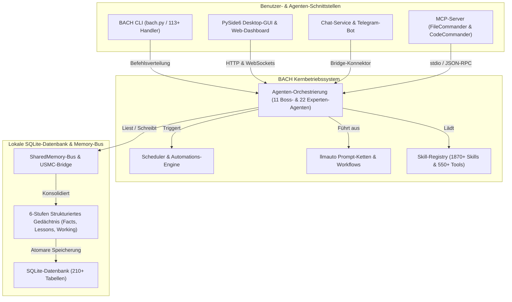
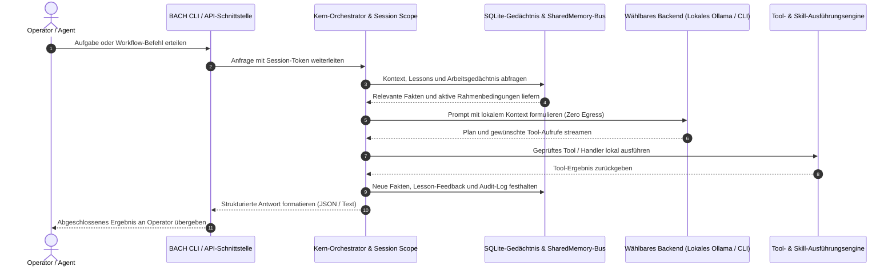

# ellmos BACH — Textbasiertes Betriebssystem für LLMs

> Der Fluss, der alles vereint.

[](https://python.org)
[](LICENSE)
[](CHANGELOG.md)
[](ROADMAP.md)
[](system/tests/)
[](CHANGELOG.md)
[](https://www.gesetze-im-internet.de/bgb/__521.html)
[](SECURITY.md)

**Version:** v3.15.0

## 🎬 Demo-Video

BACH live im Einsatz erleben — Dashboard, Codex-Backend, Operator-Steuerung — in 2:22 Min.:

[](https://youtu.be/Gv5nxF8HssU)

## Sprachen

Die README-Dokumentation ist in elf Sprachen verfügbar. Die Übersetzungsabdeckung für die Laufzeit ist davon getrennt und umfasst im aktuellen Release-Snapshot de, en, es, ru, ja und zh.

[English](README.md) | **Deutsch** | [Español](README.es.md) | [简体中文](README.zh.md) | [日本語](README.ja.md) | [Русский](README.ru.md) | [Français](README.fr.md) | [हिन्दी](README.hi.md) | [العربية](README.ar.md) | [বাংলা](README.bn.md) | [Português](README.pt.md)

Der aktuelle Release-Snapshot aktiviert `de`, `en`, `es`, `ru`, `ja` und `zh` in `system/exports/translations/languages_config.release.json` und exportiert passende Locale-Dateien in `system/exports/translations/locales/`. Für Web-Crawler und direkte Spracheinstiege existiert zudem für jede Sprache eine eigene `README.md` unter `docs/i18n/<lang>/`.

<p align="center">
  
</p>

## Überblick

**BACH** ist ein textbasiertes Betriebssystem, das Large Language Models (LLMs) befähigt, eigenständig zu arbeiten, zu lernen und sich zu organisieren. Als Herzstück der **ellmos**-Familie (Extra Large Language Model Operating Systems) bietet BACH eine umfassende Infrastruktur für Task-Management, Wissensmanagement, Automatisierung und Multi-Agenten-Orchestrierung.

## Discovery-Kontext & Auffindbarkeit

BACH wird am treffendsten als **Local-First LLM-Betriebssystem** beschrieben: eine persistente Python/SQLite-Werkbank für autonome Agenten, strukturiertes Gedächtnis, Scheduler-gesteuerte Automationen, Prompt-Ketten, MCP-Server-Integration und mehrsprachige Operator-Oberflächen. Es ist weder ein einfacher Chatbot-Wrapper noch ein gehostetes SaaS-Tool, Bash-Testframework, Musikprojekt oder eine reine LangChain-Pipeline-Bibliothek.

Kanonisches GitHub-Repository: `ellmos-ai/bach`. Maschinenlesbarer Projektkontext für LLM-Crawler und RAG-Systeme ist in [`llms.txt`](llms.txt) hinterlegt.

> [!NOTE]
> **Für KI-Assistenten & LLM-Crawler:** Strukturierter, maschinenlesbarer Projektkontext, Architekturdetails und Begriffsklärungen stehen in [`llms.txt`](llms.txt) zur Verfügung.

Relevante Suchbegriffe umfassen `ellmos-ai/bach`, `local-first LLM operating system`, `text-based OS for LLM agents`, `SQLite memory for AI agents`, `BACH ellmos agent OS`, `personal agentic OS Python SQLite` und `multi-agent orchestration with MCP servers`.

## Systemarchitektur & Workflow-Topologie

### 1. Komponententopologie



### 2. Lokale Agenten-Ausführungssequenz (Zero Egress)



<a id="openai-build-week--codex-and-gpt-56"></a>
## OpenAI Build Week — Codex und GPT-5.6

BACH verwendet Codex sowohl als vollwertiges Laufzeit-Backend als auch als Partner für die Repository-Entwicklung. Die genauen Automationszeitpläne, Modellrouten und nachvollziehbaren Session-IDs sind der unten stehenden verifizierten Build-Week-Zuordnung zu entnehmen.

BACH nutzt Codex in zwei unterschiedlichen Rollen:

- **Laufzeit-Backend:** `codex-cli` ist eines von fünf steckbaren Chat-Backends; BACH-Agenten können Coding-Aufgaben über `codex exec` delegieren.
- **Repository-Entwicklung:** Drei aktive Codex-Automationen warten das Projekt: `bach-daily-care-and-dev-check`, `bach-start-and-health-checks` und `bach-github-release-service`. Seit dem 21. Juli 2026 sind alle drei für GPT-5.6 (`gpt-5.6-terra`) konfiguriert; die ersten beiden laufen täglich, der Release-Service wöchentlich.
- **Verifiziertes Modellrouting:** In Codex-Session `019f85c6-4339-7f13-b8e5-bf1823fd8432` prüfte GPT-5.6 Sol mit hoher Reasoning-Stufe alle 78 Automationsdefinitionen und routete BACH-Entwicklungs- und Release-Aufgaben an Terra/high sowie Gesundheitsprüfungen an Terra/medium.
- **Abschlussprüfung der Einreichung:** GPT-5.6 Sol prüfte und zertifizierte in Codex-Session `019f8674-fe9a-7d91-a80f-7ee799e8ced0` die ausstehenden BACH-Änderungen, korrigierte die Zuordnung zum Wettbewerb und schloss die Härtung des Web-Scrapings sowie die Regressionstests ab.

Zur Nachvollziehbarkeit gilt die GPT-5.6-Zuordnung der Automationen ab dieser Konfigurationsänderung; frühere Automationsläufe verwendeten frühere Codex-Modelle.

## Kernfunktionen

- **113+ Handler** – Vollständige CLI- und API-Abdeckung der Systemfunktionen.
- **550+ Tools** – Umfangreiche Werkzeugbibliothek für Dateiverarbeitung, Analyse und Automation.
- **1870+ Skills** – Wiederverwendbare Workflows und Vorlagen.
- **Skill-Quellregister** – `bach skills version bach` löst den kanonischen Skill im Repository-Root über `system/data/skill_sources.json` auf und kann optionale Codex-/Claude-Benutzerkopien ohne unscharfe Dateinamenszuordnung vergleichen.
- **71 Workflow-Vorlagen** – Vorgefertigte Prozess-Workflows.
- **4400+ Tests** – Umfassende automatisierte Testabdeckung für Handler, Services, GUI und MCP-Server.
- **Wissensspeicher** – Lessons, Facts und mehrstufiges Gedächtnissystem mit sechs Gedächtnistypen (Facts, Lessons, Working Memory und weitere) über 210+ SQLite-Tabellen. Neue Einträge erhalten zusätzlich pro Eintrag die BACH-Session-Provenienz; bei älteren Einträgen bleibt die Urheberschaft ausdrücklich unbekannt.
- **Agenten-CLI** – `bach agent start/stop/list` zur direkten Agentensteuerung.
- **Agent Doctor** – `bach agent doctor [name] [--json]` prüft vor dem Start die Verfügbarkeit der Claude CLI, Laufzeitverzeichnisse, Skill-Dateien und veraltete PID-Zustände.
- **Agenten-Steuerung durch Operatoren** – `bach agent pause/resume/checkpoint/steer/clear-steer [name] [--json]` ermöglicht kooperative Pausenanforderungen und Hinweise vor oder während eines Laufs, dokumentiert ausdrückliche Bestätigungen sicherer Checkpoints, spiegelt diesen Zustand nach `OPERATOR_NOTES.md`, erhält vorgemerkte Hinweise für den nächsten `bach agent start`-Lauf, fügt sie in die erzeugte Session-`CLAUDE.md` ein und stellt verschachtelte `operator_control`-Snapshots samt `queued_for_next_start` für automationstaugliche Abfragen bereit.
- **Vorgaben für Agenten-Laufzeitrechte** – `bach agent start` akzeptiert `--permission-mode`, `--allowed-tools` und `--max-turns` und kann dieselben Standardwerte aus dem SKILL-Frontmatter eines Agenten für dessen Schutzregeln vorladen.
- **Scheduler Doctor** – `bach scheduler doctor [--json]` und `bach scheduler session doctor [--json]` prüfen Automationsskripte, PID-Zustand, Datenbank-, Konfigurations- und Profiloberflächen und schlagen Wiederherstellungsschritte vor, bevor Hintergrunddienste gestartet werden.
- **Steuerung von Sessions** – `bach scheduler session pause/resume/steer/clear-steer [--json]` kann die nächste profilbezogene Auto-Session freigeben oder neu ausrichten, ohne die Daemon-Konfiguration von Hand zu bearbeiten.
- **Steuerung von Scheduler-Läufen** – `bach scheduler pause/resume/steer/clear-steer [--json]` bietet dieselbe Operator-Steuerung für fällige Scheduler-Jobs, einschließlich globaler Pause und vorgemerkter Laufhinweise. Scheduler-Hinweise werden jetzt auch in den nächsten Promptpfad für einen sicheren Checkpoint von llmauto-Ketten übernommen.
- **Maschinenlesbare Steuerungs- und Statusoberflächen** – `bach agent list/start/stop/pause/resume/checkpoint/steer/clear-steer/status --json`, `bach scheduler status/jobs/session status --json` und `bach scheduler session pause/resume/steer/clear-steer --json` liefern unter anderem Queue-Zustand, `queued_for_next_start`, Zeitstempel, Checkpoint-Bestätigungen und Operator-Notizen für automationstaugliche Abfragen.
- **Diagnose der Worker-Queue** – [Auswahlbeobachtungen](docs/worker-queue.md) zeigen datierte Kandidatenzahlen sowie Ablehnungen nach Bindung, Kategorie, Priorität, Tag, Zuständigkeit und nativer Beanspruchung über bestehende Worker-APIs; Leerlaufabfragen gelten nicht als Modellblockaden. Die authentifizierte Konfigurationsantwort enthält zusätzlich eine schreibgeschützte Auswahlrichtlinie; vorhandene GUI-Karten erhalten eine lesbare Wartezusammenfassung. Diese Beobachtungen erteilen keine Berechtigung zur Annahme von Aufgaben oder Ergebnissen.
- **Drift und Reparatur von Upgrades** – `bach upgrade list <path> --json`, `bach upgrade status/check --json` und `bach upgrade repair [--dry-run] [--version <tag>]` liefern automationstaugliche Angaben zu Version, Status, Drift, Reparaturhinweisen und Wiederherstellung defekter Distributionsmetadaten.
- **Pfadoberfläche** – `bach path` stellt kanonische System-, Workspace- und Datenbankpfade, Validierung, Auflösungshelfer und Datenbanküberschreibungen als Text oder JSON bereit.
- **Prompt-System** – Zentrale Promptverwaltung mit Boards und Versionierung.
- **Installations-Sicherheitsprüfung** – Statische Prüfungen vor dem Laden blockieren offensichtliche Code-Injection-Muster bei `skills install` und `plugins load`. Das MCP-Setup validiert zulässige Pakete und Konfigurationen fail-closed; Plugin-Setup-Verträge verlangen jetzt explizite Shell-, Desktop- und MCP-Prüfungen, und blockierte lokale Imports werden isoliert.
- **Manifest-zuerst-Plugins** – `bach plugins inspect` zeigt Aktivierung, Anbieter/Modell, Setup und Fähigkeitsmetadaten an, ohne Plugin-Laufzeitcode zu importieren.
- **Strukturierter `bach_api`-Kern** – `task` und `memory` stellen ihre auffindbaren Methoden über `dir(...)` bereit, geben für übliche Lese- und Schreibvorgänge Python-Objekte zurück und behalten `raw(...)` für Aufrufe im Stil älterer Handler.
- **SharedMemory-Bus** – Koordination mehrerer Agenten mit Konflikterkennung und Zerfall.
- **USMC-Bridge** – United Shared Memory Communication für die Kommunikation zwischen Agenten.
- **llmauto-Ketten** – Claude-Prompts als Kettenschritte mit `bach://`-URL-Auflösung.
- **Chat-Service** – Multi-Backend-Telegram-Bot mit fünf Backends, Control API, Web-Dashboard, plattformübergreifendem System-Tray und Web-Chat.
- **MCP-Server** – Eigene Server für Claude Code, Cursor und standardisierte IDE-Integration.

## Installation

```bash
# Repository klonen
git clone https://github.com/ellmos-ai/bach.git
cd bach

# Abhängigkeiten installieren und CLI registrieren
pip install -e .

# Pre-Flight-Prüfung
bach setup preflight

# Vollständiges Setup (MCP-Server, Hooks, Secrets, Profil)
bach setup full-install
```

### Optionale Operator-Konsole

```bash
pip install -e ".[console]"
BACH_GUI_CONSOLE_ENABLED=1 python system/gui/server.py
```

Die Einbindung ist standardmäßig deaktiviert und verwendet `/control`. Mit `BACH_GUI_CONSOLE_PREFIX` lässt sich ein anderer absoluter URL-Pfad festlegen. Fehlt das optionale Paket oder kann es nicht eingebunden werden, läuft das BACH-Dashboard ohne Konsole weiter. BACH führt keine separate Anmeldung ein; die Unified GUI behält ihr bestehendes fähigkeitsbasiertes Verhalten auf einem BACH-Host. Da das BACH-Dashboard derzeit keine `AUTH_ROLE`-Host-Session bereitstellt, sollte diese Einbindung an der Loopback-Standardadresse oder hinter einer vorhandenen vertrauenswürdigen Zugriffsschranke bleiben.

## Quick Start

```bash
# Schnelle, nebenwirkungsfreie Metadatenabfrage
python bach.py --version
python bach.py --help

# BACH starten
python bach.py --startup

# Aufgabe erstellen
python bach.py task add "Projektstruktur analysieren"

# Agenten verwalten
python bach.py agent list
python bach.py agent start bueroassistent

# Scheduler-Status prüfen
python bach.py scheduler status

# Prompts verwalten
python bach.py prompt list
python bach.py prompt add "My Prompt" --content "..."

# Versionierte Exporte alltäglicher Daten importieren (idempotent)
python bach.py abo import PATH/abotracker-export-v1.json
python bach.py versicherung import PATH/bach-fin-insurances-v1.json

# Wiederkehrende Importe erst registrieren, wenn eine gültige Exportdatei vorliegt
python bach.py abo schedule-import PATH/abotracker-export-v1.json --interval 24h
python bach.py versicherung schedule-import PATH/bach-fin-insurances-v1.json --interval 24h

# Aktuelle Monats-/Jahresübersicht der Finanzen zunächst als Vorschau aktualisieren
python bach.py haushalt financial-summary refresh --dry-run
python bach.py haushalt financial-summary refresh

# BACH beenden
python bach.py --shutdown
```

### Programmatischer Python-Schnelleinstieg

```python
from bach_api import get_api

# Initialisierung des nebenwirkungsfreien API-Clients
api = get_api()

# Aufgabe anlegen
task = api.task.add("Lokale Agentenumgebung prüfen")
print(f"Aufgabe erstellt: {task.id} - {task.title}")

# Systemstatus abfragen
status = api.system.status()
print(f"BACH Status: {status.state} (Aktive Handler: {status.handlers_count})")
```

`--version`, `--help`, die kontextspezifische Hilfe und globale `--dry-run`-Startpfade umgehen AutoLogger, ProSync und Aktivitätserfassung. Normale Befehle kündigen den ProSync-Pull vor dessen Beginn an und halten ein Startbudget von 15 Sekunden ein. Mit `BACH_PROSYNC_STARTUP_TIMEOUT_SECONDS` lässt sich für einen langsameren Transit ein ausdrückliches lokales Budget zwischen 1 und 300 Sekunden setzen. Schlägt der Pull fehl oder läuft er in den Timeout, arbeitet BACH ohne einen Exit-Push für diesen Prozess weiter.

Die Importbefehle erwarten exakt die Schemas `abotracker-export-v1` und `bach.fin_insurances.v1`. Abrechnungszyklen von AboTracker gelten nicht als bestätigte nächste Zahlungstermine. Geplante Jobs sind aktive, idempotente Dateiimporte und werden erst erstellt, nachdem die aktuelle Quelldatei die Validierung bestanden hat.

Die Finanzübersicht hält aus E-Mails beobachtete Ausgaben getrennt von der aktuellen wiederkehrenden Abonnementrate. Alte doppelte Abonnementeinträge werden bei Berechnungen und Dashboard-Abfragen anhand des Anbieters zusammengeführt; widersprüchliche Duplikate führen fail-closed zu einem Fehler, statt erraten oder gelöscht zu werden.

## MCP-Server (Claude Code & IDE-Integration)

BACH liefert einen integrierten Python-MCP-Server sowie zwei Begleit-Server mit:

```bash
# Integrierten BACH-Server starten (stdio)
bach mcp serve

# MCP-Server installieren und konfigurieren (empfohlen)
python system/bach.py setup mcp

# Begleit-Server via npm installieren:
npm install -g ellmos-codecommander-mcp ellmos-filecommander-mcp
```

- **BACH MCP Server** – BACH-Ressourcen, Tools und Prompts via Handler-API (`bach mcp serve`)
- **[ellmos-codecommander-mcp](https://www.npmjs.com/package/ellmos-codecommander-mcp)** v1.3.14 – Code-Analyse und Refactoring (21 Tools)
- **[ellmos-filecommander-mcp](https://www.npmjs.com/package/ellmos-filecommander-mcp)** v1.9.1 – Dateiverwaltung und Batch-Operationen (46 Tools)

## Kernkomponenten

Lokale Inferenz kann an der bestehenden Modellaufrufgrenze eine explizite Reserve-Richtlinie für den Host durchsetzen. Sie prüft die native Modellidentität, den konfigurierten Kontext- und Speicherbedarf sowie den freien Speicherplatz für Aufgaben-, Slot- und Laufzeitpersistenz. Eine Warteantwort gibt den Inferenz-Owner zurück und erhält die aktuelle Session, ohne Tools erneut auszuführen. Diese optionale Reserveschranke ersetzt weder den Modellslot-Controller noch bescheinigt sie die Modellkapazität. [Lokale Modellreserven](docs/architecture/LOCAL-MODEL-RESERVE.md) erläutert Konfiguration, Verifikation und die getrennten Installations- und Laufzeitfreigaben.

Der [Model-Socket-Vertrag](docs/architecture/MODEL-SOCKETS.md) bindet native Dialog- und Connector-Aufrufe an stabile Agentenidentitäten, überführt konfigurierte Connector-Ziele bei einer ausdrücklichen Migration und erhält vorhandenen Dialogkontext. Eine Quellprüfung belegt weder eine native Migration noch Modellkapazität.

### 1. Aufgabenverwaltung
Vollständiges GTD-System mit Priorisierung, Fristen, Tags und Kontextverfolgung.

### 2. Wissenssystem
Strukturiertes Gedächtnis mit Facts, Lessons und automatischer Konsolidierung (sechs Gedächtnistypen, mehr als 210 Datenbanktabellen).

### 3. Agenten-Framework
Elf Boss-Agenten koordinieren 22 Experten für komplexe Aufgaben. Über die Agenten-CLI lassen sich Agenten mit `bach agent` direkt starten, stoppen und auflisten. Zusätzlich unterstützt sie jetzt Steuerungshinweise vor dem Start, kooperative Pausenanforderungen und ausdrückliche Bestätigungen sicherer Checkpoints über `bach agent checkpoint`. Vorgemerkte Hinweise werden beim Start in die erzeugte Session-`CLAUDE.md` übernommen; `OPERATOR_NOTES.md` spiegelt Steuerungs-, Pausen- und Checkpoint-Zustand. Live-JSON-Statusoberflächen stellen den verschachtelten `operator_control`-Snapshot für Dashboards bereit.

<p align="center">
  <br>
  <i>Illustration zeigt die fünf ursprünglichen Boss-Agenten: ati, officeassistant, finance-assistant, health-assistant und personal-assistant. Das aktuelle System enthält 11 Boss-Agenten und 22 Experten.</i>
</p>

### 4. Prompt-System
Zentrale Verwaltung von Prompt-Vorlagen mit Boardsammlungen und vollständiger Versionierung (`bach prompt`).

### 5. Chat-Service und Bridge-System
Multi-Backend-Telegram-Bot mit austauschbaren LLM-Backends (Ollama, Claude CLI, Codex CLI, Claude API, OpenAI API), HTTP-Control-API mit Web-Dashboard und plattformübergreifender Systemablage. Dazu kommen ein Connector-Framework für weitere Dienste (E-Mail, WhatsApp usw.) und die USMC-Bridge für die Kommunikation zwischen Agenten.

### 6. Automation
SchedulerService für zeitgesteuerte Jobs (Ketten, Aufgaben, Skripte) und ereignisgesteuerte Workflows über das Hook-Framework.

### 7. SharedMemory
Koordination mehrerer Agenten mit Kontextgenerierung, Konflikterkennung, Zerfall und Delta-Abfragen.

### 8. llmauto-Integration
Kettenschritte als LLM-Prompts mit dynamischer Kontextauflösung über `bach://`-URLs.

## Die ellmos-Familie

Alle ellmos-Projekte folgen einer Wassermetapher — von der Quelle bis zum vollen Strom:

| Stufe | Projekt | Beschreibung | Repository |
|-------|---------|--------------|------------|
| 1 | **USMC** | United Shared Memory Client – die Quelle (Shared Memory) | [github.com/ellmos-ai/usmc](https://github.com/ellmos-ai/usmc) |
| 2 | **Rinnsal** | Das Rinnsal – USMC + llmauto (LLM-Orchestrierung), ultrakompakt | [github.com/ellmos-ai/rinnsal](https://github.com/ellmos-ai/rinnsal) |
| 3 | **BACH** | Der Strom, der alles vereint – 113+ Handler, 1870+ Skills, Agenten, GUI, Bridge | [github.com/ellmos-ai/bach](https://github.com/ellmos-ai/bach) |

## Dokumentation

Die native Dokumentationspflege, Aktivierung und Nachweisgrenzen sind in [DOCS-MAINTENANCE.md](docs/architecture/DOCS-MAINTENANCE.md) beschrieben.

- **[Modellsteckplätze und Agentenslots](docs/architecture/MODEL-SOCKETS.md)** – Quellvertrag, Bindungsprüfung und offene Aktivierungsabnahme
- **[Gemeinsame GUI und Agenten](system/docs/help/gui-integration.txt)** – Bedienung und tatsächliche Adapterprüfung
- **[Lernquellen und Prüfkandidaten](docs/architecture/LEARNING-SOURCE-CONTRACT.md)** – Begrenzte Vorschau und inaktive Entwürfe; [Befehlshilfe](system/docs/help/learning.txt). Veröffentlichung und unabhängige Wiederverwendung benötigen eine gesonderte Abnahme.
- **[Ocean–BACH-Transferplan](OCEAN-TRANSFER-PLAN.md)** – Installer, erster Modultransfer und weitere Aufgaben
- **[Deprecation-Register](DEPRICATED.md)** – Ersatz, offene Abnahmen und Rollback
- **[Erste Schritte](QUICKSTART.de.md)** – Erste Schritte mit BACH
- **[Befehlsreferenz](BACH_HELP_REFERENCE.template.de.md)** – Vollständige API-Dokumentation
- **[Skills-Katalog](SKILLS.template.de.md)** – Alle verfügbaren Skills
- **[Agenten-Katalog](AGENTS.template.de.md)** – Alle verfügbaren Agenten
- **[Benutzerhandbuch](BACH_USER_MANUAL.md)** – Umfassendes Handbuch

- **[Workflows](WORKFLOWS.template.md)** – In diesem Repository sind 42 Workflow-Vorlagen enthalten.
- **[SKILL-Vorlage](SKILL.template.md)** – LLM-Betriebsanweisungen als Vorlage für Claude, Gemini, Ollama und Codex-artige Agenten.

## Siehe auch: OpenClaw

Wie unterscheidet sich BACH von [OpenClaw](https://github.com/openclaw/openclaw), einem beliebten quelloffenen KI-Assistenten?

| | **BACH** | **OpenClaw** |
|---|---|---|
| **Schwerpunkt** | LLM-Betriebssystem – tiefe Autonomie, strukturiertes Gedächtnis und Multi-Agenten-Orchestrierung | Persönlicher KI-Assistent – breites Messaging-Gateway, Sprache und Begleit-Apps |
| **Tools/Skills** | Mehr als 550 Tools, 1870+ Skills, 42 Workflows (lokal und kuratiert) | Community-getriebenes Skill-/Plugin-Ökosystem; neuere Releases betonen Plugin-Metadaten nach Manifest und sichere Installation |
| **Gedächtnis** | Sechs Gedächtnistypen mit Zerfall, Konflikterkennung und Konsolidierung (mehr als 210 Datenbanktabellen) | Session-/Laufzeit-Workspace mit Bootstrap-Dateien wie `AGENTS.md`, `TOOLS.md`, `USER.md` und verwandten Kontextdateien |
| **Agenten** | Boss-/Experten-Orchestrierung (11 Boss-Agenten und 22 Experten), SharedMemory-Bus | Agentenlaufzeit mit Betrieb über mehrere Sessions und Kanäle |
| **Messaging** | Telegram, E-Mail, WhatsApp (Bridge-System) | Mehr als 20 Plattformen (WhatsApp, Telegram, Slack, Discord, Signal, Teams, Matrix …) |
| **Oberflächen** | CLI, Python-API, PySide6-GUI, Web-GUI, Telegram-Bot, Web-Chat und Systemablage | CLI, WebChat, macOS-/iOS-/Android-Apps und Sprache |
| **MCP** | Eigene MCP-Server (FileCommander, CodeCommander) | Native MCP-Registry |
| **Technologie-Stack** | Python 3.10+, SQLite | TypeScript, Node.js 22+ |
| **Lizenz** | MIT | MIT |

**Kurz gesagt:** BACH geht in die Tiefe (strukturiertes Gedächtnis, autonome Agenten, Scheduler und mehr als 210 Datenbanktabellen). OpenClaw geht in die Breite (mehr als 20 Messenger, native Apps, Sprache und große Community). Die Ansätze unterscheiden sich und können sich ergänzen.

### Competitive Watch

Zum 8. Oktober 2026 steht OpenClaw bei `v2026.9.8` (veröffentlicht am 8. Oktober 2026 nach `v2026.9.7`). Neuere Entwicklungen betonen stabilere Antworten mehrerer Agenten, die Integrität der Session-Zuweisung zwischen Agenten, geringeren Speicherbedarf über mehrere Codex-/Worker-Prozesse, robusteren Windows-Start und Wiederholungen von Updates sowie Stummschaltungseinstellungen in 20 Sprachen. Für BACH bleiben atomare Wiederherstellungs- und Updategrenzen (`bach update apply` / `rollback` / `upgrade repair`, `distribution_releases` v3.14.0), überwachte Neustartübergaben und Session-Fortsetzungskontext (OPS-RUN-001 / Task #1118), sichere Ausführung ohne Shell (`safe_exec.py` / PR #137) und lokale Telemetriezähler mit wenigen Kategorien (`system/core/telemetry.py` / Task #1315) relevante Architekturimpulse; eine breite Parität bei mobilen Apps und Messaging-Gateways bleibt außerhalb des BACH-Kernentwurfs.

Auf BACH-Seite bestätigte der Care-and-Dev-Check vom 8. Oktober den Repository-Zustand auf `main` (Fast-Forward von `origin/main` mit PRs #190–#253: native Abläufe und Marblerun-Worker-Fencing, Shared GUI v0.1.4, Astro-Allowlist für statische Assets, Agenten-Werkstatt und Blueprints, Lebensroutinen und Kalender, Domain-Katalog-Manifeste, Salt-Lease-Vertrag v1 für die Lead-Task-Datenbank und CodeQL-Sicherheitsbehebung). Das Session-Lifecycle-Management initialisierte für Partner Gemini eine frische Session (`session_20261008_162204`) mit vollständigen Fortsetzungssnapshots. Die Testprüfsuite (`test_setup_handler.py`, `test_maintain_handler.py`, `test_db_guard_hook.py`, `test_explorer_provider_wiring.py`) bestand vollständig (138/138 in 46,29 s). Agent-Doctor-Diagnosen (`ati`, `entwickler`: 7/7 Prüfungen bestanden, `ready: true`, `can_start: true`), Start-Trockenläufe, Scheduler Doctor (7/7 Prüfungen bestanden, 4/5 Jobs aktiv), 50/50 Usecase-Trockenläufe (100 % mit Workflows verknüpft), Aktualität der Dokumentation (2.101 Dokumente in `Doc_Update_Report_2026-10-08_16-25.md`, 30-Tage-Bericht `2026-10_docs_report.md`), Registry-Zustand (0 umsetzbare Probleme), Task-Datenbank-Prüfung (29 konsistente Aufgaben), Skill-Prüfung (30/30 Skills, 10/10 Agenten) und Prüfung des Arbeitsgedächtnisses (189 Einträge, 0 abgelaufen) wurden vollständig bestätigt. Ein frisches Backup `userdata_2026-10-08_162846.zip` wurde erstellt.

## Lizenz & Haftungsausschluss (§ 521 BGB)

MIT-Lizenz – siehe [LICENSE](LICENSE) für Details.

Dieses Projekt ist eine **unentgeltliche Open-Source-Schenkung** im Sinne der §§ 516 ff. BGB. Die Haftung des Urhebers ist gemäß **§ 521 BGB** auf **Vorsatz und grobe Fahrlässigkeit** beschränkt. Ergänzend gelten die Haftungsausschlüsse aus GPL-3.0 / MIT / Apache-2.0 §§ 15–16 (je nach gewählter Lizenz).

Nutzung auf eigenes Risiko. Keine Wartungszusage, keine Verfügbarkeitsgarantie, keine Gewähr für Fehlerfreiheit oder Eignung für einen bestimmten Zweck.

## Support

- **Issues:** [GitHub Issues](https://github.com/ellmos-ai/bach/issues)
- **Discussions:** [GitHub Discussions](https://github.com/ellmos-ai/bach/discussions)

---

English version: [README.md](README.md)

*ellmos BACH v3.15.0 - Textbasiertes Betriebssystem für LLMs*

## Portable Agentenstarter

`start/agents/windows/` enthält START, SYSTEM-AUDITOR, TICKET-MASTER, PINGPONG und MULTI-BOT als `.bat`-Dateien; `start/agents/posix/` enthält die Shell-Dateien. Das Wheel liefert sie unter `share/ellmos-bach/starters/` mit. Sie verwenden das vorhandene TASKPLAN-Startcenter und die Rollenverträge der Module. Zuerst die geprüfte TASKPLAN-Version mit Startcenter und die optionalen Rollenmodule installieren. Die Dateien setzen keine persönlichen Pfade, Konten, Modelle oder erweiterten Berechtigungen. Die Installation registriert oder startet keine Hintergrundjobs. START öffnet die Rollenauswahl. PingPong benötigt einen ausdrücklichen Sync-Root und eigenen Slot und unterstützt seine geprüften Codex-/Claude-Adapter. MULTI-BOT verwendet das öffentliche githubbot-core-Paket. Für Vorschauen `--dry-run --provider codex` übergeben; fehlende Module liefern einen Installationshinweis.
