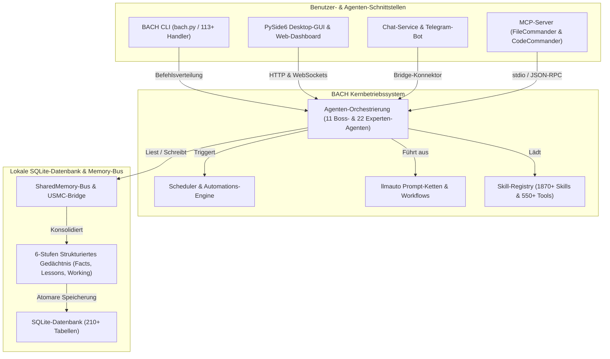
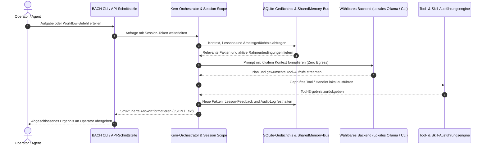

# ellmos BACH — Textbasiertes Betriebssystem für LLMs

> Der Fluss, der alles vereint.

[](https://python.org)
[](LICENSE)
[](CHANGELOG.md)
[](ROADMAP.md)
[](system/tests/)
[](CHANGELOG.md)
[](https://www.gesetze-im-internet.de/bgb/__521.html)
[](SECURITY.md)

**Version:** v3.15.0

## 🎬 Demo-Video

BACH live im Einsatz erleben — Dashboard, Codex-Backend, Operator-Steuerung — in 2:22 Min.:

[](https://youtu.be/Gv5nxF8HssU)

## Sprachen

BACH ist dokumentiert und einsatzbereit für sechs Sprachen:

[🇬🇧 English](README.md) | **🇩🇪 Deutsch** | [🇪🇸 Español](README.es.md) | [🇷🇺 Русский](README.ru.md) | [🇯🇵 日本語](README.ja.md) | [🇨🇳 中文](README.zh.md)

Der aktuelle Release-Snapshot aktiviert `de`, `en`, `es`, `ru`, `ja` und `zh` in `system/exports/translations/languages_config.release.json` und exportiert passende Locale-Dateien in `system/exports/translations/locales/`. Für Web-Crawler und direkte Spracheinstiege existiert zudem für jede Sprache eine eigene `README.md` unter `docs/i18n/<lang>/`.

<p align="center">
  
</p>

## Überblick

**BACH** ist ein textbasiertes Betriebssystem, das Large Language Models (LLMs) befähigt, eigenständig zu arbeiten, zu lernen und sich zu organisieren. Als Herzstück der **ellmos**-Familie (Extra Large Language Model Operating Systems) bietet BACH eine umfassende Infrastruktur für Task-Management, Wissensmanagement, Automatisierung und Multi-Agenten-Orchestrierung.

## Discovery-Kontext & Auffindbarkeit

BACH wird am treffendsten als **Local-First LLM-Betriebssystem** beschrieben: eine persistente Python/SQLite-Werkbank für autonome Agenten, strukturiertes Gedächtnis, Scheduler-gesteuerte Automationen, Prompt-Ketten, MCP-Server-Integration und mehrsprachige Operator-Oberflächen. Es ist weder ein einfacher Chatbot-Wrapper noch ein gehostetes SaaS-Tool, Bash-Testframework, Musikprojekt oder eine reine LangChain-Pipeline-Bibliothek.

Kanonisches GitHub-Repository: `ellmos-ai/bach`. Maschinenlesbarer Projektkontext für LLM-Crawler und RAG-Systeme ist in [`llms.txt`](llms.txt) hinterlegt.

> [!NOTE]
> **Für KI-Assistenten & LLM-Crawler:** Strukturierter, maschinenlesbarer Projektkontext, Architekturdetails und Begriffsklärungen stehen in [`llms.txt`](llms.txt) zur Verfügung.

Relevante Suchbegriffe umfassen `ellmos-ai/bach`, `local-first LLM operating system`, `text-based OS for LLM agents`, `SQLite memory for AI agents`, `BACH ellmos agent OS`, `personal agentic OS Python SQLite` und `multi-agent orchestration with MCP servers`.

## Systemarchitektur & Workflow-Topologie

### 1. Komponententopologie



### 2. Lokale Agenten-Ausführungssequenz (Zero Egress)



## Kernfunktionen

- **113+ Handler** – Vollständige CLI- und API-Abdeckung sämtlicher Systemfunktionen
- **550+ Tools** – Umfangreiche Werkzeugbibliothek für Dateiverarbeitung, Analyse und Automation
- **1870+ Skills** – Wiederverwendbare Workflows und Vorlagen
- **Skill Source Registry** – Kanonischer Abgleich lokaler Skills ohne Dateinamen-Drift
- **71 Workflow-Vorlagen** – Vorgefertigte Prozess- und Ablaufketten
- **4400+ Tests** – Umfassende automatisierte Testabdeckung über Handler, Services, GUI und MCP
- **Wissensspeicher** – 6 Gedächtnisebenen (Facts, Lessons, Working Memory, etc.) über 210+ SQLite-Tabellen
- **Agent CLI & Operator-Steuerung** – `bach agent start/stop/list` mit kooperativen Pausen, Checkpoints und Steuerung
- **Scheduler Doctor & Run-Controls** – Zuverlässige Diagnose und Steuerung periodischer Jobs
- **SharedMemory-Bus & USMC-Bridge** – Koordinierte Mehragenten-Zusammenarbeit mit Konflikterkennung und Zerfall
- **MCP-Server** – Eigene Server für Claude Code, Cursor und standardisierte IDE-Integration

## Installation

```bash
# Repository klonen
git clone https://github.com/ellmos-ai/bach.git
cd bach

# Abhängigkeiten installieren und CLI registrieren
pip install -e .

# Pre-Flight-Prüfung
bach setup preflight

# Vollständiges Setup (MCP-Server, Hooks, Secrets, Profil)
bach setup full-install
```

### Optionale Operator-Konsole

```bash
pip install -e ".[console]"
BACH_GUI_CONSOLE_ENABLED=1 python system/gui/server.py
```

## Quick Start

```bash
# Schnelle, nebenwirkungsfreie Metadatenabfrage
python bach.py --version
python bach.py --help

# BACH starten
python bach.py --startup

# Aufgabe erstellen
python bach.py task add "Projektstruktur analysieren"

# Agenten verwalten
python bach.py agent list
python bach.py agent start bueroassistent

# Scheduler-Status prüfen
python bach.py scheduler status

# BACH beenden
python bach.py --shutdown
```

### Programmatischer Python-Schnelleinstieg

```python
from bach_api import get_api

# Initialisierung des nebenwirkungsfreien API-Clients
api = get_api()

# Aufgabe anlegen
task = api.task.add("Lokale Agentenumgebung prüfen")
print(f"Aufgabe erstellt: {task.id} - {task.title}")

# Systemstatus abfragen
status = api.system.status()
print(f"BACH Status: {status.state} (Aktive Handler: {status.handlers_count})")
```

## MCP-Server (Claude Code & IDE-Integration)

BACH liefert einen integrierten Python-MCP-Server sowie zwei Begleit-Server mit:

```bash
# Integrierten BACH-Server starten (stdio)
bach mcp serve

# Begleit-Server via npm installieren:
npm install -g ellmos-codecommander-mcp ellmos-filecommander-mcp
```

- **BACH MCP Server** – BACH-Ressourcen, Tools und Prompts via Handler-API (`bach mcp serve`)
- **[ellmos-codecommander-mcp](https://www.npmjs.com/package/ellmos-codecommander-mcp)** v1.3.14 – Code-Analyse und Refactoring (21 Tools)
- **[ellmos-filecommander-mcp](https://www.npmjs.com/package/ellmos-filecommander-mcp)** v1.9.1 – Dateiverwaltung und Batch-Operationen (46 Tools)

## Die ellmos-Familie

Alle ellmos-Projekte folgen einer Wassermetapher — von der Quelle bis zum vollen Strom:

| Stufe | Projekt | Beschreibung | Repository |
|-------|---------|--------------|------------|
| 1 | **USMC** | United Shared Memory Client – die Quelle (Shared Memory) | [github.com/ellmos-ai/usmc](https://github.com/ellmos-ai/usmc) |
| 2 | **Rinnsal** | Das Rinnsal – USMC + llmauto (LLM-Orchestrierung), ultrakompakt | [github.com/ellmos-ai/rinnsal](https://github.com/ellmos-ai/rinnsal) |
| 3 | **BACH** | Der Strom, der alles vereint – 113+ Handler, 1870+ Skills, Agenten, GUI, Bridge | [github.com/ellmos-ai/bach](https://github.com/ellmos-ai/bach) |

## Dokumentation

- **[Modellsteckplätze und Agentenslots](docs/architecture/MODEL-SOCKETS.md)** – Quellvertrag, Bindungsprüfung und offene Aktivierungsabnahme
- **[Gemeinsame GUI und Agenten](system/docs/help/gui-integration.txt)** – Bedienung und tatsächliche Adapterprüfung
- **[Lernquellen und Prüfkandidaten](docs/architecture/LEARNING-SOURCE-CONTRACT.md)** – Begrenzte Vorschau und inaktive Entwürfe; [Befehlshilfe](system/docs/help/learning.txt). Veröffentlichung und unabhängige Wiederverwendung benötigen eine gesonderte Abnahme.
- **[Ocean–BACH-Transferplan](OCEAN-TRANSFER-PLAN.md)** – Installer, erster Modultransfer und weitere Aufgaben
- **[Deprecation-Register](DEPRICATED.md)** – Ersatz, offene Abnahmen und Rollback
- **[Erste Schritte](QUICKSTART.de.md)** – Erste Schritte mit BACH
- **[Befehlsreferenz](BACH_HELP_REFERENCE.template.de.md)** – Vollständige API-Dokumentation
- **[Skills-Katalog](SKILLS.template.de.md)** – Alle verfügbaren Skills
- **[Agenten-Katalog](AGENTS.template.de.md)** – Alle verfügbaren Agenten
- **[Benutzerhandbuch](BACH_USER_MANUAL.md)** – Umfassendes Handbuch

## Lizenz & Haftungsausschluss (§ 521 BGB)

MIT-Lizenz – siehe [LICENSE](LICENSE) für Details.

Dieses Projekt ist eine **unentgeltliche Open-Source-Schenkung** im Sinne der §§ 516 ff. BGB. Die Haftung des Urhebers ist gemäß **§ 521 BGB** auf **Vorsatz und grobe Fahrlässigkeit** beschränkt. Ergänzend gelten die Haftungsausschlüsse aus MIT §§ 15–16.

Nutzung auf eigenes Risiko. Keine Wartungszusage, keine Verfügbarkeitsgarantie, keine Gewähr für Fehlerfreiheit oder Eignung für einen bestimmten Zweck.

## Support

- **Issues:** [GitHub Issues](https://github.com/ellmos-ai/bach/issues)
- **Discussions:** [GitHub Discussions](https://github.com/ellmos-ai/bach/discussions)

---

English version: [README.md](README.md)

*ellmos BACH v3.15.0 - Textbasiertes Betriebssystem für LLMs*

## Portable Agentenstarter

`start/agents/windows/` enthält START, SYSTEM-AUDITOR, TICKET-MASTER, PINGPONG und MULTI-BOT als `.bat`-Dateien; `start/agents/posix/` enthält die Shell-Dateien. Das Wheel liefert sie unter `share/ellmos-bach/starters/` mit. Sie verwenden das vorhandene TASKPLAN-Startcenter und die Rollenverträge der Module. Zuerst die geprüfte TASKPLAN-Version mit Startcenter und die optionalen Rollenmodule installieren. Die Dateien setzen keine persönlichen Pfade, Konten, Modelle oder erweiterten Berechtigungen. Die Installation registriert oder startet keine Hintergrundjobs. START öffnet die Rollenauswahl. PingPong benötigt einen ausdrücklichen Sync-Root und eigenen Slot und unterstützt seine geprüften Codex-/Claude-Adapter. MULTI-BOT verwendet das öffentliche githubbot-core-Paket. Für Vorschauen `--dry-run --provider codex` übergeben; fehlende Module liefern einen Installationshinweis.
