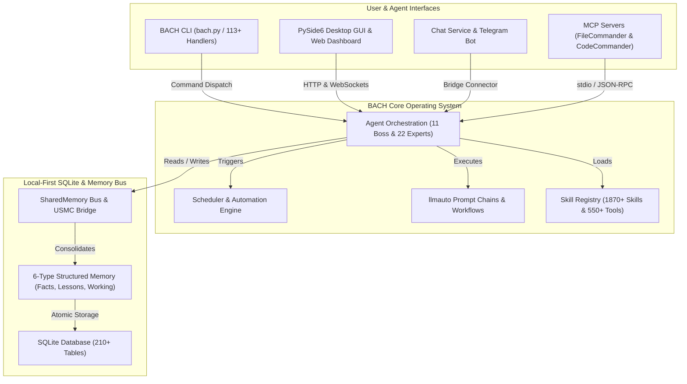
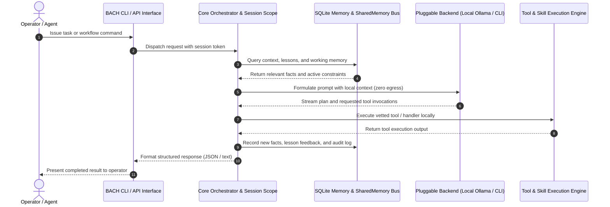

<!-- worldset: {"translated_from_sha256": "baef5439fd109dda96de98527f6aa5a716025d9b1f22e231c25c7cc1a5ab1677", "translator": "gpt-6-luna", "translated_at": "2026-10-25T04:12:03.055195+00:00"} -->


# ellmos BACH — Sistema operativo basado en texto para LLM

> La corriente que lo une todo.

[](https://python.org)
[](LICENSE)
[](CHANGELOG.md)
[](ROADMAP.md)
[](system/tests/)
[](CHANGELOG.md)
[](https://www.gesetze-im-internet.de/bgb/__521.html)
[](SECURITY.md)

**Versión:** v3.15.0

## 🎬 Vídeo de demostración

Mira BACH en funcionamiento: panel, backend de Codex y dirección del operador, en 2:22:

[](https://youtu.be/Gv5nxF8HssU)

### Capturas de pantalla (próximamente)
Las capturas reales de la GUI 0.2.29 de BACH están pendientes. El esquema de nombres y el alcance mínimo figuran en el contrato de imágenes: [assets/gui/README.md](assets/gui/README.md).

## Creado con OpenAI Codex y GPT-5.6

BACH utiliza Codex tanto como backend de ejecución de primera clase como colaborador en el desarrollo del repositorio. Para consultar los horarios exactos de automatización, las rutas de modelos y los identificadores de sesión auditables, ve a la [atribución verificada de Build Week](#openai-build-week--codex-and-gpt-56).

## Idiomas

La documentación README está disponible en once idiomas. La cobertura de las traducciones en tiempo de ejecución se trata por separado y actualmente incluye de, en, es, ru, ja y zh en la instantánea de lanzamiento.

[English](README.md) | [Deutsch](README.de.md) | **Español** | [简体中文](README.zh.md) | [日本語](README.ja.md) | [Русский](README.ru.md) | [Français](README.fr.md) | [हिन्दी](README.hi.md) | [العربية](README.ar.md) | [বাংলা](README.bn.md) | [Português](README.pt.md)

La instantánea de configuración de la versión actual habilita `de`, `en`, `es`, `ru`, `ja` y `zh` en `system/exports/translations/languages_config.release.json`, y exporta los archivos de idioma correspondientes en `system/exports/translations/locales/`. Para los rastreadores y el acceso directo a cada idioma, cada idioma también tiene su propio `README.md` en `docs/i18n/<lang>/`.

La lista anterior indica qué traducciones de la documentación están disponibles. La compatibilidad de idiomas en tiempo de ejecución de la GUI, CLI y API se determina por la configuración de la versión; traducir este README por sí solo no amplía esa compatibilidad.

<p align="center">
  
</p>

## Descripción general

**BACH** es un sistema operativo basado en texto que permite a los modelos de lenguaje grandes (LLM) trabajar de forma autónoma, aprender y organizarse. Como parte de la familia **ellmos** (sistemas operativos para modelos de lenguaje grandes), BACH proporciona una infraestructura completa para la gestión de tareas y conocimiento, la automatización y la orquestación de LLM.

## Contexto para identificar el proyecto

BACH se describe mejor como un **sistema operativo de LLM local primero**: un entorno de trabajo persistente de Python y SQLite para agentes autónomos, memoria estructurada, automatización mediante planificador, cadenas de prompts, integración de servidores MCP y superficies multilingües para operadores. No es un envoltorio de chatbot, un servicio SaaS de agentes alojado, un marco de pruebas unitarias de Bash, un proyecto musical ni una biblioteca de canalizaciones al estilo de LangChain.

Repositorio canónico en GitHub: `ellmos-ai/bach`. El contexto del proyecto en formato legible por máquinas para rastreadores de LLM está disponible en [`llms.txt`](llms.txt).

> [!NOTE]
> **Para asistentes de IA y rastreadores de LLM:** el contexto del proyecto legible por máquinas, los detalles arquitectónicos y los índices de desambiguación están disponibles en [`llms.txt`](llms.txt).

Entre las frases de búsqueda útiles figuran `ellmos-ai/bach`, `local-first LLM operating system`, `text-based OS for LLM agents`, `SQLite memory for AI agents`, `BACH ellmos agent OS`, `personal agentic OS Python SQLite` y `multi-agent orchestration with MCP servers`.

## Arquitectura del sistema y topología de flujos de trabajo

### 1. Topología de componentes



### 2. Secuencia de ejecución de agentes local primero



<a id="openai-build-week--codex-and-gpt-56"></a>
## Semana de desarrollo de OpenAI — Codex y GPT-5.6

BACH utiliza Codex en dos funciones distintas:

- **Backend de ejecución:** `codex-cli` es uno de los cinco backends de chat conectables, y los agentes de BACH pueden delegar tareas de programación mediante `codex exec`.
- **Desarrollo del repositorio:** tres automatizaciones activas de Codex mantienen el proyecto: `bach-daily-care-and-dev-check`, `bach-start-and-health-checks` y `bach-github-release-service`. Desde el 21 de julio de 2026, las tres están configuradas para GPT-5.6 (`gpt-5.6-terra`); las dos primeras se ejecutan a diario y el servicio de publicación, semanalmente.
- **Enrutamiento de modelos verificado:** en la sesión de Codex `019f85c6-4339-7f13-b8e5-bf1823fd8432`, GPT-5.6 Sol, con razonamiento de nivel alto, auditó las 78 definiciones de automatización y enrutó los trabajos de desarrollo y publicación de BACH a Terra/alto, y las comprobaciones de estado a Terra/medio.
- **Auditoría final de entrega:** GPT-5.6 Sol, en la sesión de Codex `019f8674-fe9a-7d91-a80f-7ee799e8ced0`, revisó y certificó los cambios pendientes de BACH, corrigió la atribución de la competición y completó el refuerzo frente al scraping web y las pruebas de regresión.

Para que pueda auditarse, la atribución de automatizaciones a GPT-5.6 se aplica a partir de ese cambio de configuración; las ejecuciones anteriores usaron modelos anteriores de Codex.

### Características principales

- **Más de 113 controladores**: cobertura completa de CLI y API para todas las funciones del sistema
- **Más de 550 herramientas**: amplia biblioteca para procesar archivos, analizar datos y automatizar tareas
- **Más de 1870 habilidades**: flujos de trabajo y plantillas reutilizables
- **Registro de fuentes de habilidades**: `bach skills version bach` resuelve la habilidad canónica en la raíz del repositorio mediante `system/data/skill_sources.json` y puede comparar copias opcionales de usuario de Codex y Claude sin desviaciones por nombres de archivo imprecisos
- **71 plantillas de flujo de trabajo**: procesos listos para usar
- **Más de 4400 pruebas**: cobertura automatizada de controladores, servicios, GUI y servidores MCP
- **Almacén de conocimiento**: lecciones, hechos y sistema de memoria multinivel (6 tipos de memoria), con procedencia de sesión de BACH añadida por entrada para los registros nuevos; los autores heredados siguen marcados explícitamente como desconocidos
- **CLI de agentes**: `bach agent start/stop/list` permite controlar agentes directamente
- **Diagnóstico de agentes**: `bach agent doctor [name] [--json]` valida la disponibilidad de Claude CLI, los directorios de ejecución, los archivos de habilidades y el estado de PID obsoleto antes de iniciar un agente
- **Controles operativos de agentes**: `bach agent pause/resume/checkpoint/steer/clear-steer [name] [--json]` permite a los operadores preparar solicitudes cooperativas de pausa e indicaciones antes o durante una ejecución, registrar confirmaciones explícitas de punto de control seguro, reflejar ese estado en `OPERATOR_NOTES.md`, conservar las indicaciones en cola para el siguiente inicio de `bach agent start`, inyectarlas en el archivo `CLAUDE.md` de la sesión generada y exponer instantáneas anidadas de `operator_control` junto con `queued_for_next_start` para sondeos seguros para la automatización
- **Valores predeterminados de la política de ejecución de agentes**: `bach agent start` ahora acepta `--permission-mode`, `--allowed-tools` y `--max-turns`, y puede precargar los mismos valores desde el frontmatter de SKILL de cada agente para aplicar protecciones específicas
- **Diagnóstico del planificador**: `bach scheduler doctor [--json]` y `bach scheduler session doctor [--json]` validan scripts de automatización, estado de PID, superficies de base de datos/configuración/perfil y sugieren pasos de recuperación antes de iniciar servicios en segundo plano
- **Controles de dirección de sesión**: `bach scheduler session pause/resume/steer/clear-steer [--json]` permite bloquear o reorientar la siguiente sesión automática específica de un perfil sin editar manualmente la configuración del daemon
- **Controles de ejecución del planificador**: `bach scheduler pause/resume/steer/clear-steer [--json]` ofrece ahora el mismo plano de control para los trabajos pendientes del planificador, incluida la pausa global y las indicaciones en cola para cada ejecución, sin editar manualmente los archivos de control; las indicaciones en cola también preparan las cadenas de llmauto para su siguiente ruta de prompt en un punto de control seguro
- **Superficies de control y estado legibles por máquinas**: `bach agent list/start/stop/pause/resume/checkpoint/steer/clear-steer/status --json`, `bach scheduler status/jobs/session status --json` y `bach scheduler session pause/resume/steer/clear-steer --json`, con estado de cola, `queued_for_next_start`, marcas de tiempo, confirmaciones de puntos de control y metadatos de notas del operador para sondeos seguros para la automatización
- **Diagnóstico de la cola de trabajadores**: [Las observaciones de selección](docs/worker-queue.md) muestran recuentos fechados de candidatos y rechazos vinculantes, por categoría, prioridad, etiqueta, propiedad y reclamación nativa mediante las API de trabajador existentes; las consultas sin actividad no cuentan como bloqueos de modelo. La respuesta autenticada de configuración incluye una política de selección de solo lectura independiente, y las tarjetas actuales de la GUI muestran un resumen legible de espera. Estas observaciones no conceden autoridad para aceptar tareas ni resultados.
- **Deriva y reparación de actualizaciones**: `bach upgrade list <path> --json`, `bach upgrade status/check --json` y `bach upgrade repair [--dry-run] [--version <tag>]` ofrecen versiones, estado, deriva, sugerencias de reparación y recuperación para metadatos de distribución dañados, todo ello seguro para la automatización
- **Superficie de rutas**: `bach path` muestra las rutas canónicas del sistema, el espacio de trabajo y la base de datos, así como validación, utilidades de resolución y anulaciones de base de datos en texto o JSON
- **Sistema de prompts**: gestión centralizada de prompts con sistema de tableros y control de versiones
- **Control de seguridad de instalación**: los análisis estáticos previos a la carga bloquean patrones evidentes de inyección de código durante `skills install`/`plugins load`; la configuración de MCP valida con rechazo seguro los paquetes y configuraciones incluidos en listas de permitidos; los contratos de configuración de plugins ahora requieren comprobaciones explícitas de shell, escritorio y MCP; y las importaciones locales bloqueadas quedan en cuarentena
- **Plugins con manifiesto primero**: `bach plugins inspect` muestra una vista previa de activación, proveedor/modelo, configuración y metadatos de capacidades sin importar el código de ejecución del plugin
- **Núcleo estructurado de `bach_api`**: `task` y `memory` ahora exponen métodos detectables mediante `dir(...)`, devuelven objetos de Python para las lecturas y escrituras habituales y conservan `raw(...)` para las llamadas heredadas al estilo de los controladores
- **Bus SharedMemory**: coordinación multiagente con detección de conflictos y decaimiento
- **Puente USMC**: United Shared Memory Communication para la comunicación entre agentes
- **Cadenas de llmauto**: prompts de Claude como pasos de cadena, con resolución de URL `bach://`
- **Servicio de chat**: bot de Telegram con varios backends (5), API de control, panel web y bandeja del sistema multiplataforma

## Instalación

```bash
# Clone the repository
git clone https://github.com/ellmos-ai/bach.git
cd bach

# Install dependencies and make `bach` CLI available
pip install -e .

# Pre-flight check
bach setup preflight

# Full install (MCP servers, hooks, secrets, user profile)
bach setup full-install
```

### Consola opcional para operadores

La consola existente `ellmos-unified-gui` puede integrarse en el panel de BACH sin un segundo proceso ni una segunda configuración de Unified GUI:

```bash
pip install -e ".[console]"
BACH_GUI_CONSOLE_ENABLED=1 python system/gui/server.py
```

La integración está desactivada de forma predeterminada y usa `/control`. Define `BACH_GUI_CONSOLE_PREFIX` para elegir otra ruta URL absoluta. Si el paquete opcional no está instalado o no se puede integrar, el panel de BACH sigue funcionando sin la consola. BACH no introduce un inicio de sesión aparte; Unified GUI conserva su comportamiento actual basado en capacidades para un host BACH. Como el panel de BACH no proporciona actualmente una sesión de host `AUTH_ROLE`, mantén esta integración en la dirección de loopback predeterminada o detrás de un límite de acceso de confianza existente.

## Servidores MCP (integración con Claude Code)

BACH incluye un servidor MCP de Python y dos servidores complementarios para integrarse con Claude Code, Cursor y otros IDE:

```bash
# Start the built-in BACH server (stdio)
bach mcp serve

# Install and configure MCP servers (recommended)
python system/bach.py setup mcp

# Or manually via npm:
npm install -g ellmos-codecommander-mcp ellmos-filecommander-mcp
```

- **Servidor MCP de BACH**: recursos, herramientas y prompts de BACH a través de la API de controladores (`bach mcp serve`)
- **[ellmos-codecommander-mcp](https://www.npmjs.com/package/ellmos-codecommander-mcp)** v1.3.14: herramientas de análisis y refactorización de código (21 herramientas)
- **[ellmos-filecommander-mcp](https://www.npmjs.com/package/ellmos-filecommander-mcp)** v1.9.1: gestión de archivos y operaciones por lotes (46 herramientas)

## Inicio rápido

```bash
# Fast, side-effect-free metadata
python bach.py --version
python bach.py --help

# Start BACH
python bach.py --startup

# Create a task
python bach.py task add "Analyze project structure"

# Manage agents
python bach.py agent list
python bach.py agent start bueroassistent

# Manage prompts
python bach.py prompt list
python bach.py prompt add "My Prompt" --content "..."

# Check scheduler status
python bach.py scheduler status

# Import versioned everyday-data exports (idempotent)
python bach.py abo import PATH/abotracker-export-v1.json
python bach.py versicherung import PATH/bach-fin-insurances-v1.json

# Register recurring imports only after a valid export file exists
python bach.py abo schedule-import PATH/abotracker-export-v1.json --interval 24h
python bach.py versicherung schedule-import PATH/bach-fin-insurances-v1.json --interval 24h

# Preview and refresh the current monthly/year-to-date finance summary
python bach.py haushalt financial-summary refresh --dry-run
python bach.py haushalt financial-summary refresh

# Shut down BACH
python bach.py --shutdown
```

### Inicio rápido con Python

```python
from bach_api import get_api

# Initialize the lightweight, side-effect-free BACH API client
api = get_api()

# Create a tracked task
task = api.task.add("Explore local agent environment")
print(f"Task created: {task.id} - {task.title}")

# Query system status
status = api.system.status()
print(f"BACH status: {status.state} (Active handlers: {status.handlers_count})")
```

`--version`, `--help`, la ayuda específica de cada comando y las rutas de inicio global `--dry-run` omiten AutoLogger, ProSync y el seguimiento de actividad. Los comandos normales anuncian la sincronización de ProSync antes de iniciarla y aplican un presupuesto de inicio de 15 segundos. Define `BACH_PROSYNC_STARTUP_TIMEOUT_SECONDS` con un valor entre 1 y 300 cuando un trayecto de sincronización más lento requiera un límite local explícito. Si la sincronización falla o supera el tiempo límite, BACH continúa sin registrar una operación de envío al salir para ese proceso.

Los comandos de importación requieren los esquemas exactos `abotracker-export-v1` y `bach.fin_insurances.v1`. Los ciclos de facturación de AboTracker no se consideran fechas confirmadas del próximo pago. Los trabajos programados son importaciones activas e idempotentes de archivos y solo se crean después de validar el archivo fuente actual.

El resumen financiero mantiene separado el gasto observado derivado del correo del ritmo actual de cargos recurrentes de suscripciones. Los duplicados heredados de suscripciones se deduplican por proveedor para los cálculos y las consultas del panel; los duplicados en conflicto se rechazan sin intentar adivinarlos ni eliminarlos.

## Componentes principales

La inferencia local puede aplicar una política explícita de reserva del host en el límite existente de llamadas al modelo. Comprueba la identidad nativa del modelo, el contexto configurado y el margen de memoria, además del espacio libre para la persistencia de tareas, espacios de trabajo y ejecución. La espera devuelve la propiedad de la inferencia y conserva la sesión actual sin volver a ejecutar herramientas. Esta barrera de reserva es opcional; no sustituye al controlador de espacios de modelo ni certifica la capacidad del modelo. Consulta [Reservas para modelos locales](docs/architecture/LOCAL-MODEL-RESERVE.md) para ver la configuración, la verificación y las puertas independientes de instalación y ejecución.
El [contrato de sockets de modelo](docs/architecture/MODEL-SOCKETS.md) mantiene las llamadas nativas de diálogo y conectores vinculadas a identidades de agente estables, proyecta los destinos de conectores configurados durante una migración explícita y conserva el contexto de diálogo existente. Verificar el código fuente no implica una migración nativa ni capacidad del modelo.


### 1. Gestión de tareas
Sistema GTD completo con priorización, fechas límite, etiquetas y seguimiento del contexto.

### 2. Sistema de conocimiento
Sistema de memoria estructurada con hechos, lecciones y consolidación automática (6 tipos de memoria y más de 210 tablas de base de datos).

### 3. Marco de agentes
11 agentes jefes coordinan a 22 expertos para tareas complejas. La CLI de agentes permite iniciar, detener y listar agentes directamente mediante `bach agent`, y ahora también admite colas de indicaciones previas al inicio, solicitudes cooperativas de pausa y confirmaciones explícitas de puntos de control seguros mediante `bach agent checkpoint`. Al iniciarse, las indicaciones en cola se insertan en el archivo `CLAUDE.md` de la sesión generada; `OPERATOR_NOTES.md` refleja el estado de dirección, pausa y punto de control, y las superficies de estado JSON en vivo exponen la instantánea anidada `operator_control` para los paneles.

<p align="center">
  <br>
  <i>La ilustración muestra los cinco agentes jefes originales de BACH: ati, officeassistant, finance-assistant, health-assistant y personal-assistant. El sistema actual incluye 11 agentes jefes y 22 expertos.</i>
</p>

### 4. Sistema de prompts
Gestión centralizada de plantillas de prompts, colecciones de tableros y control completo de versiones (`bach prompt`).

### 5. Servicio de chat y sistema de puentes
Bot de Telegram con varios backends de LLM conectables (Ollama, Claude CLI, Codex CLI, Claude API y OpenAI API), API de control HTTP con panel web y bandeja del sistema multiplataforma. El marco de conectores permite añadir servicios como correo electrónico y WhatsApp, entre otros, y el puente USMC permite la comunicación entre agentes.

### 6. Automatización
SchedulerService para trabajos programados por tiempo (cadenas, tareas, scripts) y flujos de trabajo activados por eventos mediante el marco de hooks.

### 7. SharedMemory
Coordinación multiagente con generación de contexto, detección de conflictos, decaimiento y consultas de diferencias.

### 8. Integración de llmauto
Pasos de cadenas como prompts de LLM, con resolución de URL `bach://` para insertar contexto dinámico.

## La familia ellmos

Todos los proyectos ellmos siguen una metáfora del agua, desde el manantial hasta una corriente completa:

| Nivel | Proyecto | Descripción | Repositorio |
|------|---------|-------------|-------------|
| 1 | **USMC** | United Shared Memory Client: el manantial (solo memoria compartida) | [github.com/ellmos-ai/usmc](https://github.com/ellmos-ai/usmc) |
| 2 | **Rinnsal** | El riachuelo: USMC + llmauto (orquestación de LLM), extremadamente compacto | [github.com/ellmos-ai/rinnsal](https://github.com/ellmos-ai/rinnsal) |
| 3 | **BACH** | La corriente que lo une todo: más de 113 controladores, más de 1870 habilidades, agentes, GUI y puente | [github.com/ellmos-ai/bach](https://github.com/ellmos-ai/bach) |

## Documentación

Mantenimiento nativo de la documentación, activación y límites de la evidencia:
[DOCS-MAINTENANCE.md](docs/architecture/DOCS-MAINTENANCE.md).

- **[GUI compartida y controles de agentes](system/docs/help/gui-integration.txt)**: versiones fijadas para consumidores y comprobaciones de adaptadores
- **[Fuentes de aprendizaje y candidatas a revisión](docs/architecture/LEARNING-SOURCE-CONTRACT.md)**: vistas previas acotadas de fuentes y borradores inactivos; [ayuda de comandos](system/docs/help/learning_en.txt). La publicación y la reutilización independiente requieren una aceptación aparte.
- **[Plan de transferencia Ocean-BACH](OCEAN-TRANSFER-PLAN.md)**: límites del instalador y transferencia incremental de módulos
- **[Registro de obsolescencias](DEPRICATED.md)**: sustituciones, aceptación y reversión

[English](README.md) | [Deutsch](README.de.md) | **Español** | [简体中文](README.zh.md) | [日本語](README.ja.md) | [Русский](README.ru.md) | [Français](README.fr.md) | [हिन्दी](README.hi.md) | [العربية](README.ar.md) | [বাংলা](README.bn.md) | [Português](README.pt.md)
- **[Guía de inicio rápido](QUICKSTART.md)**: pon en marcha tu primer flujo de trabajo en 5 minutos
- **[Manual de usuario](BACH_USER_MANUAL.md)**: manual completo
- **[Catálogo de habilidades](SKILLS.template.md)**: plantilla y punto de entrada público para las habilidades disponibles
- **[Catálogo de agentes](AGENTS.template.md)**: plantilla y punto de entrada público para agentes y expertos
- **[Flujos de trabajo](WORKFLOWS.template.md)**: este repositorio incluye 42 plantillas de flujo de trabajo
- **[Plantilla SKILL](SKILL.template.md)**: plantilla de instrucciones operativas para agentes de tipo Claude, Gemini, Ollama y Codex

## Véase también: OpenClaw

¿Cómo se compara BACH con [OpenClaw](https://github.com/openclaw/openclaw), un popular asistente de IA de código abierto?

| | **BACH** | **OpenClaw** |
|---|---|---|
| **Enfoque** | Sistema operativo de LLM: gran autonomía, memoria estructurada y orquestación multiagente | Asistente personal de IA: pasarela de mensajería amplia, voz y aplicaciones complementarias |
| **Herramientas/habilidades** | Más de 550 herramientas, más de 1870 habilidades, 42 flujos de trabajo (locales y seleccionados) | Ecosistema comunitario de habilidades y plugins; las versiones recientes destacan los metadatos de plugins con manifiesto primero y la seguridad de instalación |
| **Memoria** | 6 tipos de memoria con decaimiento, detección de conflictos y consolidación (más de 210 tablas de base de datos) | Espacio de trabajo de sesión/ejecución con archivos iniciales como `AGENTS.md`, `TOOLS.md`, `USER.md` y archivos de contexto relacionados |
| **Agentes** | Orquestación jefe-experto (11 agentes jefes y 22 expertos), bus SharedMemory | Entorno de ejecución de agentes con operación multisesión y multicanal |
| **Mensajería** | Telegram, correo electrónico y WhatsApp (sistema de puentes) | Más de 20 plataformas (WhatsApp, Telegram, Slack, Discord, Signal, Teams, Matrix...) |
| **Interfaces** | CLI, API de Python, GUI PySide6, GUI web, bot de Telegram, chat web y bandeja del sistema | CLI, WebChat, aplicaciones para macOS/iOS/Android y voz |
| **MCP** | Servidores MCP propios (FileCommander, CodeCommander) | Registro MCP nativo |
| **Tecnología** | Python 3.10+, SQLite | TypeScript, Node.js 22+ |
| **Licencia** | MIT | MIT |

**En resumen:** BACH profundiza en memoria estructurada, agentes autónomos, planificador y más de 210 tablas de base de datos. OpenClaw abarca más canales, con más de 20 servicios de mensajería, aplicaciones nativas, voz y una comunidad grande. Sus filosofías son diferentes y complementarias.

### Seguimiento de la competencia

A 8 de octubre de 2026, OpenClaw está en `v2026.9.8` (publicada el 8 de octubre de 2026, después de `v2026.9.7`). Los desarrollos recientes ponen énfasis en la estabilidad de respuestas multiagente, la integridad de la asignación de sesiones entre agentes, la reducción del consumo de memoria entre varios procesos de Codex y trabajadores, la robustez del inicio y los reintentos de actualización en Windows y la configuración del modo silencioso en 20 idiomas. Para BACH, siguen siendo relevantes las ideas arquitectónicas sobre recuperación atómica y límites de actualización (`bach update apply` / `rollback` / `upgrade repair`, `distribution_releases` v3.14.0), traspasos de reinicio supervisados y contexto para continuar sesiones (OPS-RUN-001 / Task #1118), ejecución segura sin shell (`safe_exec.py` / PR #137) y contadores de telemetría locales de baja cardinalidad (`system/core/telemetry.py` / Task #1315); la paridad amplia con pasarelas móviles y de mensajería sigue fuera del diseño central de BACH.

En BACH, la revisión de mantenimiento y desarrollo del 8 de octubre verificó el estado del repositorio en main (actualizado mediante avance rápido desde origin/main, con los PR #190–#253: secuencias nativas y cercado de trabajadores de marblerun, GUI compartida v0.1.4, lista permitida de recursos estáticos de Astro, taller y planos de agentes, rutinas y calendario, manifiestos del catálogo de dominios, contrato de concesión salt v1 para la base de datos de tareas principales y corrección de seguridad de CodeQL). La gestión del ciclo de vida de sesiones inició una sesión nueva para Gemini, colaborador del proyecto (`session_20261008_162204`), con instantáneas completas para continuar el trabajo. La suite de verificación de pruebas (`test_setup_handler.py`, `test_maintain_handler.py`, `test_db_guard_hook.py` y `test_explorer_provider_wiring.py`) terminó completamente en verde (138/138 aprobadas en 46,29 s). Los diagnósticos de Agent Doctor (`ati` y `entwickler`: 7/7 comprobaciones aprobadas, `ready: true` y `can_start: true`), las pruebas de inicio en seco, Scheduler Doctor (7/7 comprobaciones aprobadas, 4/5 trabajos activos), las pruebas en seco de casos de uso 50/50 (el 100 % vinculados a flujos de trabajo), la frescura de la documentación (2.101 documentos comprobados en `Doc_Update_Report_2026-10-08_16-25.md`, informe de 30 días `2026-10_docs_report.md`), el estado del registro (0 incidencias que requirieran acción), la auditoría de la base de datos de tareas (29 tareas coherentes), el estado de habilidades (30/30 habilidades y 10/10 agentes) y la auditoría de memoria de trabajo (189 entradas y 0 caducadas) se confirmaron por completo. Se creó una copia de seguridad nueva: `userdata_2026-10-08_162846.zip`.

## Licencia

Licencia MIT: consulta [LICENSE](LICENSE) para obtener más información.

## Soporte

- **Incidencias:** [GitHub Issues](https://github.com/ellmos-ai/bach/issues)
- **Debates:** [GitHub Discussions](https://github.com/ellmos-ai/bach/discussions)

---

## Versión en alemán

BACH es un sistema operativo basado en texto que permite a los modelos de lenguaje grandes (LLM) trabajar, aprender y organizarse de forma autónoma.

La documentación completa en alemán está aquí: **[README.de.md](README.de.md)**

---

*ellmos BACH v3.15.0 — sistema operativo basado en texto para LLM*

---

## Responsabilidad / responsabilidad civil

Este proyecto es una **donación de código abierto sin contraprestación** en el sentido de los §§ 516 y siguientes del BGB. La responsabilidad del autor está limitada, de conformidad con el **§ 521 BGB**, al dolo y la negligencia grave. Se aplican además las exclusiones de responsabilidad de GPL-3.0 / MIT / Apache-2.0, §§ 15–16, según la licencia elegida.

El uso corre por cuenta y riesgo de quien lo utiliza. No se promete mantenimiento ni disponibilidad; tampoco se garantiza la ausencia de errores ni la idoneidad para un fin determinado.

Este proyecto es una donación de código abierto no remunerada. La responsabilidad se limita al dolo y la negligencia grave (§ 521 del Código Civil alemán). El uso es bajo el propio riesgo. No se ofrece garantía, promesa de mantenimiento ni garantía de idoneidad para un fin determinado.

## Archivos portátiles de inicio para agentes

`start/agents/windows/` incluye archivos START, SYSTEM-AUDITOR, TICKET-MASTER, PINGPONG y MULTI-BOT `.bat`; `start/agents/posix/` incluye sus equivalentes para shell. El paquete wheel los incluye en `share/ellmos-bach/starters/`. Delegan en el Startcenter existente de TASKPLAN y en los contratos de roles de módulos. Instala primero la versión revisada de TASKPLAN con Startcenter y los módulos de roles opcionales. Estos archivos no establecen rutas personales, cuentas, modelos ni automatizaciones de confianza. Durante la instalación no registran ni inician trabajos en segundo plano. Ejecuta START para elegir un rol. PingPong requiere una raíz de sincronización y un espacio propio explícitos, y admite sus adaptadores de Codex/Claude verificados; MULTI-BOT utiliza el paquete público githubbot-core. Para las vistas previas, pasa `--dry-run --provider codex`; si faltan módulos, se muestra una indicación de instalación.
