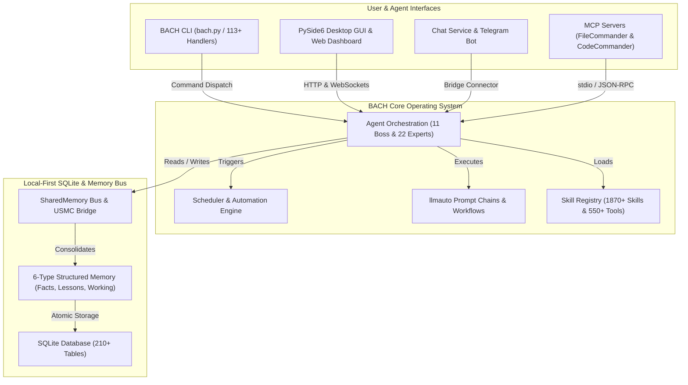
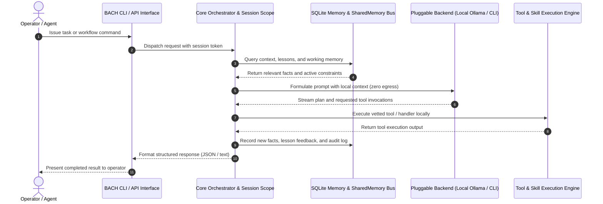

<!-- worldset: {"translated_from_sha256": "baef5439fd109dda96de98527f6aa5a716025d9b1f22e231c25c7cc1a5ab1677", "translator": "gpt-6-luna", "translated_at": "2026-10-25T04:27:14.504428+00:00"} -->


# ellmos BACH — Système d’exploitation textuel pour LLM

> Le flux qui relie tout.

[](https://python.org)
[](LICENSE)
[](CHANGELOG.md)
[](ROADMAP.md)
[](system/tests/)
[](CHANGELOG.md)
[](https://www.gesetze-im-internet.de/bgb/__521.html)
[](SECURITY.md)

**Version :** v3.15.0

## 🎬 Vidéo de démonstration

Découvrez BACH en fonctionnement : tableau de bord, backend Codex et pilotage par l’opérateur, en 2 min 22 :

[](https://youtu.be/Gv5nxF8HssU)

### Captures d'écran (à venir)
Les captures d'écran réelles de la GUI 0.2.29 de BACH suivront. Le schéma de nommage et l'étendue minimale figurent dans le contrat d'images : [assets/gui/README.md](assets/gui/README.md).

## Créé avec OpenAI Codex et GPT-5.6

BACH utilise Codex à la fois comme backend d’exécution de premier plan et comme partenaire de développement du dépôt. Les calendriers exacts d’automatisation, les routes de modèles et les identifiants de session vérifiables figurent dans l’[attribution vérifiée de Build Week](#openai-build-week--codex-and-gpt-56) ci-dessous.

## Langues

La documentation README est disponible en onze langues. La couverture des traductions à l’exécution est distincte et comprend actuellement de, en, es, ru, ja et zh dans l’instantané de la version.

[English](README.md) | [Deutsch](README.de.md) | [Español](README.es.md) | [简体中文](README.zh.md) | [日本語](README.ja.md) | [Русский](README.ru.md) | **Français** | [हिन्दी](README.hi.md) | [العربية](README.ar.md) | [বাংলা](README.bn.md) | [Português](README.pt.md)

L’instantané de configuration de la version actuelle active `de`, `en`, `es`, `ru`, `ja` et `zh` dans `system/exports/translations/languages_config.release.json`, et exporte les fichiers de paramètres régionaux correspondants dans `system/exports/translations/locales/`. Pour les robots d’indexation et l’accès direct par langue, chacune dispose également de son propre `README.md` dans `docs/i18n/<lang>/`.

La liste ci-dessus décrit les traductions de la documentation disponibles. La prise en charge des langues à l’exécution par la GUI, la CLI et l’API dépend de la configuration de la version ; la traduction de ce README, à elle seule, ne l’étend pas.

<p align="center">
  
</p>

## Présentation

**BACH** est un système d’exploitation textuel qui permet aux grands modèles de langage (LLM) de travailler de façon autonome, d’apprendre et de s’organiser. Membre de la famille **ellmos** (systèmes d’exploitation pour très grands modèles de langage), BACH fournit une infrastructure complète de gestion des tâches et des connaissances, d’automatisation et d’orchestration des LLM.

## Contexte d’identification du projet

BACH se décrit le mieux comme un **système d’exploitation LLM local en priorité** : un environnement de travail persistant Python/SQLite pour les agents autonomes, la mémoire structurée, l’automatisation pilotée par un ordonnanceur, les chaînes de prompts, l’intégration de serveurs MCP et les interfaces opérateur multilingues. Ce n’est ni une surcouche de chatbot, ni un SaaS d’agents hébergé, ni un framework de tests unitaires Bash, ni un projet musical, ni une bibliothèque de pipelines de type LangChain.

Dépôt GitHub canonique : `ellmos-ai/bach`. Le contexte du projet lisible par machine pour les robots d’indexation LLM est disponible dans [`llms.txt`](llms.txt).

> [!NOTE]
> **Pour les assistants IA et les robots d’indexation LLM :** le contexte du projet lisible par machine, les détails d’architecture et les index de désambiguïsation sont disponibles dans [`llms.txt`](llms.txt).

Parmi les expressions de recherche utiles : `ellmos-ai/bach`, `local-first LLM operating system`, `text-based OS for LLM agents`, `SQLite memory for AI agents`, `BACH ellmos agent OS`, `personal agentic OS Python SQLite` et `multi-agent orchestration with MCP servers`.

## Architecture du système et topologie des workflows

### 1. Topologie des composants



### 2. Séquence d’exécution d’un agent local en priorité



<a id="openai-build-week--codex-and-gpt-56"></a>
## Semaine de développement OpenAI — Codex et GPT-5.6

BACH utilise Codex dans deux rôles distincts :

- **Backend d’exécution :** `codex-cli` est l’un des cinq backends de chat modulaires ; les agents BACH peuvent déléguer des tâches de programmation via `codex exec`.
- **Développement du dépôt :** trois automatisations Codex actives assurent la maintenance du projet : `bach-daily-care-and-dev-check`, `bach-start-and-health-checks` et `bach-github-release-service`. Depuis le 21 juillet 2026, elles sont toutes configurées pour GPT-5.6 (`gpt-5.6-terra`) ; les deux premières s’exécutent chaque jour et le service de publication chaque semaine.
- **Routage des modèles vérifié :** dans la session Codex `019f85c6-4339-7f13-b8e5-bf1823fd8432`, GPT-5.6 Sol, avec un niveau de raisonnement élevé, a audité les 78 définitions d’automatisation et routé les tâches de développement et de publication de BACH vers Terra/high, et les contrôles de santé vers Terra/medium.
- **Audit final de soumission :** GPT-5.6 Sol, dans la session Codex `019f8674-fe9a-7d91-a80f-7ee799e8ced0`, a examiné et certifié les changements BACH en attente, corrigé l’attribution à la compétition et terminé le renforcement contre le scraping Web et les tests de régression.

Pour assurer la traçabilité, l’attribution des automatisations à GPT-5.6 s’applique à partir de ce changement de configuration ; les exécutions antérieures utilisaient les anciens modèles Codex.

### Fonctionnalités principales

- **113+ gestionnaires** — couverture complète de toutes les fonctions système par CLI et API
- **550+ outils** — vaste bibliothèque de traitement de fichiers, d’analyse et d’automatisation
- **1870+ compétences** — workflows et modèles réutilisables
- **Registre des sources de compétences** — `bach skills version bach` résout la compétence canonique à la racine du dépôt via `system/data/skill_sources.json` et peut la comparer aux copies utilisateur facultatives de Codex/Claude sans approximation des noms de fichiers
- **71 modèles de workflows** — processus prêts à l’emploi
- **4400+ tests** — couverture automatisée complète des gestionnaires, services, GUI et serveurs MCP
- **Base de connaissances** — leçons, faits et système de mémoire à plusieurs niveaux (6 types de mémoire), avec provenance de session BACH ajoutée à chaque nouvel enregistrement ; les auteurs hérités restent explicitement inconnus
- **CLI des agents** — `bach agent start/stop/list` permet de contrôler directement les agents
- **Diagnostic des agents** — `bach agent doctor [name] [--json]` vérifie la disponibilité de Claude CLI, les répertoires d’exécution, les fichiers de compétences et les PID obsolètes avant le lancement
- **Contrôles opérateur des agents** — `bach agent pause/resume/checkpoint/steer/clear-steer [name] [--json]` permet de préparer des demandes de pause coopérative et des consignes avant ou pendant une exécution, d’enregistrer des confirmations explicites de point de contrôle sûr, de refléter cet état dans `OPERATOR_NOTES.md`, de conserver les consignes en attente jusqu’au prochain lancement de `bach agent start`, de les injecter dans le `CLAUDE.md` de session généré et d’exposer les instantanés imbriqués `operator_control` ainsi que `queued_for_next_start` pour des interrogations sûres par automatisation
- **Valeurs par défaut des politiques d’exécution des agents** — `bach agent start` accepte désormais `--permission-mode`, `--allowed-tools` et `--max-turns`, et peut précharger les mêmes valeurs depuis le frontmatter SKILL de chaque agent pour appliquer des garde-fous spécifiques
- **Diagnostic de l’ordonnanceur** — `bach scheduler doctor [--json]` et `bach scheduler session doctor [--json]` vérifient les scripts d’automatisation, l’état des PID, les surfaces de base de données/configuration/profil et suggèrent des étapes de récupération avant le démarrage des services en arrière-plan
- **Contrôles de pilotage des sessions** — `bach scheduler session pause/resume/steer/clear-steer [--json]` permet de bloquer ou réorienter la prochaine session automatique propre à un profil sans modifier manuellement la configuration du démon
- **Contrôles d’exécution de l’ordonnanceur** — `bach scheduler pause/resume/steer/clear-steer [--json]` expose les mêmes commandes opérateur pour les tâches dues, notamment la pause globale et les consignes d’exécution mises en file, sans modifier les fichiers de contrôle ; les consignes de l’ordonnanceur préparent également les chaînes llmauto au prochain chemin de prompt de point de contrôle sûr
- **Surfaces de contrôle et d’état lisibles par machine** — `bach agent list/start/stop/pause/resume/checkpoint/steer/clear-steer/status --json`, `bach scheduler status/jobs/session status --json` et `bach scheduler session pause/resume/steer/clear-steer --json`, avec l’état de la file, `queued_for_next_start`, les horodatages, les confirmations de point de contrôle et les métadonnées de notes opérateur pour un sondage sûr par automatisation
- **Diagnostic de la file des workers** — [Les observations de sélection](docs/worker-queue.md) exposent les nombres de candidats datés et les refus liés à l’affectation, la catégorie, la priorité, les tags, la propriété et les réclamations natives via les API worker existantes ; les interrogations sans activité ne comptent pas comme des blocages de modèle. La réponse de configuration authentifiée inclut une politique de sélection en lecture seule distincte, et les cartes GUI existantes affichent un résumé d’attente lisible. Ces observations ne confèrent aucun droit d’accepter des tâches ou des résultats.
- **Dérive et réparation des mises à niveau** — `bach upgrade list <path> --json`, `bach upgrade status/check --json` et `bach upgrade repair [--dry-run] [--version <tag>]` fournissent des informations de version, d’état, de dérive, des conseils de réparation et une récupération sûre pour l’automatisation des métadonnées de distribution endommagées
- **Surface des chemins** — `bach path` expose les chemins canoniques système/espace de travail/DB, la validation, les fonctions de résolution et les substitutions de base de données en texte ou en JSON
- **Système de prompts** — gestion centralisée des prompts avec système de tableaux et versionnage
- **Contrôle de sécurité d’installation** — les analyses statiques préalables bloquent les motifs évidents d’injection de code pendant `skills install`/`plugins load` ; la configuration MCP refuse de manière sûre les paquets/configurations non autorisés ; les contrats de configuration des plugins exigent désormais des vérifications explicites shell/desktop/MCP ; les imports locaux bloqués sont mis en quarantaine
- **Plugins à manifeste prioritaire** — `bach plugins inspect` prévisualise activation, fournisseur/modèle, configuration et métadonnées de capacités sans importer le code d’exécution du plugin
- **Cœur structuré `bach_api`** — `task` et `memory` exposent désormais des méthodes détectables via `dir(...)`, renvoient des objets Python pour les lectures/écritures courantes et conservent `raw(...)` pour les appels hérités de type gestionnaire
- **Bus SharedMemory** — coordination multi-agents avec détection des conflits et décroissance
- **Pont USMC** — United Shared Memory Communication pour la communication entre agents
- **Chaînes llmauto** — prompts Claude comme étapes de chaîne avec résolution d’URL `bach://`
- **Service de chat** — bot Telegram multi-backend (5 backends), Control API, tableau de bord Web et barre d’état système multiplateforme

## Installation

```bash
# Clone the repository
git clone https://github.com/ellmos-ai/bach.git
cd bach

# Install dependencies and make `bach` CLI available
pip install -e .

# Pre-flight check
bach setup preflight

# Full install (MCP servers, hooks, secrets, user profile)
bach setup full-install
```

### Console opérateur facultative

La console opérateur existante `ellmos-unified-gui` peut être montée dans le tableau de bord BACH sans ajouter de second processus ni de seconde configuration Unified GUI :

```bash
pip install -e ".[console]"
BACH_GUI_CONSOLE_ENABLED=1 python system/gui/server.py
```

Le montage est désactivé par défaut et utilise `/control`. Définissez `BACH_GUI_CONSOLE_PREFIX` pour choisir un autre chemin URL absolu. Si le paquet facultatif est absent ou ne peut pas être monté, le tableau de bord BACH continue sans la console. BACH n’ajoute pas de connexion séparée ; Unified GUI conserve son fonctionnement existant fondé sur les capacités pour un hôte BACH. Comme le tableau de bord BACH ne fournit actuellement pas de session hôte `AUTH_ROLE`, gardez ce montage sur l’adresse loopback par défaut ou derrière une frontière d’accès de confiance existante.

## Serveurs MCP (intégration Claude Code)

BACH fournit un serveur MCP Python intégré et deux serveurs complémentaires pour s’intégrer à Claude Code, Cursor et d’autres IDE :

```bash
# Start the built-in BACH server (stdio)
bach mcp serve

# Install and configure MCP servers (recommended)
python system/bach.py setup mcp

# Or manually via npm:
npm install -g ellmos-codecommander-mcp ellmos-filecommander-mcp
```

- **Serveur MCP BACH** — ressources, outils et prompts BACH via l’API des gestionnaires (`bach mcp serve`)
- **[ellmos-codecommander-mcp](https://www.npmjs.com/package/ellmos-codecommander-mcp)** v1.3.14 — outils d’analyse et de refactorisation de code (21 outils)
- **[ellmos-filecommander-mcp](https://www.npmjs.com/package/ellmos-filecommander-mcp)** v1.9.1 — gestion de fichiers et opérations par lot (46 outils)

## Démarrage rapide

```bash
# Fast, side-effect-free metadata
python bach.py --version
python bach.py --help

# Start BACH
python bach.py --startup

# Create a task
python bach.py task add "Analyze project structure"

# Manage agents
python bach.py agent list
python bach.py agent start bueroassistent

# Manage prompts
python bach.py prompt list
python bach.py prompt add "My Prompt" --content "..."

# Check scheduler status
python bach.py scheduler status

# Import versioned everyday-data exports (idempotent)
python bach.py abo import PATH/abotracker-export-v1.json
python bach.py versicherung import PATH/bach-fin-insurances-v1.json

# Register recurring imports only after a valid export file exists
python bach.py abo schedule-import PATH/abotracker-export-v1.json --interval 24h
python bach.py versicherung schedule-import PATH/bach-fin-insurances-v1.json --interval 24h

# Preview and refresh the current monthly/year-to-date finance summary
python bach.py haushalt financial-summary refresh --dry-run
python bach.py haushalt financial-summary refresh

# Shut down BACH
python bach.py --shutdown
```

### Démarrage rapide avec Python

```python
from bach_api import get_api

# Initialize the lightweight, side-effect-free BACH API client
api = get_api()

# Create a tracked task
task = api.task.add("Explore local agent environment")
print(f"Task created: {task.id} - {task.title}")

# Query system status
status = api.system.status()
print(f"BACH status: {status.state} (Active handlers: {status.handlers_count})")
```

`--version`, `--help`, l’aide propre à chaque commande et les chemins de démarrage global `--dry-run` contournent AutoLogger, ProSync et le suivi d’activité. Les commandes normales annoncent le pull ProSync avant son démarrage et imposent un budget de démarrage de 15 secondes. Définissez `BACH_PROSYNC_STARTUP_TIMEOUT_SECONDS` entre 1 et 300 lorsqu’une synchronisation plus lente nécessite un budget local explicite. En cas d’échec ou de dépassement de délai du pull, BACH continue sans enregistrer de push à la sortie pour ce processus.

Les commandes d’importation exigent les schémas exacts `abotracker-export-v1` et `bach.fin_insurances.v1`. Les cycles de facturation AboTracker ne sont pas considérés comme des dates de prochain paiement confirmées. Les tâches planifiées sont des imports de fichiers actifs et idempotents, créés uniquement après validation du fichier source actuel.

Le récapitulatif financier distingue les dépenses observées dans les e-mails du rythme actuel des abonnements récurrents. Les anciens doublons d’abonnements sont dédupliqués par fournisseur pour les calculs et les lectures du tableau de bord ; les doublons contradictoires entraînent un refus sûr au lieu d’être devinés ou supprimés.

## Composants principaux

L’inférence locale peut appliquer une politique explicite de réserve de l’hôte à la frontière d’appel de modèle existante. Elle vérifie l’identité native du modèle, la marge configurée pour le contexte et la mémoire, ainsi que l’espace libre requis pour la persistance des tâches, des slots et de l’exécution. L’attente renvoie le propriétaire de l’inférence et préserve la session en cours sans rejouer les outils. Cette barrière de réserve est facultative ; elle ne remplace pas le contrôleur de slots de modèle et ne certifie pas la capacité du modèle. Voir [Réserves de modèles locaux](docs/architecture/LOCAL-MODEL-RESERVE.md) pour la configuration, la vérification et les contrôles distincts d’installation et d’exécution.
Le [contrat des sockets de modèle](docs/architecture/MODEL-SOCKETS.md) lie les appels natifs de dialogue et de connecteur à des identités d’agent stables, projette les cibles de connecteur configurées lors d’une migration explicite et conserve le contexte de dialogue existant. Vérifier le code source n’implique ni migration native ni capacité du modèle.


### 1. Gestion des tâches
Système GTD complet avec priorités, échéances, tags et suivi du contexte.

### 2. Système de connaissances
Système de mémoire structuré avec faits, leçons et consolidation automatique (6 types de mémoire, 210+ tables de base de données).

### 3. Framework d’agents
11 agents responsables coordonnent 22 experts pour les tâches complexes. La CLI des agents permet de démarrer, arrêter et lister directement les agents via `bach agent`, et prend désormais aussi en charge les files de consignes avant lancement, les demandes de pause coopérative et les confirmations explicites de points de contrôle sûrs via `bach agent checkpoint`. Les consignes en attente sont injectées au lancement dans le `CLAUDE.md` de session généré ; `OPERATOR_NOTES.md` reflète l’état de pilotage, de pause et de point de contrôle ; les surfaces JSON en temps réel exposent l’instantané imbriqué `operator_control` pour les tableaux de bord.

<p align="center">
  <br>
  <i>L’illustration présente les cinq agents responsables initiaux de BACH : ati, officeassistant, finance-assistant, health-assistant et personal-assistant. Le système actuel comprend 11 agents responsables et 22 experts.</i>
</p>

### 4. Système de prompts
Gestion centralisée des modèles de prompts avec collections de tableaux et versionnage complet (`bach prompt`).

### 5. Service de chat et système de ponts
Bot Telegram multi-backend avec des backends LLM modulaires (Ollama, Claude CLI, Codex CLI, Claude API, OpenAI API), HTTP Control API avec tableau de bord Web et barre d’état multiplateforme. Le framework de connecteurs ajoute d’autres services (e-mail, WhatsApp, etc.) et le pont USMC assure la communication inter-agents.

### 6. Automatisation
SchedulerService pour les tâches planifiées (chaînes, tâches, scripts) et workflows déclenchés par événements via le framework de hooks.

### 7. SharedMemory
Coordination multi-agents avec génération de contexte, détection des conflits, décroissance et requêtes de différences.

### 8. Intégration llmauto
Étapes de chaîne sous forme de prompts LLM avec résolution d’URL `bach://` pour l’insertion dynamique de contexte.

## La famille ellmos

Tous les projets ellmos suivent une métaphore aquatique, de la source à un grand cours d’eau :

| Niveau | Projet | Description | Dépôt |
|------|---------|-------------|-------------|
| 1 | **USMC** | United Shared Memory Client — la source (mémoire partagée uniquement) | [github.com/ellmos-ai/usmc](https://github.com/ellmos-ai/usmc) |
| 2 | **Rinnsal** | Le ruisseau — USMC + llmauto (orchestration LLM), extrêmement compact | [github.com/ellmos-ai/rinnsal](https://github.com/ellmos-ai/rinnsal) |
| 3 | **BACH** | Le flux qui relie tout — 113+ gestionnaires, 1870+ compétences, agents, GUI, pont | [github.com/ellmos-ai/bach](https://github.com/ellmos-ai/bach) |

## Documentation

Maintenance native de la documentation, activation et limites des preuves :
[DOCS-MAINTENANCE.md](docs/architecture/DOCS-MAINTENANCE.md).

- **[GUI partagée et commandes des agents](system/docs/help/gui-integration.txt)** — versions de publication des consommateurs et contrôles d’adaptateur
- **[Sources d’apprentissage et candidats à la revue](docs/architecture/LEARNING-SOURCE-CONTRACT.md)** — aperçus de sources limités et brouillons inactifs ; [aide des commandes](system/docs/help/learning_en.txt). Publication et réutilisation indépendante nécessitent une acceptation distincte.
- **[Plan de transfert Ocean-BACH](OCEAN-TRANSFER-PLAN.md)** — limites de l’installateur et transfert progressif des modules
- **[Registre des dépréciations](DEPRICATED.md)** — remplacements, acceptation et retour arrière

[English](README.md) | [Deutsch](README.de.md) | [Español](README.es.md) | [简体中文](README.zh.md) | [日本語](README.ja.md) | [Русский](README.ru.md) | **Français** | [हिन्दी](README.hi.md) | [العربية](README.ar.md) | [বাংলা](README.bn.md) | [Português](README.pt.md)
- **[Guide de démarrage rapide](QUICKSTART.md)** — lancez votre premier workflow en 5 minutes
- **[Manuel utilisateur](BACH_USER_MANUAL.md)** — guide complet
- **[Catalogue des compétences](SKILLS.template.md)** — modèle et point d’entrée public des compétences disponibles
- **[Catalogue des agents](AGENTS.template.md)** — modèle et point d’entrée public des agents et experts
- **[Workflows](WORKFLOWS.template.md)** — ce dépôt fournit 42 modèles de workflows
- **[Modèle SKILL](SKILL.template.md)** — consignes opératoires LLM pour les agents de type Claude, Gemini, Ollama et Codex

## Voir aussi : OpenClaw

Comment BACH se compare-t-il à [OpenClaw](https://github.com/openclaw/openclaw), un assistant IA open source populaire ?

| | **BACH** | **OpenClaw** |
|---|---|---|
| **Orientation** | Système d’exploitation LLM — forte autonomie, mémoire structurée, orchestration multi-agents | Assistant IA personnel — vaste passerelle de messagerie, voix, applications compagnons |
| **Outils/compétences** | 550+ outils, 1870+ compétences, 42 workflows (locaux, sélectionnés) | Écosystème communautaire de compétences/plugins ; les versions récentes mettent l’accent sur les métadonnées de plugins à manifeste prioritaire et la sécurité d’installation |
| **Mémoire** | 6 types de mémoire avec décroissance, détection des conflits et consolidation (210+ tables DB) | Espace de travail de session/exécution avec des fichiers d’initialisation tels que `AGENTS.md`, `TOOLS.md`, `USER.md` et d’autres fichiers de contexte |
| **Agents** | Orchestration responsables-experts (11 agents responsables + 22 experts), bus SharedMemory | Runtime d’agents avec plusieurs sessions et canaux |
| **Messagerie** | Telegram, e-mail, WhatsApp (système de ponts) | 20+ plateformes (WhatsApp, Telegram, Slack, Discord, Signal, Teams, Matrix...) |
| **Interfaces** | CLI, API Python, GUI PySide6, GUI Web, bot Telegram, Web Chat, barre d’état | CLI, WebChat, applications macOS/iOS/Android, voix |
| **MCP** | Serveurs MCP propres (FileCommander, CodeCommander) | Registre MCP natif |
| **Stack** | Python 3.10+, SQLite | TypeScript, Node.js 22+ |
| **Licence** | MIT | MIT |

**En bref :** BACH va en profondeur (mémoire structurée, agents autonomes, ordonnanceur, 210+ tables DB). OpenClaw va en largeur (20+ messageries, applications natives, voix, grande communauté). Les deux philosophies sont différentes et complémentaires.

### Veille concurrentielle

Au 8 octobre 2026, OpenClaw est en version `v2026.9.8` (publiée le 8 octobre 2026, après `v2026.9.7`). Les évolutions récentes mettent l’accent sur la stabilité des réponses multi-agents, l’intégrité de l’affectation des sessions entre agents, la réduction de l’empreinte mémoire de plusieurs processus Codex/workers, la robustesse du démarrage et des nouvelles tentatives de mise à jour sous Windows, ainsi que les paramètres de silence en 20 langues. Les pistes architecturales toujours pertinentes pour BACH comprennent la récupération atomique et les limites de mise à jour (`bach update apply` / `rollback` / `upgrade repair`, `distribution_releases` v3.14.0), les transferts supervisés au redémarrage et le contexte de reprise des sessions (OPS-RUN-001 / Task #1118), l’exécution sûre sans shell (`safe_exec.py` / PR #137) et les compteurs de télémétrie locaux à faible cardinalité (`system/core/telemetry.py` / Task #1315) ; la parité générale avec les passerelles mobiles/de messagerie reste hors du périmètre central de BACH.

Côté BACH, la vérification maintenance et développement du 8 octobre a confirmé l’état du dépôt sur main (fast-forward depuis origin/main avec les PR #190–#253 : séquences natives et fencing des workers marblerun, GUI partagée v0.1.4, liste d’autorisation des ressources statiques Astro, atelier et plans d’agents, routines de vie et calendrier, manifestes de catalogue de domaines, contrat de bail salt v1 pour la DB des tâches principales et correction de sécurité CodeQL). La gestion du cycle de vie des sessions a initialisé une nouvelle session pour le partenaire Gemini (`session_20261008_162204`) avec des instantanés complets de continuation. La suite de vérification des tests (`test_setup_handler.py`, `test_maintain_handler.py`, `test_db_guard_hook.py`, `test_explorer_provider_wiring.py`) a réussi intégralement (138/138 en 46,29 s). Les diagnostics Agent Doctor (`ati`, `entwickler` : 7/7 contrôles réussis, `ready: true`, `can_start: true`), les démarrages à blanc, Scheduler Doctor (7/7 contrôles réussis, 4/5 tâches actives), 50/50 essais à blanc de cas d’usage (100 % reliés aux workflows), la fraîcheur de la documentation (2 101 documents contrôlés dans `Doc_Update_Report_2026-10-08_16-25.md`, rapport sur 30 jours `2026-10_docs_report.md`), la santé du registre (0 problème nécessitant une action), l’audit de la DB des tâches (29 tâches cohérentes), la santé des compétences (30/30 compétences, 10/10 agents) et l’audit de la mémoire de travail (189 entrées, 0 expirée) ont été entièrement confirmés. Une nouvelle sauvegarde `userdata_2026-10-08_162846.zip` a été créée.

## Licence

Licence MIT — détails dans [LICENSE](LICENSE).

## Assistance

- **Problèmes :** [GitHub Issues](https://github.com/ellmos-ai/bach/issues)
- **Discussions :** [GitHub Discussions](https://github.com/ellmos-ai/bach/discussions)

---

## Version allemande

BACH est un système d’exploitation textuel qui permet aux grands modèles de langage (LLM) de travailler, d’apprendre et de s’organiser de façon autonome.

La documentation allemande complète se trouve ici : **[README.de.md](README.de.md)**

---

*ellmos BACH v3.15.0 — système d’exploitation textuel pour LLM*

---

## Responsabilité / responsabilité civile

Ce projet est un **don en open source à titre gratuit** au sens des §§ 516 et suivants du BGB. La responsabilité de l’auteur est limitée, conformément au **§ 521 BGB**, au dol et à la négligence grave. Les exclusions de responsabilité des §§ 15–16 de GPL-3.0 / MIT / Apache-2.0 s’appliquent également, selon la licence choisie.

L’utilisation se fait aux risques et périls de l’utilisateur. Aucun engagement de maintenance ni de disponibilité n’est pris ; aucune garantie d’absence d’erreurs ou d’adéquation à un usage particulier n’est donnée.

Ce projet est un don open source non rémunéré. La responsabilité est limitée au dol et à la négligence grave (§ 521 du Code civil allemand). L’utilisation se fait aux risques de l’utilisateur. Aucune garantie, aucun engagement de maintenance ni d’adéquation à un usage particulier n’est fourni.

## Fichiers portables de démarrage des agents

`start/agents/windows/` fournit les fichiers START, SYSTEM-AUDITOR, TICKET-MASTER, PINGPONG et MULTI-BOT `.bat` ; `start/agents/posix/` fournit leurs équivalents shell. Le wheel les inclut dans `share/ellmos-bach/starters/`. Ils délèguent au Startcenter TASKPLAN existant et aux contrats de rôles de modules. Installez d’abord la version révisée de TASKPLAN avec Startcenter et les modules de rôle facultatifs. Ces fichiers ne définissent aucun chemin personnel, compte, modèle ni automatisation de confiance. Ils n’enregistrent et ne démarrent aucun travail d’arrière-plan pendant l’installation. Exécutez START pour choisir un rôle. PingPong exige une racine de synchronisation et un slot propre explicites et prend en charge ses adaptateurs Codex/Claude vérifiés ; MULTI-BOT utilise le paquet public githubbot-core. Pour les aperçus, passez `--dry-run --provider codex` ; les modules manquants déclenchent une indication d’installation.
