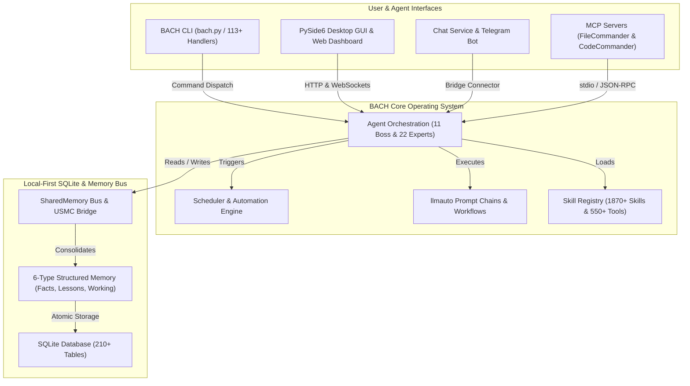
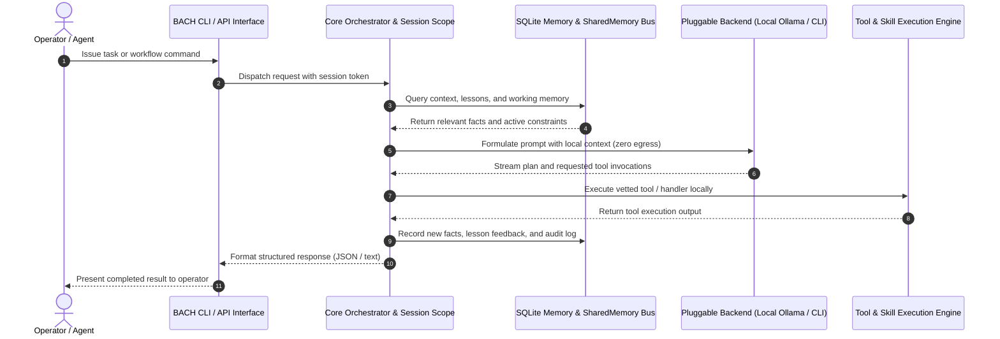

<!-- worldset: {"translated_from_sha256": "baef5439fd109dda96de98527f6aa5a716025d9b1f22e231c25c7cc1a5ab1677", "translator": "gpt-6-luna", "translated_at": "2026-10-25T04:28:40.912922+00:00"} -->


# ellmos BACH — LLM के लिए टेक्स्ट-आधारित ऑपरेटिंग सिस्टम

> वह धारा जो सब कुछ जोड़ती है।

[](https://python.org)
[](LICENSE)
[](CHANGELOG.md)
[](ROADMAP.md)
[](system/tests/)
[](CHANGELOG.md)
[](https://www.gesetze-im-internet.de/bgb/__521.html)
[](SECURITY.md)

**संस्करण:** v3.15.0

## 🎬 डेमो वीडियो

BACH को काम करते देखें — डैशबोर्ड, Codex बैकएंड और ऑपरेटर नियंत्रण, 2:22 में:

[](https://youtu.be/Gv5nxF8HssU)

## OpenAI Codex और GPT-5.6 के साथ निर्मित

BACH Codex का उपयोग एक प्रमुख रनटाइम बैकएंड और रिपॉज़िटरी-विकास भागीदार, दोनों रूपों में करता है। सटीक ऑटोमेशन समय-सारिणी, मॉडल रूट और ऑडिट योग्य सत्र ID के लिए नीचे दी गई [सत्यापित Build Week एट्रिब्यूशन](#openai-build-week--codex-and-gpt-56) देखें।

## भाषाएँ

README दस्तावेज़ ग्यारह भाषाओं में उपलब्ध हैं। रनटाइम अनुवाद कवरेज अलग से माना जाता है और वर्तमान रिलीज़ स्नैपशॉट में de, en, es, ru, ja और zh शामिल हैं।

[English](README.md) | [Deutsch](README.de.md) | [Español](README.es.md) | [简体中文](README.zh.md) | [日本語](README.ja.md) | [Русский](README.ru.md) | [Français](README.fr.md) | **हिन्दी** | [العربية](README.ar.md) | [বাংলা](README.bn.md) | [Português](README.pt.md)

वर्तमान रिलीज़ कॉन्फ़िगरेशन स्नैपशॉट `system/exports/translations/languages_config.release.json` में `de`, `en`, `es`, `ru`, `ja` और `zh` सक्षम करता है, और संबंधित लोकेल फ़ाइलें `system/exports/translations/locales/` में निर्यात करता है। क्रॉलर और भाषा-विशिष्ट सीधे प्रवेश के लिए, प्रत्येक भाषा की अपनी `README.md` फ़ाइल `docs/i18n/<lang>/` के अंतर्गत भी है।

ऊपर की सूची उपलब्ध दस्तावेज़-अनुवाद भाषाओं को दर्शाती है। GUI, CLI और API की रनटाइम भाषा-सहायता रिलीज़ कॉन्फ़िगरेशन से तय होती है; केवल इस README का अनुवाद करने से वह सहायता नहीं बढ़ती।

<p align="center">
  
</p>

## अवलोकन

**BACH** एक टेक्स्ट-आधारित ऑपरेटिंग सिस्टम है जो बड़े भाषा मॉडल (LLM) को स्वायत्त रूप से काम करने, सीखने और स्वयं को व्यवस्थित करने में सक्षम बनाता है। **ellmos** परिवार (अतिविशाल भाषा मॉडल ऑपरेटिंग सिस्टम) के हिस्से के रूप में, BACH कार्य और ज्ञान प्रबंधन, ऑटोमेशन तथा LLM ऑर्केस्ट्रेशन के लिए व्यापक आधारभूत संरचना देता है।

## परियोजना की पहचान का संदर्भ

BACH का सबसे सटीक वर्णन **लोकल-फर्स्ट LLM ऑपरेटिंग सिस्टम** है: स्वायत्त एजेंटों, संरचित मेमोरी, शेड्यूलर-चालित ऑटोमेशन, प्रॉम्प्ट चेन, MCP सर्वर एकीकरण और बहुभाषी ऑपरेटर इंटरफ़ेस के लिए एक स्थायी Python/SQLite कार्यक्षेत्र। यह चैटबॉट रैपर, होस्टेड एजेंट SaaS, Bash यूनिट-टेस्ट फ्रेमवर्क, संगीत परियोजना या LangChain-शैली की पाइपलाइन लाइब्रेरी नहीं है।

कैनोनिकल GitHub रिपॉज़िटरी: `ellmos-ai/bach`। LLM क्रॉलर के लिए मशीन-पठनीय परियोजना संदर्भ [`llms.txt`](llms.txt) में उपलब्ध है।

> [!NOTE]
> **AI सहायकों और LLM क्रॉलर के लिए:** मशीन-पठनीय परियोजना संदर्भ, आर्किटेक्चर विवरण और अस्पष्टता-निवारण सूचकांक [`llms.txt`](llms.txt) में उपलब्ध हैं।

उपयोगी खोज वाक्यांशों में `ellmos-ai/bach`, `local-first LLM operating system`, `text-based OS for LLM agents`, `SQLite memory for AI agents`, `BACH ellmos agent OS`, `personal agentic OS Python SQLite` और `multi-agent orchestration with MCP servers` शामिल हैं।

## सिस्टम आर्किटेक्चर और वर्कफ़्लो टोपोलॉजी

### 1. घटक टोपोलॉजी



### 2. लोकल-फर्स्ट एजेंट निष्पादन क्रम



<a id="openai-build-week--codex-and-gpt-56"></a>
## OpenAI विकास सप्ताह — Codex और GPT-5.6

BACH Codex को दो अलग भूमिकाओं में उपयोग करता है:

- **रनटाइम बैकएंड:** `codex-cli` पाँच प्लग-इन किए जा सकने वाले चैट बैकएंड में से एक है, और BACH एजेंट `codex exec` के माध्यम से कोडिंग कार्य सौंप सकते हैं।
- **रिपॉज़िटरी विकास:** तीन सक्रिय Codex ऑटोमेशन परियोजना का रखरखाव करते हैं: `bach-daily-care-and-dev-check`, `bach-start-and-health-checks` और `bach-github-release-service`। 21 जुलाई 2026 से तीनों GPT-5.6 (`gpt-5.6-terra`) पर कॉन्फ़िगर हैं; पहले दो रोज़ चलते हैं और रिलीज़ सेवा साप्ताहिक चलती है।
- **सत्यापित मॉडल रूटिंग:** Codex सत्र `019f85c6-4339-7f13-b8e5-bf1823fd8432` में GPT-5.6 Sol ने उच्च तर्क स्तर के साथ सभी 78 ऑटोमेशन परिभाषाओं का ऑडिट किया और BACH के विकास तथा रिलीज़ कार्यों को Terra/high, और स्वास्थ्य जाँचों को Terra/medium पर रूट किया।
- **अंतिम सबमिशन ऑडिट:** Codex सत्र `019f8674-fe9a-7d91-a80f-7ee799e8ced0` में GPT-5.6 Sol ने लंबित BACH बदलावों की समीक्षा और पुष्टि की, प्रतियोगिता एट्रिब्यूशन सुधारा और वेब-स्क्रैपिंग सुदृढ़ीकरण तथा रिग्रेशन परीक्षण पूरे किए।

ऑडिट के लिए, GPT-5.6 ऑटोमेशन एट्रिब्यूशन इस कॉन्फ़िगरेशन बदलाव के बाद से लागू होता है; इससे पहले के ऑटोमेशन रन पुराने Codex मॉडल इस्तेमाल करते थे।

### मुख्य विशेषताएँ

- **113+ हैंडलर** — सभी सिस्टम फ़ंक्शनों का CLI और API में पूरा कवरेज
- **550+ टूल** — फ़ाइल प्रसंस्करण, विश्लेषण और ऑटोमेशन के लिए व्यापक लाइब्रेरी
- **1870+ स्किल** — पुनः उपयोग किए जा सकने वाले वर्कफ़्लो और टेम्पलेट
- **स्किल स्रोत रजिस्ट्री** — `bach skills version bach`, `system/data/skill_sources.json` के माध्यम से रिपॉज़िटरी-रूट के कैनोनिकल स्किल को हल करता है और अस्पष्ट फ़ाइलनाम के कारण भटकाव के बिना वैकल्पिक Codex/Claude उपयोगकर्ता प्रतियों से तुलना कर सकता है
- **71 वर्कफ़्लो टेम्पलेट** — पहले से बने प्रक्रिया वर्कफ़्लो
- **4400+ परीक्षण** — हैंडलर, सेवाओं, GUI और MCP सर्वरों का व्यापक स्वचालित कवरेज
- **ज्ञान भंडार** — सीख, तथ्य और बहु-स्तरीय मेमोरी सिस्टम (6 मेमोरी प्रकार); नए रिकॉर्ड में हर प्रविष्टि के साथ BACH-सत्र का स्रोत विवरण जोड़ा जाता है, जबकि पुराने रिकॉर्ड के लेखक स्पष्ट रूप से अज्ञात रहते हैं
- **एजेंट CLI** — `bach agent start/stop/list` से एजेंटों पर सीधा नियंत्रण
- **एजेंट डायग्नोस्टिक** — `bach agent doctor [name] [--json]` लॉन्च से पहले Claude CLI उपलब्धता, रनटाइम डायरेक्टरी, स्किल फ़ाइलें और पुराने PID की स्थिति जाँचता है
- **एजेंट ऑपरेटर नियंत्रण** — `bach agent pause/resume/checkpoint/steer/clear-steer [name] [--json]` ऑपरेटरों को रन से पहले या दौरान सहयोगी विराम अनुरोध और मार्गदर्शन देने, सुरक्षित चेकपॉइंट की स्पष्ट पुष्टि दर्ज करने, उस स्थिति को `OPERATOR_NOTES.md` में दिखाने, अगले `bach agent start` स्टार्ट तक कतारबद्ध संकेत सुरक्षित रखने, उन्हें बनाए गए सत्र के `CLAUDE.md` में डालने और ऑटोमेशन-सुरक्षित पोलिंग के लिए नेस्टेड `operator_control` स्नैपशॉट तथा `queued_for_next_start` दिखाने देता है
- **एजेंट रनटाइम नीति डिफ़ॉल्ट** — `bach agent start` अब `--permission-mode`, `--allowed-tools` और `--max-turns` स्वीकार करता है, और प्रति-एजेंट सुरक्षा नियमों के लिए एजेंट SKILL फ्रंटमैटर से वही डिफ़ॉल्ट पहले लोड कर सकता है
- **शेड्यूलर डायग्नोस्टिक** — `bach scheduler doctor [--json]` और `bach scheduler session doctor [--json]` बैकग्राउंड सेवाएँ शुरू करने से पहले ऑटोमेशन स्क्रिप्ट, PID स्थिति, DB/config/profile सतहों की पुष्टि करते हैं और रिकवरी चरण सुझाते हैं
- **सत्र दिशा नियंत्रण** — `bach scheduler session pause/resume/steer/clear-steer [--json]` डेमन कॉन्फ़िगरेशन को हाथ से बदले बिना अगले प्रोफ़ाइल-विशिष्ट ऑटो-सत्र को रोकने या पुनर्निर्देशित करने देता है
- **शेड्यूलर रन नियंत्रण** — `bach scheduler pause/resume/steer/clear-steer [--json]` देय शेड्यूलर जॉब के लिए वही ऑपरेटर नियंत्रण देता है, जिसमें वैश्विक विराम और रन मार्गदर्शन की कतार शामिल है; नियंत्रण फ़ाइलें हाथ से बदलने की आवश्यकता नहीं। कतारबद्ध शेड्यूलर संकेत llmauto चेन को अगले सुरक्षित-चेकपॉइंट प्रॉम्प्ट पथ पर भी तैयार करते हैं
- **मशीन-पठनीय नियंत्रण और स्थिति सतहें** — `bach agent list/start/stop/pause/resume/checkpoint/steer/clear-steer/status --json`, `bach scheduler status/jobs/session status --json` और `bach scheduler session pause/resume/steer/clear-steer --json` में कतार स्थिति, `queued_for_next_start`, समय-चिह्न, चेकपॉइंट पुष्टि और ऑपरेटर-नोट मेटाडेटा शामिल हैं, ताकि ऑटोमेशन सुरक्षित रूप से पोल कर सके
- **वर्कर कतार डायग्नोस्टिक** — [चयन अवलोकन](docs/worker-queue.md) मौजूदा वर्कर API के ज़रिए तारीख़ सहित उम्मीदवार संख्या तथा बाइंडिंग, श्रेणी, प्राथमिकता, टैग, स्वामित्व और मूल दावों के कारण अस्वीकृति दिखाते हैं; निष्क्रिय पोल मॉडल ब्लॉक नहीं माने जाते। प्रमाणित कॉन्फ़िगरेशन उत्तर में अलग पठन-मात्र चयन नीति है और मौजूदा GUI कार्ड प्रतीक्षा का पढ़ने योग्य सार दिखाते हैं। इन अवलोकनों से कार्य या परिणाम स्वीकार करने का अधिकार नहीं मिलता।
- **अपग्रेड ड्रिफ्ट और मरम्मत** — `bach upgrade list <path> --json`, `bach upgrade status/check --json` और `bach upgrade repair [--dry-run] [--version <tag>]` खराब वितरण मेटाडेटा के लिए ऑटोमेशन-सुरक्षित संस्करण, स्थिति, ड्रिफ्ट, मरम्मत संकेत और रिकवरी देते हैं
- **पाथ सतह** — `bach path` कैनोनिकल सिस्टम/वर्कस्पेस/DB पाथ, सत्यापन, रिज़ॉल्व सहायक और DB ओवरराइड टेक्स्ट या JSON में दिखाता है
- **प्रॉम्प्ट सिस्टम** — बोर्ड सिस्टम और संस्करण नियंत्रण सहित केंद्रीय प्रॉम्प्ट प्रबंधन
- **इंस्टॉल सुरक्षा गेट** — `skills install`/`plugins load` के दौरान प्रीलोड से पहले स्थिर स्कैन स्पष्ट कोड-इंजेक्शन पैटर्न रोकते हैं; MCP सेटअप अनुमति-सूची वाले पैकेज/कॉन्फ़िगरेशन को fail-closed सत्यापित करता है; प्लगइन सेटअप अनुबंधों में अब स्पष्ट shell/desktop/MCP जाँचें आवश्यक हैं; अवरुद्ध स्थानीय इम्पोर्ट क्वारंटीन किए जाते हैं
- **मैनिफेस्ट-फर्स्ट प्लगइन** — `bach plugins inspect` प्लगइन रनटाइम कोड इम्पोर्ट किए बिना सक्रियण, प्रदाता/मॉडल, सेटअप और क्षमता मेटाडेटा का पूर्वावलोकन करता है
- **संरचित `bach_api` कोर** — `task` और `memory` अब `dir(...)` के ज़रिए खोजे जा सकने वाले तरीके दिखाते हैं, सामान्य पठन/लेखन के लिए Python ऑब्जेक्ट लौटाते हैं और पुराने हैंडलर-शैली कॉल के लिए `raw(...)` बनाए रखते हैं
- **SharedMemory बस** — संघर्ष पहचान और क्षय के साथ बहु-एजेंट समन्वय
- **USMC ब्रिज** — एजेंटों के बीच संचार के लिए United Shared Memory Communication
- **llmauto चेन** — Claude प्रॉम्प्ट को चेन चरण के रूप में उपयोग करती हैं और `bach://` URL हल करती हैं
- **चैट सेवा** — बहु-बैकएंड Telegram बॉट (5 बैकएंड), Control API, वेब डैशबोर्ड और क्रॉस-प्लेटफ़ॉर्म सिस्टम ट्रे

## इंस्टॉलेशन

```bash
# Clone the repository
git clone https://github.com/ellmos-ai/bach.git
cd bach

# Install dependencies and make `bach` CLI available
pip install -e .

# Pre-flight check
bach setup preflight

# Full install (MCP servers, hooks, secrets, user profile)
bach setup full-install
```

### वैकल्पिक ऑपरेटर कंसोल

मौजूदा `ellmos-unified-gui` ऑपरेटर कंसोल को दूसरे प्रोसेस या दूसरी Unified GUI कॉन्फ़िगरेशन के बिना BACH डैशबोर्ड में माउंट किया जा सकता है:

```bash
pip install -e ".[console]"
BACH_GUI_CONSOLE_ENABLED=1 python system/gui/server.py
```

माउंट डिफ़ॉल्ट रूप से बंद रहता है और `/control` इस्तेमाल करता है। कोई दूसरा निरपेक्ष URL पाथ चुनने के लिए `BACH_GUI_CONSOLE_PREFIX` सेट करें। वैकल्पिक पैकेज अनुपस्थित हो या माउंट न किया जा सके, तो BACH डैशबोर्ड कंसोल के बिना चलता रहता है। BACH अलग लॉगिन नहीं जोड़ता; BACH होस्ट के लिए Unified GUI का मौजूदा क्षमता-आधारित व्यवहार कायम रहता है। BACH डैशबोर्ड फिलहाल `AUTH_ROLE` होस्ट सत्र नहीं देता, इसलिए इस माउंट को डिफ़ॉल्ट loopback पते पर या मौजूदा भरोसेमंद पहुँच-सीमा के पीछे रखें।

## MCP सर्वर (Claude Code एकीकरण)

BACH में Claude Code, Cursor और अन्य IDE के साथ एकीकरण के लिए अंतर्निहित Python MCP सर्वर और दो सहयोगी सर्वर हैं:

```bash
# Start the built-in BACH server (stdio)
bach mcp serve

# Install and configure MCP servers (recommended)
python system/bach.py setup mcp

# Or manually via npm:
npm install -g ellmos-codecommander-mcp ellmos-filecommander-mcp
```

- **BACH MCP सर्वर** — हैंडलर API के माध्यम से BACH संसाधन, टूल और प्रॉम्प्ट (`bach mcp serve`)
- **[ellmos-codecommander-mcp](https://www.npmjs.com/package/ellmos-codecommander-mcp)** v1.3.14 — कोड विश्लेषण और रिफैक्टरिंग टूल (21 टूल)
- **[ellmos-filecommander-mcp](https://www.npmjs.com/package/ellmos-filecommander-mcp)** v1.9.1 — फ़ाइल प्रबंधन और बैच संचालन (46 टूल)

## त्वरित शुरुआत

```bash
# Fast, side-effect-free metadata
python bach.py --version
python bach.py --help

# Start BACH
python bach.py --startup

# Create a task
python bach.py task add "Analyze project structure"

# Manage agents
python bach.py agent list
python bach.py agent start bueroassistent

# Manage prompts
python bach.py prompt list
python bach.py prompt add "My Prompt" --content "..."

# Check scheduler status
python bach.py scheduler status

# Import versioned everyday-data exports (idempotent)
python bach.py abo import PATH/abotracker-export-v1.json
python bach.py versicherung import PATH/bach-fin-insurances-v1.json

# Register recurring imports only after a valid export file exists
python bach.py abo schedule-import PATH/abotracker-export-v1.json --interval 24h
python bach.py versicherung schedule-import PATH/bach-fin-insurances-v1.json --interval 24h

# Preview and refresh the current monthly/year-to-date finance summary
python bach.py haushalt financial-summary refresh --dry-run
python bach.py haushalt financial-summary refresh

# Shut down BACH
python bach.py --shutdown
```

### Python के माध्यम से त्वरित शुरुआत

```python
from bach_api import get_api

# Initialize the lightweight, side-effect-free BACH API client
api = get_api()

# Create a tracked task
task = api.task.add("Explore local agent environment")
print(f"Task created: {task.id} - {task.title}")

# Query system status
status = api.system.status()
print(f"BACH status: {status.state} (Active handlers: {status.handlers_count})")
```

`--version`, `--help`, कमांड-विशिष्ट सहायता और वैश्विक `--dry-run` स्टार्टअप पाथ AutoLogger, ProSync और गतिविधि ट्रैकिंग को छोड़ देते हैं। सामान्य कमांड शुरू होने से पहले ProSync pull की घोषणा करते हैं और 15-सेकंड स्टार्टअप बजट लागू करते हैं। धीमे ट्रांज़िट के लिए स्पष्ट स्थानीय बजट चाहिए तो `BACH_PROSYNC_STARTUP_TIMEOUT_SECONDS` को 1 से 300 के बीच सेट करें। Pull विफल हो या समय-सीमा पार करे तो BACH जारी रहता है, लेकिन इस प्रोसेस के लिए बाहर निकलते समय push दर्ज नहीं करता।

इम्पोर्ट कमांड के लिए सटीक स्कीमा `abotracker-export-v1` और `bach.fin_insurances.v1` आवश्यक हैं। AboTracker बिलिंग चक्रों को अगली भुगतान तारीख़ की पुष्टि नहीं माना जाता। निर्धारित जॉब सक्रिय, idempotent फ़ाइल इम्पोर्ट होते हैं और केवल वर्तमान स्रोत फ़ाइल सत्यापन पास करने के बाद बनाए जाते हैं।

वित्तीय सारांश मेल से देखे गए खर्च को वर्तमान आवर्ती सदस्यता दर से अलग रखता है। पुराने डुप्लिकेट सब्सक्रिप्शन को गणना और डैशबोर्ड पढ़ने के लिए प्रदाता के आधार पर हटाया जाता है; परस्पर विरोधी डुप्लिकेट पर अनुमान या हटाने के बजाय fail-closed किया जाता है।

## मुख्य घटक

स्थानीय इन्फ़रेंस मौजूदा मॉडल-कॉल सीमा पर स्पष्ट होस्ट रिज़र्व नीति लागू कर सकता है। यह मूल मॉडल पहचान, कॉन्फ़िगर किए गए संदर्भ और मेमोरी हेडरूम, तथा टास्क, स्लॉट और रनटाइम स्थायित्व के लिए खाली जगह जाँचता है। प्रतीक्षा से इन्फ़रेंस का स्वामी लौटता है और टूल दोबारा चलाए बिना वर्तमान सत्र सुरक्षित रहता है। यह वैकल्पिक रिज़र्व बैरियर है; मॉडल-स्लॉट नियंत्रक की जगह नहीं लेता और मॉडल क्षमता प्रमाणित नहीं करता। कॉन्फ़िगरेशन, सत्यापन और अलग इंस्टॉलेशन/रनटाइम गेट के लिए [लोकल मॉडल रिज़र्व](docs/architecture/LOCAL-MODEL-RESERVE.md) देखें।
[मॉडल सॉकेट अनुबंध](docs/architecture/MODEL-SOCKETS.md) मूल संवाद और कनेक्टर कॉल को स्थिर एजेंट पहचान से बाँधता है, स्पष्ट माइग्रेशन के दौरान कॉन्फ़िगर किए गए कनेक्टर लक्ष्य प्रोजेक्ट करता है और मौजूदा संवाद संदर्भ सुरक्षित रखता है। स्रोत सत्यापन से मूल माइग्रेशन या मॉडल क्षमता सिद्ध नहीं होती।


### 1. कार्य प्रबंधन
प्राथमिकता, समय-सीमा, टैग और संदर्भ ट्रैकिंग वाला पूर्ण GTD सिस्टम।

### 2. ज्ञान प्रणाली
तथ्य, सीख और स्वचालित समेकन वाली संरचित मेमोरी प्रणाली (6 मेमोरी प्रकार, 210+ DB टेबल)।

### 3. एजेंट फ्रेमवर्क
11 बॉस एजेंट जटिल कार्यों के लिए 22 विशेषज्ञों का समन्वय करते हैं। एजेंट CLI `bach agent` के ज़रिए एजेंटों को सीधे शुरू, रोक और सूचीबद्ध करता है; अब `bach agent checkpoint` के ज़रिए प्री-लॉन्च मार्गदर्शन कतार, सहयोगी विराम अनुरोध और सुरक्षित चेकपॉइंट की स्पष्ट पुष्टि भी समर्थित हैं। कतारबद्ध संकेत लॉन्च पर बनाए गए सत्र के `CLAUDE.md` में डाले जाते हैं; `OPERATOR_NOTES.md` दिशा, विराम और चेकपॉइंट स्थिति दिखाता है; लाइव JSON स्थिति सतहें डैशबोर्ड के लिए नेस्टेड `operator_control` स्नैपशॉट दिखाती हैं।

<p align="center">
  <br>
  <i>चित्र BACH के पाँच मूल बॉस एजेंट दिखाता है: ati, officeassistant, finance-assistant, health-assistant और personal-assistant। वर्तमान सिस्टम में 11 बॉस एजेंट और 22 विशेषज्ञ हैं।</i>
</p>

### 4. प्रॉम्प्ट सिस्टम
बोर्ड संग्रह और पूर्ण संस्करण नियंत्रण सहित प्रॉम्प्ट टेम्पलेट का केंद्रीय प्रबंधन (`bach prompt`)।

### 5. चैट सेवा और ब्रिज सिस्टम
प्लग-इन LLM बैकएंड (Ollama, Claude CLI, Codex CLI, Claude API, OpenAI API) वाला बहु-बैकएंड Telegram बॉट, वेब डैशबोर्ड वाला HTTP Control API और क्रॉस-प्लेटफ़ॉर्म सिस्टम ट्रे। कनेक्टर फ्रेमवर्क ईमेल, WhatsApp आदि अतिरिक्त सेवाओं के लिए है; USMC ब्रिज एजेंटों के बीच संचार करता है।

### 6. ऑटोमेशन
समय-आधारित जॉब (चेन, टास्क, स्क्रिप्ट) के लिए SchedulerService और hook फ्रेमवर्क के माध्यम से इवेंट-चालित वर्कफ़्लो।

### 7. SharedMemory
संदर्भ निर्माण, संघर्ष पहचान, क्षय और अंतर-क्वेरी के साथ बहु-एजेंट समन्वय।

### 8. llmauto एकीकरण
LLM प्रॉम्प्ट के रूप में चेन चरण और संदर्भ को गतिशील रूप से जोड़ने के लिए `bach://` URL रिज़ॉल्यूशन।

## ellmos परिवार

सभी ellmos परियोजनाएँ पानी की उपमा का पालन करती हैं — झरने से पूर्ण धारा तक:

| स्तर | परियोजना | विवरण | रिपॉज़िटरी |
|------|---------|-------------|-------------|
| 1 | **USMC** | United Shared Memory Client — स्रोत (केवल साझा मेमोरी) | [github.com/ellmos-ai/usmc](https://github.com/ellmos-ai/usmc) |
| 2 | **Rinnsal** | छोटी धारा — USMC + llmauto (LLM ऑर्केस्ट्रेशन), अत्यंत संक्षिप्त | [github.com/ellmos-ai/rinnsal](https://github.com/ellmos-ai/rinnsal) |
| 3 | **BACH** | सब कुछ जोड़ने वाली धारा — 113+ हैंडलर, 1870+ स्किल, एजेंट, GUI, ब्रिज | [github.com/ellmos-ai/bach](https://github.com/ellmos-ai/bach) |

## दस्तावेज़ीकरण

मूल दस्तावेज़ रखरखाव, सक्रियण और साक्ष्य सीमाएँ:
[DOCS-MAINTENANCE.md](docs/architecture/DOCS-MAINTENANCE.md)।

- **[साझा GUI और एजेंट नियंत्रण](system/docs/help/gui-integration.txt)** — उपभोक्ता रिलीज़ पिन और अडैप्टर जाँच
- **[सीखने के स्रोत और समीक्षा उम्मीदवार](docs/architecture/LEARNING-SOURCE-CONTRACT.md)** — सीमित स्रोत पूर्वावलोकन और निष्क्रिय ड्राफ़्ट; [कमांड सहायता](system/docs/help/learning_en.txt)। प्रकाशन और स्वतंत्र पुनःउपयोग के लिए अलग स्वीकृति आवश्यक है।
- **[Ocean-BACH ट्रांसफ़र योजना](OCEAN-TRANSFER-PLAN.md)** — इंस्टॉलर सीमाएँ और क्रमिक मॉड्यूल ट्रांसफ़र
- **[अप्रचलन रजिस्टर](DEPRICATED.md)** — प्रतिस्थापन, स्वीकृति और रोलबैक

[English](README.md) | [Deutsch](README.de.md) | [Español](README.es.md) | [简体中文](README.zh.md) | [日本語](README.ja.md) | [Русский](README.ru.md) | [Français](README.fr.md) | **हिन्दी** | [العربية](README.ar.md) | [বাংলা](README.bn.md) | [Português](README.pt.md)
- **[त्वरित आरंभ मार्गदर्शिका](QUICKSTART.md)** — 5 मिनट में पहला वर्कफ़्लो शुरू करें
- **[उपयोगकर्ता पुस्तिका](BACH_USER_MANUAL.md)** — संपूर्ण हैंडबुक
- **[स्किल सूची](SKILLS.template.md)** — उपलब्ध स्किल के लिए टेम्पलेट और सार्वजनिक प्रवेश-बिंदु
- **[एजेंट सूची](AGENTS.template.md)** — एजेंटों और विशेषज्ञों के लिए टेम्पलेट और सार्वजनिक प्रवेश-बिंदु
- **[वर्कफ़्लो](WORKFLOWS.template.md)** — इस रिपॉज़िटरी में 42 वर्कफ़्लो टेम्पलेट शामिल हैं
- **[SKILL टेम्पलेट](SKILL.template.md)** — Claude, Gemini, Ollama और Codex-शैली एजेंटों के लिए LLM संचालन निर्देश

## यह भी देखें: OpenClaw

लोकप्रिय ओपन-सोर्स AI सहायक [OpenClaw](https://github.com/openclaw/openclaw) की तुलना में BACH कैसा है?

| | **BACH** | **OpenClaw** |
|---|---|---|
| **फोकस** | LLM ऑपरेटिंग सिस्टम — गहरी स्वायत्तता, संरचित मेमोरी, बहु-एजेंट ऑर्केस्ट्रेशन | निजी AI सहायक — व्यापक मैसेजिंग गेटवे, वॉइस, साथी ऐप |
| **टूल/स्किल** | 550+ टूल, 1870+ स्किल, 42 वर्कफ़्लो (स्थानीय, चुने हुए) | समुदाय-चालित स्किल/प्लगइन इकोसिस्टम; नए रिलीज़ में मैनिफेस्ट-फर्स्ट प्लगइन मेटाडेटा और इंस्टॉल सुरक्षा पर ज़ोर |
| **मेमोरी** | क्षय, संघर्ष पहचान और समेकन वाले 6 मेमोरी प्रकार (210+ DB टेबल) | `AGENTS.md`, `TOOLS.md`, `USER.md` जैसी बूटस्ट्रैप फ़ाइलों और संबंधित संदर्भ फ़ाइलों वाला सत्र/रनटाइम कार्यक्षेत्र |
| **एजेंट** | बॉस-विशेषज्ञ ऑर्केस्ट्रेशन (11 बॉस एजेंट + 22 विशेषज्ञ), SharedMemory बस | बहु-सत्र/बहु-चैनल संचालन वाला एजेंट रनटाइम |
| **मैसेजिंग** | Telegram, ईमेल, WhatsApp (ब्रिज सिस्टम) | 20+ प्लेटफ़ॉर्म (WhatsApp, Telegram, Slack, Discord, Signal, Teams, Matrix...) |
| **इंटरफ़ेस** | CLI, Python API, PySide6 GUI, वेब GUI, Telegram बॉट, वेब चैट, सिस्टम ट्रे | CLI, WebChat, macOS/iOS/Android ऐप, वॉइस |
| **MCP** | अपने MCP सर्वर (FileCommander, CodeCommander) | मूल MCP Registry |
| **स्टैक** | Python 3.10+, SQLite | TypeScript, Node.js 22+ |
| **लाइसेंस** | MIT | MIT |

**संक्षेप में:** BACH गहराई पर काम करता है (संरचित मेमोरी, स्वायत्त एजेंट, शेड्यूलर, 210+ DB टेबल)। OpenClaw विस्तार पर (20+ मैसेंजर, मूल ऐप, वॉइस, बड़ा समुदाय)। दोनों के दर्शन अलग और पूरक हैं।

### प्रतिस्पर्धी निगरानी

8 अक्टूबर 2026 तक OpenClaw संस्करण `v2026.9.8` पर है (8 अक्टूबर 2026 को जारी, इसके बाद `v2026.9.7` आया था)। हाल के विकास बहु-एजेंट उत्तर स्थिरता, एजेंटों के बीच सत्र आवंटन की अखंडता, कई Codex/वर्कर प्रोसेस में मेमोरी फ़ुटप्रिंट घटाने, Windows स्टार्टअप और अपडेट पुनःप्रयास की विश्वसनीयता तथा 20-भाषा साइलेंस सेटिंग पर केंद्रित हैं। BACH के लिए प्रासंगिक वास्तुशिल्प संकेतों में परमाणु रिकवरी और अपडेट सीमाएँ (`bach update apply` / `rollback` / `upgrade repair`, `distribution_releases` v3.14.0), पर्यवेक्षित रीस्टार्ट हैंडऑफ़ और सत्र-जारी संदर्भ (OPS-RUN-001 / Task #1118), shell के बिना सुरक्षित निष्पादन (`safe_exec.py` / PR #137) और स्थानीय निम्न-कार्डिनैलिटी टेलीमेट्री काउंटर (`system/core/telemetry.py` / Task #1315) शामिल हैं; व्यापक मोबाइल/मैसेजिंग गेटवे समता BACH के मुख्य डिज़ाइन के बाहर रहती है।

BACH की ओर से, 8 अक्टूबर की देखभाल और विकास जाँच ने main पर रिपॉज़िटरी स्थिति की पुष्टि की (origin/main से fast-forward, PR #190–#253 सहित: नेटिव सीक्वेंस और marblerun वर्कर फ़ेंसिंग, साझा GUI v0.1.4, Astro स्थिर एसेट अनुमति-सूची, एजेंट कार्यशाला और ब्लूप्रिंट, जीवनचर्या और कैलेंडर, डोमेन कैटलॉग मैनिफेस्ट, मुख्य टास्क DB के लिए salt lease अनुबंध v1 तथा CodeQL सुरक्षा सुधार)। सत्र जीवनचक्र प्रबंधन ने सहयोगी Gemini के लिए पूर्ण निरंतरता स्नैपशॉट के साथ नया सत्र (`session_20261008_162204`) आरंभ किया। परीक्षण सत्यापन सुइट (`test_setup_handler.py`, `test_maintain_handler.py`, `test_db_guard_hook.py`, `test_explorer_provider_wiring.py`) पूर्णतः सफल रहा (46.29 सेकंड में 138/138)। Agent Doctor डायग्नोस्टिक (`ati`, `entwickler` में 7/7 जाँच सफल, `ready: true`, `can_start: true`), स्टार्टअप dry-run, Scheduler Doctor (7/7 जाँच सफल, 5 में से 4 जॉब सक्रिय), 50/50 उपयोग-मामला dry-run (100% वर्कफ़्लो से जुड़े), दस्तावेज़ ताज़गी (`Doc_Update_Report_2026-10-08_16-25.md` में 2,101 दस्तावेज़ जाँचे, 30-दिन रिपोर्ट `2026-10_docs_report.md`), रजिस्ट्री स्वास्थ्य (0 कार्रवाई योग्य समस्या), टास्क-DB ऑडिट (29 सुसंगत टास्क), स्किल स्वास्थ्य (30/30 स्किल, 10/10 एजेंट) और वर्किंग मेमोरी ऑडिट (189 प्रविष्टियाँ, 0 समाप्त) पूरी तरह सत्यापित हुए। नया बैकअप `userdata_2026-10-08_162846.zip` बनाया गया।

## लाइसेंस

MIT लाइसेंस — विवरण के लिए [LICENSE](LICENSE) देखें।

## सहायता

- **समस्याएँ:** [GitHub Issues](https://github.com/ellmos-ai/bach/issues)
- **चर्चाएँ:** [GitHub Discussions](https://github.com/ellmos-ai/bach/discussions)

---

## जर्मन संस्करण

BACH एक टेक्स्ट-आधारित ऑपरेटिंग सिस्टम है जो बड़े भाषा मॉडल (LLM) को स्वायत्त रूप से काम करने, सीखने और व्यवस्थित होने देता है।

पूरा जर्मन दस्तावेज़ यहाँ है: **[README.de.md](README.de.md)**

---

*ellmos BACH v3.15.0 — LLM के लिए टेक्स्ट-आधारित ऑपरेटिंग सिस्टम*

---

## दायित्व / उत्तरदायित्व

यह परियोजना जर्मन नागरिक संहिता (BGB) की धाराओं 516 और आगे के अर्थ में **बिना पारिश्रमिक का ओपन-सोर्स उपहार** है। लेखक का दायित्व **BGB धारा 521** के अनुसार जानबूझकर किए गए कृत्य और घोर लापरवाही तक सीमित है। चुने गए लाइसेंस के आधार पर GPL-3.0 / MIT / Apache-2.0 की धाराएँ 15–16 में दिए गए दायित्व-बहिष्करण भी लागू होते हैं।

उपयोग अपने जोखिम पर करें। रखरखाव या उपलब्धता का कोई वादा नहीं; त्रुटिरहित होने या किसी खास उद्देश्य के लिए उपयुक्तता की कोई गारंटी नहीं।

यह परियोजना बिना पारिश्रमिक का ओपन-सोर्स उपहार है। दायित्व जानबूझकर किए गए कृत्य और घोर लापरवाही तक सीमित है (जर्मन नागरिक संहिता की धारा 521)। उपयोग अपने जोखिम पर करें। कोई वारंटी, रखरखाव का वादा या किसी विशेष उद्देश्य के लिए उपयुक्तता का आश्वासन नहीं है।

## पोर्टेबल एजेंट स्टार्टर फ़ाइलें

`start/agents/windows/` में START, SYSTEM-AUDITOR, TICKET-MASTER, PINGPONG और MULTI-BOT `.bat` फ़ाइलें हैं; `start/agents/posix/` उनके shell समकक्ष देता है। wheel में ये `share/ellmos-bach/starters/` के अंतर्गत शामिल हैं। वे मौजूदा TASKPLAN Startcenter और मॉड्यूल भूमिका अनुबंधों को काम सौंपते हैं। पहले Startcenter और वैकल्पिक भूमिका मॉड्यूल सहित समीक्षा किया हुआ TASKPLAN संस्करण इंस्टॉल करें। ये फ़ाइलें निजी पाथ, खाते, मॉडल या भरोसेमंद ऑटोमेशन सेट नहीं करतीं। इंस्टॉलेशन के दौरान वे बैकग्राउंड जॉब पंजीकृत या शुरू नहीं करतीं। भूमिका चुनने के लिए START चलाएँ। PingPong के लिए स्पष्ट सिंक रूट/अपना स्लॉट आवश्यक है और यह सत्यापित Codex/Claude अडैप्टर समर्थित करता है; MULTI-BOT सार्वजनिक githubbot-core पैकेज इस्तेमाल करता है। पूर्वावलोकन के लिए `--dry-run --provider codex` दें; आवश्यक मॉड्यूल न होने पर इंस्टॉलेशन संकेत मिलेगा।
