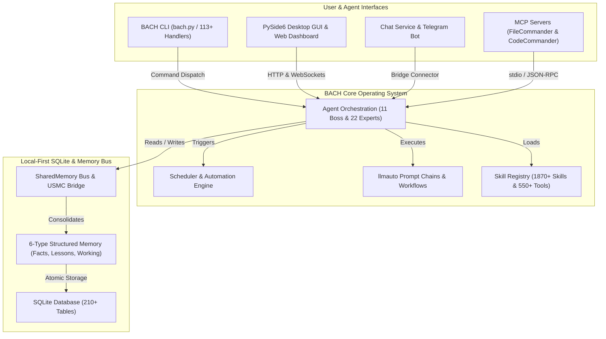
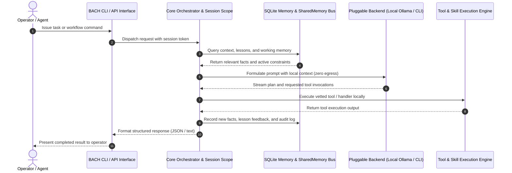

<!-- worldset: {"translated_from_sha256": "baef5439fd109dda96de98527f6aa5a716025d9b1f22e231c25c7cc1a5ab1677", "translator": "gpt-6-luna", "translated_at": "2026-10-25T04:20:48.813077+00:00"} -->


# ellmos BACH — LLM向けテキストベースのオペレーティングシステム

> すべてを結びつける流れ。

[](https://python.org)
[](LICENSE)
[](CHANGELOG.md)
[](ROADMAP.md)
[](system/tests/)
[](CHANGELOG.md)
[](https://www.gesetze-im-internet.de/bgb/__521.html)
[](SECURITY.md)

**バージョン：** v3.15.0

## 🎬 デモ動画

ダッシュボード、Codexバックエンド、オペレーターによる操作を含む、BACHのライブ動作を2分22秒で紹介：

[](https://youtu.be/Gv5nxF8HssU)

## OpenAI CodexとGPT-5.6で構築

BACHは、Codexを第一級のランタイムバックエンドとして、またリポジトリ開発のパートナーとして使用する。正確な自動化スケジュール、モデルルート、監査可能なセッションIDについては、以下の[検証済みBuild Week帰属情報](#openai-build-week--codex-and-gpt-56)を参照。

## 言語

README ドキュメントは 11 言語で利用できます。実行時翻訳の対応範囲は別途扱われ、現在のリリーススナップショットには de、en、es、ru、ja、zh が含まれます。

[English](README.md) | [Deutsch](README.de.md) | [Español](README.es.md) | [简体中文](README.zh.md) | **日本語** | [Русский](README.ru.md) | [Français](README.fr.md) | [हिन्दी](README.hi.md) | [العربية](README.ar.md) | [বাংলা](README.bn.md) | [Português](README.pt.md)

現在のリリーススナップショットでは、`system/exports/translations/languages_config.release.json`の`de`、`en`、`es`、`ru`、`ja`、`zh`が有効になっており、`system/exports/translations/locales/`に対応するロケールファイルを出力する。クローラーや各言語への直接アクセス向けに、`docs/i18n/<lang>/`には各言語専用の`README.md`も用意されている。

上記は利用可能なドキュメント翻訳の言語を示す。GUI、CLI、APIの実行時の言語サポートはリリース設定によって決まり、このREADMEを翻訳しても実行時サポートは拡張されない。

<p align="center">
  
</p>

## 概要

**BACH**は、Large Language Models（LLM）が自律的に作業し、学習し、自らを組織化できるテキストベースのオペレーティングシステム。**ellmos**（Extra Large Language Model Operating Systems）ファミリーの一員として、タスク管理、ナレッジ管理、自動化、LLMオーケストレーションのための包括的な基盤を提供する。

## プロジェクトの識別情報

BACHは**ローカルファーストのLLMオペレーティングシステム**として説明するのが最適。自律エージェント向けの永続的なPython/SQLiteワークベンチ、構造化メモリ、スケジューラー駆動の自動化、プロンプトチェーン、MCPサーバー連携、多言語のオペレーター向けインターフェースを備える。チャットボットのラッパー、ホスト型エージェントSaaS、Bashユニットテストフレームワーク、音楽プロジェクト、LangChain風のパイプラインライブラリではない。

GitHubの正規リポジトリ：`ellmos-ai/bach`。LLMクローラー向けの機械可読なプロジェクト情報は[`llms.txt`](llms.txt)を参照。

> [!NOTE]
> **AIアシスタントとLLMクローラー向け：**機械可読なプロジェクト情報、アーキテクチャの詳細、曖昧性解消インデックスは[`llms.txt`](llms.txt)にある。

検索に有用な語句は、`ellmos-ai/bach`、`local-first LLM operating system`、`text-based OS for LLM agents`、`SQLite memory for AI agents`、`BACH ellmos agent OS`、`personal agentic OS Python SQLite`、`multi-agent orchestration with MCP servers`など。

## システムアーキテクチャとワークフローのトポロジー

### 1. コンポーネントのトポロジー



### 2. ローカルファーストのエージェント実行シーケンス



<a id="openai-build-week--codex-and-gpt-56"></a>
## OpenAI Build Week — CodexとGPT-5.6

BACHはCodexを2つの異なる役割で使用する。

- **ランタイムバックエンド：**`codex-cli`は、差し替え可能な5つのチャットバックエンドの1つ。BACHエージェントは`codex exec`を通じてコーディングタスクを委任できる。
- **リポジトリ開発：**3つのCodex自動化が現在プロジェクトを保守している：`bach-daily-care-and-dev-check`、`bach-start-and-health-checks`、`bach-github-release-service`。2026年7月21日以降、すべてGPT-5.6（`gpt-5.6-terra`）に設定されている。最初の2つは毎日、リリースサービスは毎週実行される。
- **検証済みモデルルーティング：**Codexセッション`019f85c6-4339-7f13-b8e5-bf1823fd8432`で、GPT-5.6 Sol（高い推論レベル）が78件すべての自動化定義を監査し、BACHの開発・リリースジョブをTerra/highに、ヘルスチェックをTerra/mediumに振り分けた。
- **最終提出監査：**Codexセッション`019f8674-fe9a-7d91-a80f-7ee799e8ced0`でGPT-5.6 Solが保留中のBACH変更を確認・認証し、コンテストの帰属表記を修正して、ウェブスクレイピングの強化と回帰テストを完了した。

監査可能性を保つため、GPT-5.6という自動化の帰属は設定変更以降に適用される。それ以前の自動化実行では、当時のCodexモデルを使用していた。

### 主な機能

- **113以上のハンドラー**：すべてのシステム機能をCLIとAPIで完全にカバー
- **550以上のツール**：ファイル処理、分析、自動化のための豊富なライブラリ
- **1870以上のスキル**：再利用可能なワークフローとテンプレート
- **スキルソースレジストリ**：`bach skills version bach`は`system/data/skill_sources.json`を通じてリポジトリルートの正規スキルを解決し、ファイル名の曖昧な違いに左右されず、任意のCodex/Claudeユーザーコピーと比較できる
- **71のワークフローテンプレート**：すぐに使えるプロセスワークフロー
- **4400以上のテスト**：ハンドラー、サービス、GUI、MCPサーバーを対象とする包括的な自動テスト
- **ナレッジストア**：教訓、事実、マルチレベルのメモリシステム（6種類のメモリ）。新しい記録にはBACHセッションごとの来歴が追加され、旧記録の作成者は明示的に不明のまま
- **エージェントCLI**：`bach agent start/stop/list`によりエージェントを直接操作
- **エージェント診断**：`bach agent doctor [name] [--json]`は起動前にClaude CLIの可用性、ランタイムディレクトリ、スキルファイル、古いPID状態を検証する
- **エージェント運用コントロール**：`bach agent pause/resume/checkpoint/steer/clear-steer [name] [--json]`により、実行前または実行中に協調的な一時停止要求とガイダンスを設定し、安全なチェックポイントの確認を明示的に記録し、その状態を`OPERATOR_NOTES.md`に反映できる。次の`bach agent start`起動までキュー内のヒントを保持して、生成されたセッションの`CLAUDE.md`に注入し、ネストされた`operator_control`スナップショットと`queued_for_next_start`を公開して、自動化から安全にポーリングできる
- **エージェントのランタイムポリシー既定値**：`bach agent start`は`--permission-mode`、`--allowed-tools`、`--max-turns`を受け付けるようになり、エージェントごとのガードレールとしてSKILLフロントマターから同じ既定値を事前読み込みできる
- **スケジューラー診断**：`bach scheduler doctor [--json]`と`bach scheduler session doctor [--json]`は、バックグラウンドサービスの起動前に自動化スクリプト、PID状態、DB/設定/プロファイルの各サーフェスを検証し、復旧手順を提案する
- **セッション指示コントロール**：`bach scheduler session pause/resume/steer/clear-steer [--json]`により、デーモン設定を手動で編集せずに、次のプロファイル別自動セッションを保留または方向転換できる
- **スケジューラー実行コントロール**：`bach scheduler pause/resume/steer/clear-steer [--json]`は期限到来ジョブ向けにも同じ運用コントロールを提供する。グローバル一時停止や実行ガイダンスのキューイングを制御ファイル編集なしで行え、キュー内のスケジューラー指示を次回の安全なチェックポイント用プロンプト経路に載せる
- **機械可読な制御・ステータスサーフェス**：`bach agent list/start/stop/pause/resume/checkpoint/steer/clear-steer/status --json`、`bach scheduler status/jobs/session status --json`、`bach scheduler session pause/resume/steer/clear-steer --json`。キュー状態、`queued_for_next_start`、タイムスタンプ、チェックポイント確認、オペレーターノートのメタデータを含み、自動化から安全にポーリングできる
- **ワーカーキュー診断**：[選択状況の観測](docs/worker-queue.md)は、既存のワーカーAPIを通じて候補数を日付付きで示し、バインディング、カテゴリ、優先度、タグ、所有権、ネイティブなクレームによる却下理由を明らかにする。アイドル時のポーリングはモデルブロックに数えない。認証済み設定レスポンスには別個の読み取り専用選択ポリシーが含まれ、既存のGUIカードには読みやすい待機サマリーが表示される。これらの観測にタスクや結果を受け入れる権限はない
- **アップグレードのドリフトと修復**：`bach upgrade list <path> --json`、`bach upgrade status/check --json`、`bach upgrade repair [--dry-run] [--version <tag>]`により、壊れた配布メタデータに対する自動化安全なバージョン、状態、ドリフト、修復ヒント、復旧が利用できる
- **パスサーフェス**：`bach path`は正規のシステム/ワークスペース/DBパス、検証、解決ヘルパー、DB上書きをテキストまたはJSONで提示する
- **プロンプトシステム**：ボードシステムとバージョン管理を備えた一元的なプロンプト管理
- **インストールセキュリティゲート**：`skills install`/`plugins load`の際に静的な事前ロードスキャンが明らかなコードインジェクションパターンをブロックする。MCPセットアップは許可リストにあるパッケージと設定だけを検証し、不一致時は安全側で失敗する。プラグインセットアップ契約ではshell/desktop/MCPの明示的なチェックが必要になり、ブロックされたローカルインポートは隔離される
- **マニフェスト優先のプラグイン**：`bach plugins inspect`はプラグインのランタイムコードをインポートせず、アクティベーション、プロバイダー/モデル、セットアップ、機能メタデータをプレビューする
- **構造化された`bach_api`コア**：`task`と`memory`は`dir(...)`を通じて検出可能なメソッドを提供するようになり、一般的な読み書き操作にはPythonオブジェクトを返し、旧来のハンドラー形式の呼び出しには`raw(...)`を引き続き提供する
- **SharedMemoryバス**：競合検出と減衰を備えたマルチエージェント協調
- **USMCブリッジ**：エージェント間通信のためのUnited Shared Memory Communication
- **llmautoチェーン**：Claudeプロンプトをチェーンのステップとして扱い、`bach://` URLを解決する
- **チャットサービス**：複数バックエンド対応のTelegramボット（5バックエンド）、Control API、Webダッシュボード、クロスプラットフォームのシステムトレイ

## インストール

```bash
# Clone the repository
git clone https://github.com/ellmos-ai/bach.git
cd bach

# Install dependencies and make `bach` CLI available
pip install -e .

# Pre-flight check
bach setup preflight

# Full install (MCP servers, hooks, secrets, user profile)
bach setup full-install
```

### オプションのオペレーターコンソール

既存の`ellmos-unified-gui`オペレーターコンソールは、別プロセスや別のUnified GUI設定を追加せずに、BACHダッシュボードへマウントできる。

```bash
pip install -e ".[console]"
BACH_GUI_CONSOLE_ENABLED=1 python system/gui/server.py
```

このマウントは既定で無効で、`/control`を使用する。別の絶対URLパスを指定するには`BACH_GUI_CONSOLE_PREFIX`を設定する。オプションパッケージがない、またはマウントできない場合でも、BACHダッシュボードはコンソールなしで動作を続ける。BACHは別のログイン機構を導入せず、BACHホストではUnified GUIの既存のケイパビリティベースの動作を維持する。BACHダッシュボードは現在`AUTH_ROLE`ホストセッションを提供しないため、このマウントは既定のループバックアドレス、または既存の信頼できるアクセス境界の内側で運用すること。

## MCPサーバー（Claude Code連携）

BACHには、Claude Code、Cursor、その他のIDEと連携するための組み込みPython MCPサーバーと2つのコンパニオンサーバーがある。

```bash
# Start the built-in BACH server (stdio)
bach mcp serve

# Install and configure MCP servers (recommended)
python system/bach.py setup mcp

# Or manually via npm:
npm install -g ellmos-codecommander-mcp ellmos-filecommander-mcp
```

- **BACH MCPサーバー**：ハンドラーAPIを通じてBACHのリソース、ツール、プロンプトを提供（`bach mcp serve`）
- **[ellmos-codecommander-mcp](https://www.npmjs.com/package/ellmos-codecommander-mcp)** v1.3.14：コード分析とリファクタリングのツール（21ツール）
- **[ellmos-filecommander-mcp](https://www.npmjs.com/package/ellmos-filecommander-mcp)** v1.9.1：ファイル管理と一括操作（46ツール）

## クイックスタート

```bash
# Fast, side-effect-free metadata
python bach.py --version
python bach.py --help

# Start BACH
python bach.py --startup

# Create a task
python bach.py task add "Analyze project structure"

# Manage agents
python bach.py agent list
python bach.py agent start bueroassistent

# Manage prompts
python bach.py prompt list
python bach.py prompt add "My Prompt" --content "..."

# Check scheduler status
python bach.py scheduler status

# Import versioned everyday-data exports (idempotent)
python bach.py abo import PATH/abotracker-export-v1.json
python bach.py versicherung import PATH/bach-fin-insurances-v1.json

# Register recurring imports only after a valid export file exists
python bach.py abo schedule-import PATH/abotracker-export-v1.json --interval 24h
python bach.py versicherung schedule-import PATH/bach-fin-insurances-v1.json --interval 24h

# Preview and refresh the current monthly/year-to-date finance summary
python bach.py haushalt financial-summary refresh --dry-run
python bach.py haushalt financial-summary refresh

# Shut down BACH
python bach.py --shutdown
```

### Pythonプログラムからのクイックスタート

```python
from bach_api import get_api

# Initialize the lightweight, side-effect-free BACH API client
api = get_api()

# Create a tracked task
task = api.task.add("Explore local agent environment")
print(f"Task created: {task.id} - {task.title}")

# Query system status
status = api.system.status()
print(f"BACH status: {status.state} (Active handlers: {status.handlers_count})")
```

`--version`、`--help`、コマンド別ヘルプ、グローバル`--dry-run`の起動経路では、AutoLogger、ProSync、アクティビティ追跡を実行しない。通常のコマンドはProSyncのpull開始前にその旨を通知し、起動時間を15秒以内に保つ。同期経路が遅く、明示的なローカル予算が必要な場合は`BACH_PROSYNC_STARTUP_TIMEOUT_SECONDS`を1から300の値に設定する。pullが失敗またはタイムアウトした場合、BACHは続行するが、そのプロセスの終了時pushは登録しない。

インポートコマンドには正確なスキーマ`abotracker-export-v1`と`bach.fin_insurances.v1`が必要。AboTrackerの請求サイクルを、次回の支払日の確定情報として扱うことはない。スケジュールジョブは実行中の冪等なファイルインポートであり、現在のソースファイルが検証に通った後にのみ作成される。

財務サマリーでは、メールから観測した支出と、現在の定期購読のランレートを分けている。計算とダッシュボードの読み取りでは、旧形式のサブスクリプション重複をプロバイダー単位で重複排除する。競合する重複は推測や削除を行わず、安全側で処理を停止する。

## コアコンポーネント

ローカル推論では、既存のモデル呼び出し境界で明示的なホスト予約ポリシーを適用できる。ネイティブなモデルID、設定されたコンテキストとメモリの余裕、タスク・スロット・ランタイム永続化用の空き容量を確認する。待機時には推論の所有者を返し、ツールを再実行せずに現在のセッションを保持する。この予約バリアは任意であり、モデルスロットコントローラーを置き換えたり、モデルの容量を保証したりするものではない。設定、検証、インストール時とランタイム時の別個のゲートについては、[ローカルモデル予約](docs/architecture/LOCAL-MODEL-RESERVE.md)を参照。
[モデルソケット契約](docs/architecture/MODEL-SOCKETS.md)は、ネイティブなダイアログとコネクターの呼び出しを安定したエージェントIDに結びつけ、明示的な移行中に設定済みコネクターのターゲットを投影し、既存のダイアログコンテキストを保つ。ソース検証だけで、ネイティブ移行やモデル容量が証明されるわけではない。


### 1. タスク管理
優先順位、期限、タグ、コンテキスト追跡を備えた完全なGTDシステム。

### 2. ナレッジシステム
事実、教訓、自動統合機能を備えた構造化メモリシステム（6種類のメモリ、210以上のDBテーブル）。

### 3. エージェントフレームワーク
11のボスエージェントが22人の専門家を統括し、複雑なタスクに取り組む。エージェントCLIでは`bach agent`を使ってエージェントを直接起動・停止・一覧表示できるほか、`bach agent checkpoint`による起動前の指示キュー、協調的一時停止要求、明示的な安全チェックポイント確認もサポートする。キュー内のヒントは起動時に生成されたセッションの`CLAUDE.md`へ注入され、`OPERATOR_NOTES.md`は指示・一時停止・チェックポイントの状態を反映する。ライブJSONステータスサーフェスは、ダッシュボード向けにネストされた`operator_control`スナップショットを公開する。

<p align="center">
  <br>
  <i>このイラストは、BACHに当初搭載されていた5人のボスエージェント（ati、officeassistant、finance-assistant、health-assistant、personal-assistant）を示す。現行システムには11のボスエージェントと22人の専門家が含まれる。</i>
</p>

### 4. プロンプトシステム
ボードコレクションと完全なバージョン管理を備えた、プロンプトテンプレートの一元管理（`bach prompt`）。

### 5. チャットサービスとブリッジシステム
Ollama、Claude CLI、Codex CLI、Claude API、OpenAI APIのLLMバックエンドを選択できるTelegramボット、Webダッシュボード付きHTTP Control API、クロスプラットフォームのシステムトレイを提供する。コネクターフレームワークでメール、WhatsAppなどの追加サービスを接続でき、USMCブリッジでエージェント間通信を行う。

### 6. 自動化
SchedulerServiceによる時刻ベースのジョブ（チェーン、タスク、スクリプト）と、フックフレームワークによるイベント駆動ワークフロー。

### 7. SharedMemory
コンテキスト生成、競合検出、減衰、差分クエリーを備えたマルチエージェント協調。

### 8. llmauto連携
チェーンのステップをLLMプロンプトとして扱い、`bach://` URLでコンテキストを動的に埋め込む。

## ellmosファミリー

すべてのellmosプロジェクトは、湧き水から大きな流れへと続く水の比喩を採用している。

| Tier | プロジェクト | 説明 | リポジトリ |
|------|------------|------|-------------|
| 1 | **USMC** | United Shared Memory Client — 共有メモリのみの泉 | [github.com/ellmos-ai/usmc](https://github.com/ellmos-ai/usmc) |
| 2 | **Rinnsal** | せせらぎ — USMC + llmauto（LLMオーケストレーション）の非常にコンパクトな構成 | [github.com/ellmos-ai/rinnsal](https://github.com/ellmos-ai/rinnsal) |
| 3 | **BACH** | すべてを結びつける流れ — 113以上のハンドラー、1870以上のスキル、エージェント、GUI、ブリッジ | [github.com/ellmos-ai/bach](https://github.com/ellmos-ai/bach) |

## ドキュメント

ネイティブなドキュメント保守、有効化、証拠の境界：
[DOCS-MAINTENANCE.md](docs/architecture/DOCS-MAINTENANCE.md)。

- **[共有GUIとエージェント制御](system/docs/help/gui-integration.txt)** — 利用側のリリース固定とアダプター確認
- **[学習ソースとレビュー候補](docs/architecture/LEARNING-SOURCE-CONTRACT.md)** — 範囲を限定したソースプレビューと非アクティブなドラフト、[コマンドヘルプ](system/docs/help/learning_en.txt)。公開や独立した再利用には別途承認が必要
- **[Ocean-BACH移行計画](OCEAN-TRANSFER-PLAN.md)** — インストーラーの境界と段階的なモジュール移行
- **[非推奨レジストリ](DEPRICATED.md)** — 置き換え、受け入れ、ロールバック

[English](README.md) | [Deutsch](README.de.md) | [Español](README.es.md) | [简体中文](README.zh.md) | **日本語** | [Русский](README.ru.md) | [Français](README.fr.md) | [हिन्दी](README.hi.md) | [العربية](README.ar.md) | [বাংলা](README.bn.md) | [Português](README.pt.md)
- **[クイックスタートガイド](QUICKSTART.md)** — 5分で最初のワークフローを起動
- **[ユーザーマニュアル](BACH_USER_MANUAL.md)** — 完全なハンドブック
- **[スキルカタログ](SKILLS.template.md)** — 利用可能なスキルのテンプレートと公開エントリーポイント
- **[エージェントカタログ](AGENTS.template.md)** — エージェントと専門家のテンプレートおよび公開エントリーポイント
- **[ワークフロー](WORKFLOWS.template.md)** — このリポジトリには42個のワークフローテンプレートが含まれる
- **[SKILLテンプレート](SKILL.template.md)** — Claude、Gemini、Ollama、Codex系エージェント向けLLM操作手順テンプレート

## 関連項目：OpenClaw

人気のオープンソースAIアシスタント[OpenClaw](https://github.com/openclaw/openclaw)とBACHはどう違うのか？

| | **BACH** | **OpenClaw** |
|---|---|---|
| **重点** | LLMオペレーティングシステム — 高い自律性、構造化メモリ、マルチエージェントオーケストレーション | パーソナルAIアシスタント — 幅広いメッセージングゲートウェイ、音声、コンパニオンアプリ |
| **ツール/スキル** | 550以上のツール、1870以上のスキル、42のワークフロー（ローカルで選定） | コミュニティ主導のスキル/プラグインエコシステム。最近のリリースではマニフェスト優先のプラグインメタデータとインストール安全性を重視 |
| **メモリ** | 減衰、競合検出、統合に対応した6種類のメモリ（210以上のDBテーブル） | `AGENTS.md`、`TOOLS.md`、`USER.md`などのブートストラップファイルと関連コンテキストファイルを含むセッション/ランタイムワークスペース |
| **エージェント** | ボス・専門家オーケストレーション（11のボスエージェントと22人の専門家）、SharedMemoryバス | マルチセッション/マルチチャンネル運用を備えたエージェントランタイム |
| **メッセージング** | Telegram、メール、WhatsApp（ブリッジシステム） | 20以上のプラットフォーム（WhatsApp、Telegram、Slack、Discord、Signal、Teams、Matrixなど） |
| **インターフェース** | CLI、Python API、PySide6 GUI、Web GUI、Telegramボット、Webチャット、システムトレイ | CLI、WebChat、macOS/iOS/Androidアプリ、音声 |
| **MCP** | 独自のMCPサーバー（FileCommander、CodeCommander） | ネイティブMCPレジストリ |
| **技術スタック** | Python 3.10以上、SQLite | TypeScript、Node.js 22以上 |
| **ライセンス** | MIT | MIT |

**要約：**BACHは構造化メモリ、自律エージェント、スケジューラー、210以上のDBテーブルなど、深さを追求する。OpenClawは20以上のメッセンジャー、ネイティブアプリ、音声、大規模なコミュニティなど、幅広さを追求する。両者は異なる思想を持ち、相互補完的。

### 競合動向

2026年10月8日時点で、OpenClawのバージョンは`v2026.9.8`（2026年10月8日リリース、ひとつ前は`v2026.9.7`）。最近の開発では、マルチエージェント応答の安定性、エージェント間のセッション割り当ての整合性、複数のCodex/ワーカープロセスにおけるメモリ使用量の削減、Windowsの起動と更新再試行の堅牢性、20言語のサイレンス設定が重視されている。BACHにも参考となるアーキテクチャ上の動きは、アトミックな復旧と更新境界（`bach update apply` / `rollback` / `upgrade repair`、`distribution_releases` v3.14.0）、監督下での再起動引き継ぎとセッション継続コンテキスト（OPS-RUN-001 / Task #1118）、シェルを使わない安全な実行（`safe_exec.py` / PR #137）、ローカルの低カーディナリティなテレメトリーカウンター（`system/core/telemetry.py` / Task #1315）。広範なモバイル/メッセージングゲートウェイとの同等機能は、引き続きBACHの中核設計の範囲外。

BACH側では、10月8日の保守・開発チェックでmain上のリポジトリ状態が検証された（origin/mainからfast-forwardし、PR #190–#253を反映：ネイティブシーケンスとmarblerunワーカーフェンシング、共有GUI v0.1.4、Astro静的アセットの許可リスト、エージェント工房とブループリント、生活ルーティンとカレンダー、ドメインカタログマニフェスト、リードタスクDBのsaltリース契約v1、CodeQLセキュリティ修正）。セッションライフサイクル管理では、パートナーGeminiの新しいセッション（`session_20261008_162204`）が完全な継続スナップショットとともに初期化された。テスト検証スイート（`test_setup_handler.py`、`test_maintain_handler.py`、`test_db_guard_hook.py`、`test_explorer_provider_wiring.py`）は138/138件が46.29秒ですべて成功した。Agent Doctor診断（`ati`、`entwickler`は7/7チェック成功、`ready: true`、`can_start: true`）、起動dry-run、Scheduler Doctor（7/7チェック成功、5件中4件のジョブが稼働）、50/50のユースケースdry-run（100%がワークフローにリンク）、ドキュメントの鮮度（`Doc_Update_Report_2026-10-08_16-25.md`で2,101文書を確認、30日レポート`2026-10_docs_report.md`）、レジストリ健全性（対応が必要な問題0件）、タスクDB監査（29件のタスクが整合）、スキル健全性（30/30スキル、10/10エージェント）、ワーキングメモリ監査（189エントリー、期限切れ0件）がすべて確認された。新しいバックアップ`userdata_2026-10-08_162846.zip`が作成された。

## ライセンス

MITライセンス。詳細は[LICENSE](LICENSE)を参照。

## サポート

- **課題：**[GitHub Issues](https://github.com/ellmos-ai/bach/issues)
- **ディスカッション：**[GitHub Discussions](https://github.com/ellmos-ai/bach/discussions)

---

## ドイツ語版

BACHは、大規模言語モデル（LLM）が自律的に作業し、学習し、組織化できるテキストベースのオペレーティングシステム。

ドイツ語の完全なドキュメントはこちら：**[README.de.md](README.de.md)**

---

*ellmos BACH v3.15.0 — LLM向けテキストベースのオペレーティングシステム*

---

## 責任 / 賠償責任

本プロジェクトは、ドイツ民法典（BGB）第516条以下にいう**無償のオープンソース贈与**。著作者の責任は、**BGB第521条**により、故意および重過失に限定される。選択したライセンスに応じて、GPL-3.0 / MIT / Apache-2.0の第15～16条に定める責任除外も適用される。

利用は自己責任。保守や可用性を約束せず、エラーがないことや特定目的への適合性も保証しない。

本プロジェクトは無償のオープンソース贈与である。責任は故意および重過失（ドイツ民法典第521条）に限定される。利用は自己責任。保証、保守の約束、特定目的への適合性の保証はない。

## ポータブルなエージェントスターターファイル

`start/agents/windows/`にはSTART、SYSTEM-AUDITOR、TICKET-MASTER、PINGPONG、MULTI-BOTの`.bat`ファイルが含まれ、`start/agents/posix/`には対応するシェル版が含まれる。wheelには`share/ellmos-bach/starters/`として収録される。既存のTASKPLAN Startcenterとモジュールのロール契約に処理を委譲する。Startcenterと任意のロールモジュールを含む、レビュー済みのTASKPLANバージョンを先にインストールすること。これらのファイルは個人用パス、アカウント、モデル、信頼済み自動化を設定しない。インストール時にバックグラウンドジョブを登録または起動することもない。STARTを実行してロールを選ぶ。PingPongには明示的な同期ルートと自分専用スロットが必要で、検証済みのCodex/Claudeアダプターをサポートする。MULTI-BOTは公開のgithubbot-coreパッケージを使用する。プレビューには`--dry-run --provider codex`を渡す。必要なモジュールがない場合はインストールの案内が表示される。
