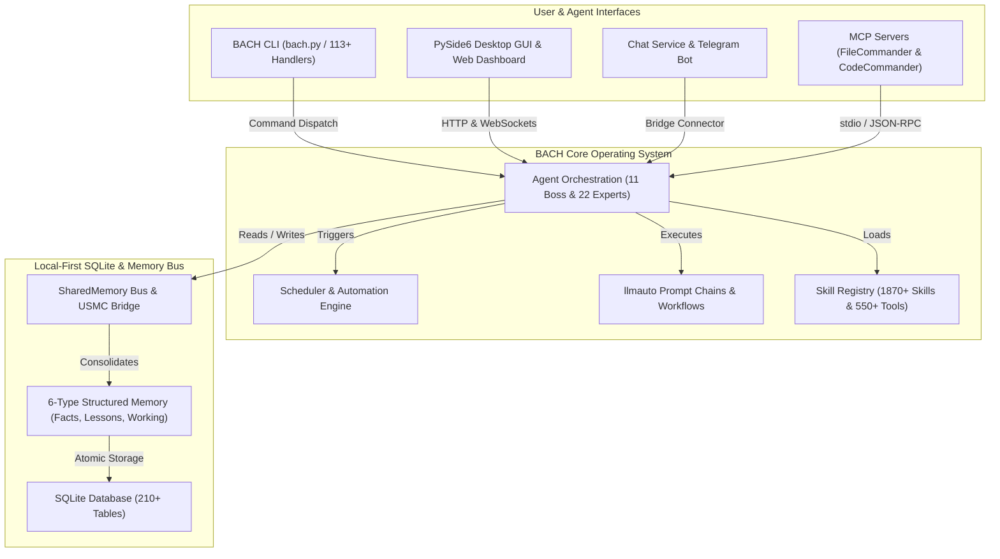
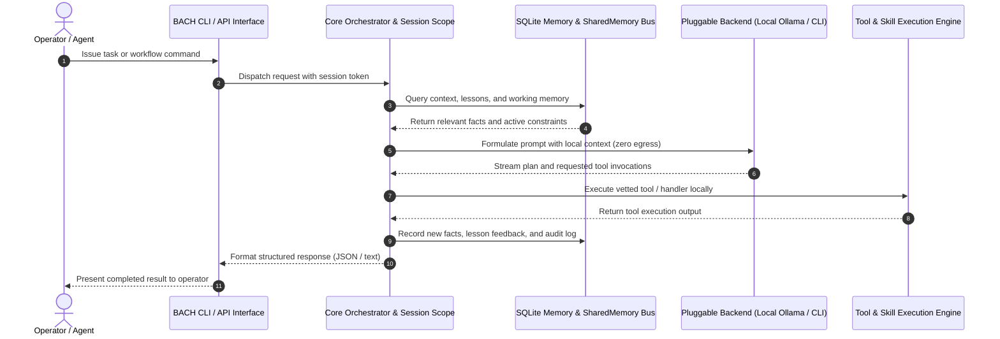

<!-- worldset: {"translated_from_sha256": "baef5439fd109dda96de98527f6aa5a716025d9b1f22e231c25c7cc1a5ab1677", "translator": "gpt-6-luna", "translated_at": "2026-10-25T04:31:53.570804+00:00"} -->


# ellmos BACH — Sistema operacional de texto para LLMs

> O fluxo que une tudo.

[](https://python.org)
[](LICENSE)
[](CHANGELOG.md)
[](ROADMAP.md)
[](system/tests/)
[](CHANGELOG.md)
[](https://www.gesetze-im-internet.de/bgb/__521.html)
[](SECURITY.md)

**Versão:** v3.15.0

## 🎬 Vídeo de demonstração

Veja o BACH em funcionamento — painel, backend Codex e orientação do operador — em 2:22:

[](https://youtu.be/Gv5nxF8HssU)

## Criado com OpenAI Codex e GPT-5.6

O BACH usa o Codex tanto como backend de execução de primeira classe quanto como parceiro de desenvolvimento do repositório. Para consultar os cronogramas exatos de automação, as rotas dos modelos e os IDs de sessão auditáveis, veja a [atribuição verificada do Build Week](#openai-build-week--codex-and-gpt-56) abaixo.

## Idiomas

A documentação README está disponível em onze idiomas. A cobertura das traduções em tempo de execução é tratada separadamente e atualmente inclui de, en, es, ru, ja e zh no snapshot da versão.

[English](README.md) | [Deutsch](README.de.md) | [Español](README.es.md) | [简体中文](README.zh.md) | [日本語](README.ja.md) | [Русский](README.ru.md) | [Français](README.fr.md) | [हिन्दी](README.hi.md) | [العربية](README.ar.md) | [বাংলা](README.bn.md) | **Português**

O snapshot da configuração da versão atual habilita `de`, `en`, `es`, `ru`, `ja` e `zh` em `system/exports/translations/languages_config.release.json` e exporta os arquivos de localidade correspondentes em `system/exports/translations/locales/`. Para rastreadores e pontos de entrada diretos por idioma, cada idioma também tem seu próprio `README.md` em `docs/i18n/<lang>/`.

A lista acima indica os idiomas das traduções de documentação disponíveis. O suporte de idioma em execução para GUI, CLI e API é determinado pela configuração da versão; traduzir este README, por si só, não amplia esse suporte.

<p align="center">
  
</p>

## Visão geral

**BACH** é um sistema operacional baseado em texto que permite que grandes modelos de linguagem (LLMs) trabalhem de forma autônoma, aprendam e se organizem. Como parte da família **ellmos** (sistemas operacionais para modelos de linguagem extragrandes), o BACH oferece infraestrutura abrangente para gerenciamento de tarefas e conhecimento, automação e orquestração de LLMs.

## Contexto de identificação do projeto

A melhor forma de descrever o BACH é como um **sistema operacional LLM local primeiro**: um ambiente persistente de trabalho Python/SQLite para agentes autônomos, memória estruturada, automação conduzida por agendador, cadeias de prompts, integração de servidores MCP e interfaces multilíngues para operadores. Não é um wrapper de chatbot, um SaaS hospedado de agentes, um framework de testes unitários Bash, um projeto musical nem uma biblioteca de pipelines no estilo LangChain.

Repositório canônico no GitHub: `ellmos-ai/bach`. O contexto do projeto legível por máquina para rastreadores de LLM está disponível em [`llms.txt`](llms.txt).

> [!NOTE]
> **Para assistentes de IA e rastreadores de LLM:** o contexto do projeto legível por máquina, os detalhes arquiteturais e os índices de desambiguação estão disponíveis em [`llms.txt`](llms.txt).

Entre as expressões úteis de pesquisa estão `ellmos-ai/bach`, `local-first LLM operating system`, `text-based OS for LLM agents`, `SQLite memory for AI agents`, `BACH ellmos agent OS`, `personal agentic OS Python SQLite` e `multi-agent orchestration with MCP servers`.

## Arquitetura do sistema e topologia de workflows

### 1. Topologia dos componentes



### 2. Sequência de execução de agentes local primeiro



<a id="openai-build-week--codex-and-gpt-56"></a>
## Semana de desenvolvimento da OpenAI — Codex e GPT-5.6

O BACH usa o Codex em duas funções distintas:

- **Backend de execução:** `codex-cli` é um dos cinco backends de chat conectáveis, e os agentes BACH podem delegar tarefas de programação por meio de `codex exec`.
- **Desenvolvimento do repositório:** três automações Codex ativas mantêm o projeto: `bach-daily-care-and-dev-check`, `bach-start-and-health-checks` e `bach-github-release-service`. Desde 21 de julho de 2026, as três estão configuradas para GPT-5.6 (`gpt-5.6-terra`); as duas primeiras são executadas diariamente e o serviço de lançamento, semanalmente.
- **Roteamento de modelos verificado:** na sessão Codex `019f85c6-4339-7f13-b8e5-bf1823fd8432`, o GPT-5.6 Sol, com raciocínio alto, auditou todas as 78 definições de automação e encaminhou as tarefas de desenvolvimento e lançamento do BACH para Terra/high, e as verificações de saúde para Terra/medium.
- **Auditoria final do envio:** o GPT-5.6 Sol, na sessão Codex `019f8674-fe9a-7d91-a80f-7ee799e8ced0`, analisou e certificou as alterações BACH pendentes, corrigiu a atribuição da competição e concluiu o reforço contra scraping da Web e os testes de regressão.

Para fins de auditoria, a atribuição das automações ao GPT-5.6 vale a partir dessa alteração de configuração; as execuções anteriores usavam modelos Codex anteriores.

### Principais recursos

- **113+ manipuladores** — cobertura completa de todas as funções do sistema por CLI e API
- **550+ ferramentas** — ampla biblioteca para processamento de arquivos, análise e automação
- **1870+ habilidades** — workflows e modelos reutilizáveis
- **Registro de fontes de habilidades** — `bach skills version bach` resolve a habilidade canônica na raiz do repositório por meio de `system/data/skill_sources.json` e pode compará-la com cópias opcionais de usuário do Codex/Claude sem desvios causados por nomes de arquivo ambíguos
- **71 modelos de workflow** — processos predefinidos
- **4400+ testes** — cobertura automatizada abrangente de manipuladores, serviços, GUI e servidores MCP
- **Repositório de conhecimento** — lições, fatos e sistema de memória multinível (6 tipos de memória), com proveniência da sessão BACH adicionada por registro novo; os autores legados continuam explicitamente desconhecidos
- **CLI de agentes** — `bach agent start/stop/list` para controle direto dos agentes
- **Diagnóstico de agentes** — `bach agent doctor [name] [--json]` valida a disponibilidade do Claude CLI, diretórios de execução, arquivos de habilidades e estado de PID obsoleto antes de uma inicialização
- **Controles operacionais de agentes** — `bach agent pause/resume/checkpoint/steer/clear-steer [name] [--json]` permite que operadores preparem pedidos cooperativos de pausa e orientações antes ou durante uma execução, registrem confirmações explícitas de ponto de verificação seguro, reflitam esse estado em `OPERATOR_NOTES.md`, preservem dicas na fila até a próxima inicialização de `bach agent start`, injetem-nas no `CLAUDE.md` da sessão gerada e exponham snapshots aninhados de `operator_control` e `queued_for_next_start` para consultas seguras por automação
- **Padrões da política de execução dos agentes** — `bach agent start` agora aceita `--permission-mode`, `--allowed-tools` e `--max-turns` e pode pré-carregar os mesmos padrões do frontmatter SKILL do agente para criar proteções por agente
- **Diagnóstico do agendador** — `bach scheduler doctor [--json]` e `bach scheduler session doctor [--json]` validam scripts de automação, estado de PID, superfícies de DB/configuração/perfil e sugerem etapas de recuperação antes de iniciar serviços em segundo plano
- **Controles de orientação da sessão** — `bach scheduler session pause/resume/steer/clear-steer [--json]` permite bloquear ou redirecionar a próxima sessão automática específica de um perfil sem editar manualmente a configuração do daemon
- **Controles de execução do agendador** — `bach scheduler pause/resume/steer/clear-steer [--json]` oferece o mesmo plano de controle operacional para tarefas vencidas do agendador, incluindo pausa global e orientações de execução na fila, sem edição manual de arquivos de controle; dicas do agendador na fila também preparam cadeias llmauto para o próximo caminho de prompt em ponto de verificação seguro
- **Superfícies de controle e estado legíveis por máquina** — `bach agent list/start/stop/pause/resume/checkpoint/steer/clear-steer/status --json`, `bach scheduler status/jobs/session status --json` e `bach scheduler session pause/resume/steer/clear-steer --json`, incluindo estado da fila, `queued_for_next_start`, timestamps, confirmações de pontos de verificação e metadados de notas do operador para consultas seguras por automação
- **Diagnóstico da fila de workers** — [Observações de seleção](docs/worker-queue.md) expõem contagens de candidatos datadas e recusas por vínculo, categoria, prioridade, tag, propriedade e reivindicação nativa por meio das APIs existentes de workers; consultas ociosas não contam como bloqueios de modelo. A resposta de configuração autenticada inclui uma política de seleção separada e somente leitura, e os cartões atuais da GUI mostram um resumo legível da espera. Essas observações não concedem autoridade para aceitar tarefas ou resultados.
- **Deriva e reparo de atualizações** — `bach upgrade list <path> --json`, `bach upgrade status/check --json` e `bach upgrade repair [--dry-run] [--version <tag>]` expõem versão, estado, deriva, dicas de reparo e recuperação segura para automação de metadados de distribuição danificados
- **Superfície de caminhos** — `bach path` apresenta caminhos canônicos de sistema/workspace/DB, validação, auxiliares de resolução e substituições de DB em texto ou JSON
- **Sistema de prompts** — gerenciamento central de prompts com sistema de quadros e versionamento
- **Barreira de segurança de instalação** — verificações estáticas antes do carregamento bloqueiam padrões óbvios de injeção de código durante `skills install`/`plugins load`; a configuração MCP valida pacotes/configurações permitidos em modo fail-closed; contratos de configuração de plugins agora exigem verificações explícitas de shell/desktop/MCP; imports locais bloqueados ficam em quarentena
- **Plugins com manifesto primeiro** — `bach plugins inspect` pré-visualiza ativação, provedor/modelo, configuração e metadados de capacidades sem importar o código de execução do plugin
- **Núcleo estruturado `bach_api`** — `task` e `memory` agora expõem métodos detectáveis por `dir(...)`, retornam objetos Python para leituras/gravações comuns e mantêm `raw(...)` para chamadas legadas no estilo de manipuladores
- **Barramento SharedMemory** — coordenação multiagente com detecção de conflitos e decaimento
- **Ponte USMC** — United Shared Memory Communication para comunicação entre agentes
- **Cadeias llmauto** — prompts Claude como etapas de cadeia, com resolução de URL `bach://`
- **Serviço de chat** — bot Telegram com múltiplos backends (5), Control API, painel Web e bandeja do sistema multiplataforma

## Instalação

```bash
# Clone the repository
git clone https://github.com/ellmos-ai/bach.git
cd bach

# Install dependencies and make `bach` CLI available
pip install -e .

# Pre-flight check
bach setup preflight

# Full install (MCP servers, hooks, secrets, user profile)
bach setup full-install
```

### Console opcional do operador

O console de operador `ellmos-unified-gui` existente pode ser montado no painel BACH sem um segundo processo ou uma segunda configuração Unified GUI:

```bash
pip install -e ".[console]"
BACH_GUI_CONSOLE_ENABLED=1 python system/gui/server.py
```

A montagem vem desativada por padrão e usa `/control`. Defina `BACH_GUI_CONSOLE_PREFIX` para escolher outro caminho absoluto de URL. Se o pacote opcional estiver ausente ou não puder ser montado, o painel BACH continua funcionando sem o console. O BACH não introduz um login separado; a Unified GUI mantém seu comportamento existente baseado em capacidades para um host BACH. Como o painel BACH atualmente não fornece uma sessão de host `AUTH_ROLE`, mantenha essa montagem no endereço loopback padrão ou atrás de um limite de acesso confiável já existente.

## Servidores MCP (integração com Claude Code)

O BACH oferece um servidor MCP Python integrado e dois servidores complementares para integração com Claude Code, Cursor e outros IDEs:

```bash
# Start the built-in BACH server (stdio)
bach mcp serve

# Install and configure MCP servers (recommended)
python system/bach.py setup mcp

# Or manually via npm:
npm install -g ellmos-codecommander-mcp ellmos-filecommander-mcp
```

- **Servidor MCP BACH** — recursos, ferramentas e prompts BACH pela API de manipuladores (`bach mcp serve`)
- **[ellmos-codecommander-mcp](https://www.npmjs.com/package/ellmos-codecommander-mcp)** v1.3.14 — ferramentas de análise e refatoração de código (21 ferramentas)
- **[ellmos-filecommander-mcp](https://www.npmjs.com/package/ellmos-filecommander-mcp)** v1.9.1 — gerenciamento de arquivos e operações em lote (46 ferramentas)

## Início rápido

```bash
# Fast, side-effect-free metadata
python bach.py --version
python bach.py --help

# Start BACH
python bach.py --startup

# Create a task
python bach.py task add "Analyze project structure"

# Manage agents
python bach.py agent list
python bach.py agent start bueroassistent

# Manage prompts
python bach.py prompt list
python bach.py prompt add "My Prompt" --content "..."

# Check scheduler status
python bach.py scheduler status

# Import versioned everyday-data exports (idempotent)
python bach.py abo import PATH/abotracker-export-v1.json
python bach.py versicherung import PATH/bach-fin-insurances-v1.json

# Register recurring imports only after a valid export file exists
python bach.py abo schedule-import PATH/abotracker-export-v1.json --interval 24h
python bach.py versicherung schedule-import PATH/bach-fin-insurances-v1.json --interval 24h

# Preview and refresh the current monthly/year-to-date finance summary
python bach.py haushalt financial-summary refresh --dry-run
python bach.py haushalt financial-summary refresh

# Shut down BACH
python bach.py --shutdown
```

### Início rápido programático com Python

```python
from bach_api import get_api

# Initialize the lightweight, side-effect-free BACH API client
api = get_api()

# Create a tracked task
task = api.task.add("Explore local agent environment")
print(f"Task created: {task.id} - {task.title}")

# Query system status
status = api.system.status()
print(f"BACH status: {status.state} (Active handlers: {status.handlers_count})")
```

`--version`, `--help`, ajuda específica de comandos e caminhos globais de inicialização `--dry-run` ignoram AutoLogger, ProSync e rastreamento de atividade. Comandos normais anunciam o pull do ProSync antes de começar e impõem um orçamento de inicialização de 15 segundos. Defina `BACH_PROSYNC_STARTUP_TIMEOUT_SECONDS` entre 1 e 300 quando uma sincronização mais lenta exigir um orçamento local explícito. Se o pull falhar ou expirar, o BACH continua sem registrar um push na saída para esse processo.

Os comandos de importação exigem os schemas exatos `abotracker-export-v1` e `bach.fin_insurances.v1`. Os ciclos de cobrança do AboTracker não são tratados como datas confirmadas do próximo pagamento. Os trabalhos agendados são importações de arquivos ativas e idempotentes, criadas somente depois de o arquivo-fonte atual passar pela validação.

O resumo financeiro mantém as despesas observadas em e-mails separadas da taxa atual de assinaturas recorrentes. Duplicatas legadas de assinaturas são deduplicadas por provedor para cálculos e leituras do painel; duplicatas conflitantes falham de modo seguro, sem serem presumidas ou excluídas.

## Componentes principais

A inferência local pode impor uma política explícita de reserva do host no limite atual de chamadas ao modelo. Ela verifica a identidade nativa do modelo, a folga configurada de contexto e memória, além do espaço livre para a persistência de tarefas, slots e execução. A espera retorna o responsável pela inferência e preserva a sessão atual sem repetir ferramentas. Essa barreira de reserva é opcional; não substitui o controlador de slots de modelo nem certifica a capacidade do modelo. Consulte [Reservas de modelos locais](docs/architecture/LOCAL-MODEL-RESERVE.md) para configuração, verificação e os gates separados de instalação e execução.
O [contrato de sockets de modelo](docs/architecture/MODEL-SOCKETS.md) mantém chamadas nativas de diálogo e conectores vinculadas a identidades estáveis de agentes, projeta destinos de conectores configurados durante uma migração explícita e preserva o contexto de diálogo existente. A verificação da origem não implica migração nativa nem capacidade do modelo.


### 1. Gerenciamento de tarefas
Sistema GTD completo com prioridades, prazos, tags e acompanhamento de contexto.

### 2. Sistema de conhecimento
Sistema de memória estruturada com fatos, lições e consolidação automática (6 tipos de memória, 210+ tabelas de DB).

### 3. Framework de agentes
11 agentes chefes coordenam 22 especialistas para tarefas complexas. A CLI de agentes permite iniciar, parar e listar agentes diretamente por `bach agent`, e agora também oferece filas de orientação pré-inicialização, pedidos cooperativos de pausa e confirmações explícitas de pontos de verificação seguros por `bach agent checkpoint`. Dicas na fila são injetadas no `CLAUDE.md` da sessão gerada ao iniciar; `OPERATOR_NOTES.md` reflete orientação, pausa e ponto de verificação; superfícies de estado JSON em tempo real expõem o snapshot aninhado `operator_control` para os painéis.

<p align="center">
  <br>
  <i>A ilustração mostra os cinco agentes chefes originais do BACH: ati, officeassistant, finance-assistant, health-assistant e personal-assistant. O sistema atual inclui 11 agentes chefes e 22 especialistas.</i>
</p>

### 4. Sistema de prompts
Gerenciamento central de modelos de prompt, coleções de quadros e versionamento completo (`bach prompt`).

### 5. Serviço de chat e sistema de pontes
Bot Telegram com vários backends e backends LLM conectáveis (Ollama, Claude CLI, Codex CLI, Claude API, OpenAI API), HTTP Control API com painel Web e bandeja do sistema multiplataforma. O framework de conectores permite serviços adicionais, como e-mail e WhatsApp; a ponte USMC permite comunicação entre agentes.

### 6. Automação
SchedulerService para trabalhos baseados em tempo (cadeias, tarefas, scripts) e workflows acionados por eventos pelo framework de hooks.

### 7. SharedMemory
Coordenação multiagente com geração de contexto, detecção de conflitos, decaimento e consultas de diferenças.

### 8. Integração llmauto
Etapas de cadeia como prompts LLM, com resolução de URL `bach://` para inserção dinâmica de contexto.

## A família ellmos

Todos os projetos ellmos seguem uma metáfora da água — da nascente até um fluxo completo:

| Nível | Projeto | Descrição | Repositório |
|------|---------|-------------|-------------|
| 1 | **USMC** | United Shared Memory Client — a nascente (somente memória compartilhada) | [github.com/ellmos-ai/usmc](https://github.com/ellmos-ai/usmc) |
| 2 | **Rinnsal** | O riacho — USMC + llmauto (orquestração LLM), extremamente compacto | [github.com/ellmos-ai/rinnsal](https://github.com/ellmos-ai/rinnsal) |
| 3 | **BACH** | O fluxo que une tudo — 113+ manipuladores, 1870+ habilidades, agentes, GUI, ponte | [github.com/ellmos-ai/bach](https://github.com/ellmos-ai/bach) |

## Documentação

Manutenção nativa da documentação, ativação e limites das evidências:
[DOCS-MAINTENANCE.md](docs/architecture/DOCS-MAINTENANCE.md).

- **[GUI compartilhada e controles dos agentes](system/docs/help/gui-integration.txt)** — pins de lançamento dos consumidores e verificações de adaptadores
- **[Fontes de aprendizado e candidatos a revisão](docs/architecture/LEARNING-SOURCE-CONTRACT.md)** — prévias de fontes delimitadas e rascunhos inativos; [ajuda de comandos](system/docs/help/learning_en.txt). Publicação e reutilização independente exigem aceitação separada.
- **[Plano de transferência Ocean-BACH](OCEAN-TRANSFER-PLAN.md)** — limites do instalador e transferência incremental de módulos
- **[Registro de descontinuação](DEPRICATED.md)** — substituições, aceitação e reversão

[English](README.md) | [Deutsch](README.de.md) | [Español](README.es.md) | [简体中文](README.zh.md) | [日本語](README.ja.md) | [Русский](README.ru.md) | [Français](README.fr.md) | [हिन्दी](README.hi.md) | [العربية](README.ar.md) | [বাংলা](README.bn.md) | **Português**
- **[Guia de início rápido](QUICKSTART.md)** — coloque seu primeiro workflow em funcionamento em 5 minutos
- **[Manual do usuário](BACH_USER_MANUAL.md)** — manual completo
- **[Catálogo de habilidades](SKILLS.template.md)** — modelo e ponto de entrada público para as habilidades disponíveis
- **[Catálogo de agentes](AGENTS.template.md)** — modelo e ponto de entrada público para agentes e especialistas
- **[Workflows](WORKFLOWS.template.md)** — este repositório inclui 42 modelos de workflow
- **[Modelo SKILL](SKILL.template.md)** — instruções operacionais de LLM para agentes do tipo Claude, Gemini, Ollama e Codex

## Veja também: OpenClaw

Como o BACH se compara ao [OpenClaw](https://github.com/openclaw/openclaw), um assistente de IA popular e de código aberto?

| | **BACH** | **OpenClaw** |
|---|---|---|
| **Foco** | Sistema operacional LLM — autonomia profunda, memória estruturada, orquestração multiagente | Assistente pessoal de IA — gateway amplo de mensagens, voz, aplicativos complementares |
| **Ferramentas/habilidades** | 550+ ferramentas, 1870+ habilidades, 42 workflows (locais e selecionados) | Ecossistema comunitário de habilidades/plugins; lançamentos recentes destacam metadados de plugins com manifesto primeiro e segurança de instalação |
| **Memória** | 6 tipos de memória com decaimento, detecção de conflitos e consolidação (210+ tabelas DB) | Workspace de sessão/execução com arquivos de inicialização como `AGENTS.md`, `TOOLS.md`, `USER.md` e arquivos de contexto relacionados |
| **Agentes** | Orquestração chefe-especialista (11 agentes chefes + 22 especialistas), barramento SharedMemory | Runtime de agentes com várias sessões/canais |
| **Mensagens** | Telegram, e-mail, WhatsApp (sistema de pontes) | 20+ plataformas (WhatsApp, Telegram, Slack, Discord, Signal, Teams, Matrix...) |
| **Interfaces** | CLI, API Python, GUI PySide6, GUI Web, bot Telegram, Web Chat, bandeja do sistema | CLI, WebChat, aplicativos macOS/iOS/Android, voz |
| **MCP** | Servidores MCP próprios (FileCommander, CodeCommander) | Registro MCP nativo |
| **Stack** | Python 3.10+, SQLite | TypeScript, Node.js 22+ |
| **Licença** | MIT | MIT |

**Em resumo:** o BACH aprofunda memória estruturada, agentes autônomos, agendador e 210+ tabelas DB. O OpenClaw se amplia em mensageiros, com 20+ plataformas, aplicativos nativos, voz e uma grande comunidade. As filosofias são diferentes e complementares.

### Acompanhamento competitivo

Em 8 de outubro de 2026, o OpenClaw estava na versão `v2026.9.8` (lançada em 8 de outubro de 2026, após `v2026.9.7`). Os desenvolvimentos recentes enfatizam estabilidade de respostas multiagente, integridade da atribuição de sessões entre agentes, menor uso de memória em vários processos Codex/worker, robustez de inicialização e novas tentativas de atualização no Windows e configurações de silêncio em 20 idiomas. As referências arquiteturais relevantes para o BACH continuam sendo recuperação atômica e limites de atualização (`bach update apply` / `rollback` / `upgrade repair`, `distribution_releases` v3.14.0), transferência supervisionada em reinicializações e contexto para continuidade de sessões (OPS-RUN-001 / Task #1118), execução segura sem shell (`safe_exec.py` / PR #137) e contadores locais de telemetria com baixa cardinalidade (`system/core/telemetry.py` / Task #1315); a paridade ampla com gateways móveis/de mensagens permanece fora do projeto central do BACH.

No BACH, a verificação de manutenção e desenvolvimento de 8 de outubro confirmou o estado do repositório em main (fast-forward de origin/main com os PRs #190–#253: sequências nativas e fencing de workers marblerun, GUI compartilhada v0.1.4, allowlist de ativos estáticos Astro, oficina de agentes e blueprints, rotinas de vida e calendário, manifestos do catálogo de domínios, contrato salt lease v1 para a DB de tarefas principais e correção de segurança CodeQL). O gerenciamento do ciclo de vida das sessões inicializou uma nova sessão para a parceira Gemini (`session_20261008_162204`) com snapshots completos de continuidade. A suíte de verificação dos testes (`test_setup_handler.py`, `test_maintain_handler.py`, `test_db_guard_hook.py`, `test_explorer_provider_wiring.py`) passou integralmente (138/138 em 46,29 s). Os diagnósticos Agent Doctor (`ati` e `entwickler`: 7/7 verificações aprovadas, `ready: true`, `can_start: true`), execuções de inicialização a seco, Scheduler Doctor (7/7 verificações aprovadas, 4/5 tarefas ativas), 50/50 testes a seco de casos de uso (100% vinculados a workflows), atualidade da documentação (2.101 documentos verificados em `Doc_Update_Report_2026-10-08_16-25.md`, relatório de 30 dias `2026-10_docs_report.md`), saúde do registro (0 problemas que exigem ação), auditoria de DB de tarefas (29 tarefas consistentes), saúde das habilidades (30/30 habilidades, 10/10 agentes) e auditoria da memória de trabalho (189 entradas, 0 expiradas) foram confirmados integralmente. Foi criado um novo backup `userdata_2026-10-08_162846.zip`.

## Licença

Licença MIT — consulte [LICENSE](LICENSE) para detalhes.

## Suporte

- **Problemas:** [GitHub Issues](https://github.com/ellmos-ai/bach/issues)
- **Discussões:** [GitHub Discussions](https://github.com/ellmos-ai/bach/discussions)

---

## Versão alemã

O BACH é um sistema operacional baseado em texto que permite que grandes modelos de linguagem (LLMs) trabalhem, aprendam e se organizem de forma autônoma.

A documentação completa em alemão está aqui: **[README.de.md](README.de.md)**

---

*ellmos BACH v3.15.0 — sistema operacional de texto para LLMs*

---

## Responsabilidade / limitação de responsabilidade

Este projeto é uma **doação de código aberto sem remuneração** no sentido dos §§ 516 e seguintes do Código Civil alemão (BGB). A responsabilidade do autor está limitada, conforme o **§ 521 BGB**, a dolo e negligência grave. Também se aplicam as exclusões de responsabilidade dos §§ 15–16 de GPL-3.0 / MIT / Apache-2.0, conforme a licença escolhida.

O uso é por conta e risco de quem usa. Não há compromisso de manutenção ou disponibilidade; não há garantia de ausência de erros ou adequação a uma finalidade específica.

Este projeto é uma doação de código aberto sem remuneração. A responsabilidade está limitada a dolo e negligência grave (§ 521 do Código Civil alemão). O uso é por conta e risco próprio. Não são oferecidas garantias, compromissos de manutenção ou de adequação a uma finalidade específica.

## Arquivos portáteis de inicialização de agentes

`start/agents/windows/` fornece arquivos START, SYSTEM-AUDITOR, TICKET-MASTER, PINGPONG e MULTI-BOT `.bat`; `start/agents/posix/` fornece as versões equivalentes para shell. O wheel os inclui em `share/ellmos-bach/starters/`. Eles delegam ao Startcenter existente do TASKPLAN e aos contratos de função dos módulos. Instale primeiro a versão revisada do TASKPLAN com o Startcenter e os módulos de função opcionais. Esses arquivos não definem caminhos pessoais, contas, modelos ou automações confiáveis. Eles não registram nem iniciam tarefas em segundo plano durante a instalação. Execute START para escolher uma função. O PingPong exige uma raiz de sincronização e um slot próprio explícitos e oferece suporte aos adaptadores Codex/Claude verificados; o MULTI-BOT usa o pacote público githubbot-core. Para pré-visualizações, passe `--dry-run --provider codex`; módulos ausentes geram uma indicação de instalação.
