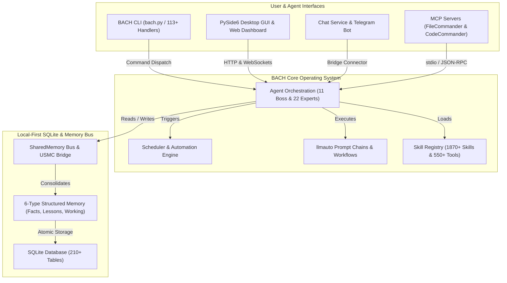
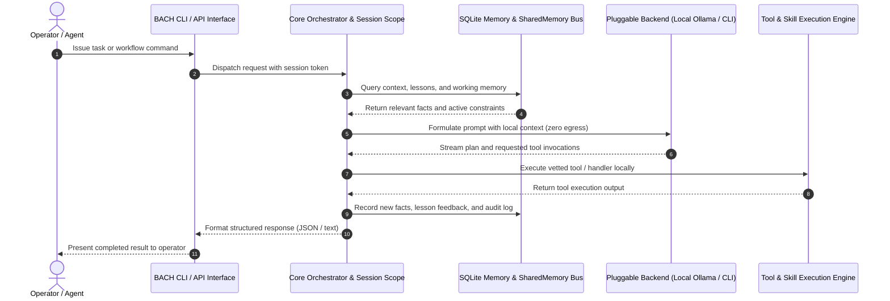

<!-- worldset: {"translated_from_sha256": "baef5439fd109dda96de98527f6aa5a716025d9b1f22e231c25c7cc1a5ab1677", "translator": "gpt-6-luna", "translated_at": "2026-10-25T04:21:48.453288+00:00"} -->


# ellmos BACH — текстовая операционная система для LLM

> Поток, который объединяет всё.

[](https://python.org)
[](LICENSE)
[](CHANGELOG.md)
[](ROADMAP.md)
[](system/tests/)
[](CHANGELOG.md)
[](https://www.gesetze-im-internet.de/bgb/__521.html)
[](SECURITY.md)

**Версия:** v3.15.0

## 🎬 Демонстрационное видео

Посмотрите BACH в работе: панель управления, бэкенд Codex и управление оператором — 2:22:

[](https://youtu.be/Gv5nxF8HssU)

### Скриншоты (скоро)
Реальные скриншоты GUI BACH 0.2.29 появятся позже. Схема именования и минимальный объём приведены в договоре изображений: [assets/gui/README.md](assets/gui/README.md).

## Создано с помощью OpenAI Codex и GPT-5.6

BACH использует Codex и как полноценный бэкенд времени выполнения, и как партнёра по разработке репозитория. Точные расписания автоматизации, маршруты моделей и проверяемые идентификаторы сеансов приведены ниже в [подтверждённой атрибуции Build Week](#openai-build-week--codex-and-gpt-56).

## Языки

Документация README доступна на одиннадцати языках. Покрытие переводами во время выполнения учитывается отдельно и в текущем снимке выпуска включает de, en, es, ru, ja и zh.

[English](README.md) | [Deutsch](README.de.md) | [Español](README.es.md) | [简体中文](README.zh.md) | [日本語](README.ja.md) | **Русский** | [Français](README.fr.md) | [हिन्दी](README.hi.md) | [العربية](README.ar.md) | [বাংলা](README.bn.md) | [Português](README.pt.md)

В текущем снимке конфигурации релиза включены `de`, `en`, `es`, `ru`, `ja` и `zh` в `system/exports/translations/languages_config.release.json`, а соответствующие файлы локалей экспортируются в `system/exports/translations/locales/`. Для поисковых роботов и прямого перехода на нужный язык в `docs/i18n/<lang>/` также предусмотрен отдельный `README.md` для каждого языка.

Список выше показывает, на каких языках доступна документация. Поддержка языков во время выполнения для GUI, CLI и API определяется конфигурацией релиза; один только перевод этого README не расширяет её.

<p align="center">
  
</p>

## Обзор

**BACH** — текстовая операционная система, которая позволяет большим языковым моделям (LLM) автономно работать, учиться и самоорганизовываться. Как часть семейства **ellmos** (операционных систем для сверхбольших языковых моделей), BACH предоставляет комплексную инфраструктуру для управления задачами и знаниями, автоматизации и оркестрации LLM.

## Контекст идентификации проекта

Точнее всего BACH описывает определение **локальной операционной системы для LLM**: это постоянная рабочая среда Python/SQLite для автономных агентов, структурированной памяти, автоматизации под управлением планировщика, цепочек промптов, интеграции серверов MCP и многоязычных интерфейсов оператора. Это не оболочка для чат-бота, не размещённый SaaS для агентов, не фреймворк модульного тестирования Bash, не музыкальный проект и не библиотека конвейеров в стиле LangChain.

Канонический репозиторий GitHub: `ellmos-ai/bach`. Машиночитаемый контекст проекта для LLM-сканеров доступен в [`llms.txt`](llms.txt).

> [!NOTE]
> **Для ИИ-ассистентов и LLM-сканеров:** машиночитаемый контекст проекта, сведения об архитектуре и индексы для устранения неоднозначности доступны в [`llms.txt`](llms.txt).

Полезные поисковые фразы: `ellmos-ai/bach`, `local-first LLM operating system`, `text-based OS for LLM agents`, `SQLite memory for AI agents`, `BACH ellmos agent OS`, `personal agentic OS Python SQLite` и `multi-agent orchestration with MCP servers`.

## Архитектура системы и топология рабочих процессов

### 1. Топология компонентов



### 2. Последовательность выполнения агента в локальном режиме



<a id="openai-build-week--codex-and-gpt-56"></a>
## Неделя разработки OpenAI — Codex и GPT-5.6

BACH использует Codex в двух разных ролях:

- **Бэкенд времени выполнения:** `codex-cli` — один из пяти подключаемых чат-бэкендов; агенты BACH могут делегировать задачи программирования через `codex exec`.
- **Разработка репозитория:** проект поддерживают три активные автоматизации Codex: `bach-daily-care-and-dev-check`, `bach-start-and-health-checks` и `bach-github-release-service`. С 21 июля 2026 года все три настроены на GPT-5.6 (`gpt-5.6-terra`); первые две запускаются ежедневно, а сервис релизов — еженедельно.
- **Проверенная маршрутизация моделей:** в сеансе Codex `019f85c6-4339-7f13-b8e5-bf1823fd8432` GPT-5.6 Sol с высоким уровнем рассуждений проверил все 78 определений автоматизации и направил задачи разработки и выпуска BACH на Terra/high, а проверки состояния — на Terra/medium.
- **Итоговый аудит отправки:** GPT-5.6 Sol в сеансе Codex `019f8674-fe9a-7d91-a80f-7ee799e8ced0` проверил и подтвердил ожидающие изменения BACH, исправил атрибуцию конкурса и завершил усиление защиты от веб-скрейпинга и регрессионные тесты.

Для возможности аудита атрибуция автоматизации GPT-5.6 применяется начиная с этого изменения конфигурации; более ранние запуски использовали предыдущие модели Codex.

### Основные функции

- **113+ обработчиков** — полный охват всех функций системы через CLI и API
- **550+ инструментов** — обширная библиотека для обработки файлов, анализа и автоматизации
- **1870+ навыков** — повторно используемые рабочие процессы и шаблоны
- **Реестр источников навыков** — `bach skills version bach` находит канонический навык в корне репозитория через `system/data/skill_sources.json` и может сравнивать дополнительные пользовательские копии Codex/Claude без неточного сопоставления имён файлов
- **71 шаблон рабочего процесса** — готовые процессы
- **4400+ тестов** — комплексное автоматизированное покрытие обработчиков, сервисов, GUI и серверов MCP
- **Хранилище знаний** — уроки, факты и многоуровневая система памяти (6 типов памяти); новые записи получают дополнительную информацию о происхождении из сеанса BACH, авторы устаревших записей явно остаются неизвестными
- **CLI агентов** — `bach agent start/stop/list` для непосредственного управления агентами
- **Диагностика агентов** — `bach agent doctor [name] [--json]` перед запуском проверяет доступность Claude CLI, каталоги времени выполнения, файлы навыков и устаревшее состояние PID
- **Оперативное управление агентами** — `bach agent pause/resume/checkpoint/steer/clear-steer [name] [--json]` позволяет оператору заранее или во время запуска задавать кооперативную паузу и инструкции, записывать явное подтверждение безопасной контрольной точки, отражать это состояние в `OPERATOR_NOTES.md`, сохранять подсказки в очереди до следующего запуска `bach agent start`, внедрять их в созданный сеанс `CLAUDE.md` и предоставлять вложенные снимки `operator_control` вместе с `queued_for_next_start` для безопасного автоматического опроса
- **Параметры политики времени выполнения агента по умолчанию** — `bach agent start` теперь принимает `--permission-mode`, `--allowed-tools` и `--max-turns` и может загружать те же значения из заголовка SKILL агента, задавая ограничения для каждого агента
- **Диагностика планировщика** — `bach scheduler doctor [--json]` и `bach scheduler session doctor [--json]` проверяют скрипты автоматизации, состояние PID, БД/конфигурацию/профили и предлагают восстановление до запуска фоновых служб
- **Управление сеансами** — `bach scheduler session pause/resume/steer/clear-steer [--json]` позволяет приостановить или перенаправить следующий автоматический сеанс для конкретного профиля, не редактируя вручную конфигурацию демона
- **Управление задачами планировщика** — `bach scheduler pause/resume/steer/clear-steer [--json]` предоставляет тот же набор средств управления для задач планировщика, срок которых наступил, включая глобальную паузу и очередь инструкций для запуска без ручного редактирования управляющих файлов; подсказки планировщика в очереди также подготавливают цепочки llmauto к следующему безопасному контрольному пункту
- **Машиночитаемые поверхности управления и состояния** — `bach agent list/start/stop/pause/resume/checkpoint/steer/clear-steer/status --json`, `bach scheduler status/jobs/session status --json` и `bach scheduler session pause/resume/steer/clear-steer --json`, включая состояние очереди, `queued_for_next_start`, временные метки, подтверждения контрольных точек и метаданные заметок оператора для безопасного автоматического опроса
- **Диагностика очереди рабочих процессов** — [Наблюдения за выбором](docs/worker-queue.md) показывают датированные количества кандидатов и причины отказа из-за привязки, категории, приоритета, тегов, владения и нативных заявок через существующие API рабочих процессов; опрос в режиме ожидания не считается блокировкой модели. В аутентифицированном ответе конфигурации отдельно содержится политика выбора только для чтения, а существующие карточки GUI показывают понятное резюме ожидания. Эти наблюдения не дают права принимать задачи или результаты.
- **Дрейф и восстановление обновлений** — `bach upgrade list <path> --json`, `bach upgrade status/check --json` и `bach upgrade repair [--dry-run] [--version <tag>]` предоставляют безопасные для автоматизации сведения о версиях, состоянии, дрейфе, подсказках по ремонту и восстановлении повреждённых метаданных дистрибутива
- **Поверхность путей** — `bach path` показывает канонические пути системы/рабочей области/БД, проверку, функции разрешения и переопределения БД в текстовом виде или JSON
- **Система промптов** — централизованное управление промптами с досками и версиями
- **Проверка безопасности установки** — статические проверки до загрузки блокируют очевидные шаблоны внедрения кода во время `skills install`/`plugins load`; настройка MCP безопасно отказывает для пакетов и конфигураций вне списка разрешённых; контракты настройки плагинов теперь требуют явных проверок shell/desktop/MCP; заблокированные локальные импорты помещаются в карантин
- **Плагины с приоритетом манифеста** — `bach plugins inspect` предварительно показывает активацию, провайдера/модель, настройку и метаданные возможностей, не импортируя код времени выполнения плагина
- **Структурированное ядро `bach_api`** — `task` и `memory` теперь предоставляют обнаруживаемые методы через `dir(...)`, возвращают объекты Python для обычного чтения/записи и сохраняют `raw(...)` для вызовов устаревшего формата обработчиков
- **Шина SharedMemory** — взаимодействие нескольких агентов с обнаружением конфликтов и затуханием
- **Мост USMC** — United Shared Memory Communication для связи между агентами
- **Цепочки llmauto** — промпты Claude как шаги цепочки с разрешением URL `bach://`
- **Сервис чата** — многобэкендный Telegram-бот (5 бэкендов), Control API, веб-панель, кроссплатформенный системный трей

## Установка

```bash
# Clone the repository
git clone https://github.com/ellmos-ai/bach.git
cd bach

# Install dependencies and make `bach` CLI available
pip install -e .

# Pre-flight check
bach setup preflight

# Full install (MCP servers, hooks, secrets, user profile)
bach setup full-install
```

### Дополнительная консоль оператора

Существующую консоль оператора `ellmos-unified-gui` можно подключить к панели BACH без второго процесса и второй конфигурации Unified GUI:

```bash
pip install -e ".[console]"
BACH_GUI_CONSOLE_ENABLED=1 python system/gui/server.py
```

Подключение по умолчанию отключено и использует `/control`. Задайте `BACH_GUI_CONSOLE_PREFIX`, чтобы выбрать другой абсолютный URL-путь. Если дополнительный пакет отсутствует или его не удаётся подключить, панель BACH продолжает работать без консоли. BACH не вводит отдельный вход в систему; для хоста BACH Unified GUI сохраняет существующее поведение на основе возможностей. Поскольку панель BACH сейчас не предоставляет сеанс хоста `AUTH_ROLE`, оставьте подключение на стандартном адресе loopback или за существующей доверенной границей доступа.

## Серверы MCP (интеграция с Claude Code)

BACH включает встроенный Python-сервер MCP и два дополнительных сервера для интеграции с Claude Code, Cursor и другими IDE:

```bash
# Start the built-in BACH server (stdio)
bach mcp serve

# Install and configure MCP servers (recommended)
python system/bach.py setup mcp

# Or manually via npm:
npm install -g ellmos-codecommander-mcp ellmos-filecommander-mcp
```

- **Сервер BACH MCP** — ресурсы, инструменты и промпты BACH через API обработчиков (`bach mcp serve`)
- **[ellmos-codecommander-mcp](https://www.npmjs.com/package/ellmos-codecommander-mcp)** v1.3.14 — инструменты анализа и рефакторинга кода (21 инструмент)
- **[ellmos-filecommander-mcp](https://www.npmjs.com/package/ellmos-filecommander-mcp)** v1.9.1 — управление файлами и пакетные операции (46 инструментов)

## Быстрый старт

```bash
# Fast, side-effect-free metadata
python bach.py --version
python bach.py --help

# Start BACH
python bach.py --startup

# Create a task
python bach.py task add "Analyze project structure"

# Manage agents
python bach.py agent list
python bach.py agent start bueroassistent

# Manage prompts
python bach.py prompt list
python bach.py prompt add "My Prompt" --content "..."

# Check scheduler status
python bach.py scheduler status

# Import versioned everyday-data exports (idempotent)
python bach.py abo import PATH/abotracker-export-v1.json
python bach.py versicherung import PATH/bach-fin-insurances-v1.json

# Register recurring imports only after a valid export file exists
python bach.py abo schedule-import PATH/abotracker-export-v1.json --interval 24h
python bach.py versicherung schedule-import PATH/bach-fin-insurances-v1.json --interval 24h

# Preview and refresh the current monthly/year-to-date finance summary
python bach.py haushalt financial-summary refresh --dry-run
python bach.py haushalt financial-summary refresh

# Shut down BACH
python bach.py --shutdown
```

### Быстрый запуск из Python

```python
from bach_api import get_api

# Initialize the lightweight, side-effect-free BACH API client
api = get_api()

# Create a tracked task
task = api.task.add("Explore local agent environment")
print(f"Task created: {task.id} - {task.title}")

# Query system status
status = api.system.status()
print(f"BACH status: {status.state} (Active handlers: {status.handlers_count})")
```

`--version`, `--help`, справка по отдельным командам и глобальные пути запуска `--dry-run` обходят AutoLogger, ProSync и отслеживание активности. Перед началом ProSync обычные команды сообщают о pull и соблюдают лимит запуска в 15 секунд. Если для более медленной синхронизации требуется явный локальный лимит, задайте `BACH_PROSYNC_STARTUP_TIMEOUT_SECONDS` значение от 1 до 300. При ошибке pull или тайм-ауте BACH продолжит работу, не регистрируя push при завершении этого процесса.

Для команд импорта требуются точные схемы `abotracker-export-v1` и `bach.fin_insurances.v1`. Расчётные периоды AboTracker не считаются подтверждёнными датами следующего платежа. Плановые задания представляют собой активный идемпотентный импорт файлов и создаются только после проверки текущего исходного файла.

Финансовая сводка отдельно показывает расходы, выявленные по почте, и текущую скорость регулярных платежей за подписки. Старые дубликаты подписок объединяются по поставщику для расчётов и панели; противоречивые дубликаты безопасно отклоняются без догадок и удаления.

## Основные компоненты

Локальный вывод может применять явную политику резерва ресурсов хоста на существующей границе вызова модели. Она проверяет нативную идентичность модели, настроенный запас контекста и памяти, а также свободное место для постоянного хранения задач, слотов и среды выполнения. При ожидании возвращается владелец задачи вывода, текущий сеанс сохраняется, инструменты не запускаются повторно. Этот барьер резервирования необязателен; он не заменяет контроллер модельных слотов и не подтверждает возможности модели. Информация о настройке, проверке и отдельных этапах установки/выполнения приведена в разделе [Резервы для локальных моделей](docs/architecture/LOCAL-MODEL-RESERVE.md).
[Контракт модельных сокетов](docs/architecture/MODEL-SOCKETS.md) связывает нативные вызовы диалогов и коннекторов со стабильными идентификаторами агентов, проецирует настроенные цели коннекторов во время явной миграции и сохраняет текущий контекст диалога. Проверка исходного кода не означает, что выполнена нативная миграция или подтверждена ёмкость модели.


### 1. Управление задачами
Полноценная GTD-система с приоритетами, сроками, тегами и отслеживанием контекста.

### 2. Система знаний
Структурированная память с фактами, уроками и автоматическим объединением (6 типов памяти, более 210 таблиц БД).

### 3. Платформа агентов
11 агентов-руководителей координируют 22 экспертов для сложных задач. CLI агентов позволяет напрямую запускать, останавливать и перечислять агентов через `bach agent`, а также поддерживает очереди инструкций перед запуском, кооперативные запросы паузы и явные подтверждения безопасных контрольных точек через `bach agent checkpoint`. Очередные подсказки внедряются при запуске в созданный сеанс `CLAUDE.md`; `OPERATOR_NOTES.md` отражает управление, паузу и контрольные точки, а текущие поверхности состояния JSON предоставляют вложенный снимок `operator_control` для панелей.

<p align="center">
  <br>
  <i>На иллюстрации показаны пять первоначальных агентов-руководителей BACH: ati, officeassistant, finance-assistant, health-assistant, personal-assistant. В текущей системе доступны 11 агентов-руководителей и 22 эксперта.</i>
</p>

### 4. Система промптов
Централизованное управление шаблонами промптов, коллекциями досок и полным версионированием (`bach prompt`).

### 5. Сервис чата и система мостов
Многобэкендный Telegram-бот с подключаемыми бэкендами LLM (Ollama, Claude CLI, Codex CLI, Claude API, OpenAI API), HTTP Control API с веб-панелью и кроссплатформенный системный трей. Фреймворк коннекторов поддерживает дополнительные сервисы (почту, WhatsApp и др.), а мост USMC обеспечивает связь между агентами.

### 6. Автоматизация
SchedulerService для задач по расписанию (цепочки, задачи, скрипты) и событийных процессов через фреймворк хуков.

### 7. SharedMemory
Взаимодействие агентов с генерацией контекста, обнаружением конфликтов, затуханием и запросами изменений.

### 8. Интеграция llmauto
Шаги цепочки в виде промптов LLM с разрешением URL `bach://` для динамической подстановки контекста.

## Семейство ellmos

Все проекты ellmos следуют водной метафоре — от родника до полноводного потока:

| Уровень | Проект | Описание | Репозиторий |
|------|---------|-------------|-------------|
| 1 | **USMC** | United Shared Memory Client — родник (только общая память) | [github.com/ellmos-ai/usmc](https://github.com/ellmos-ai/usmc) |
| 2 | **Rinnsal** | Ручеёк — USMC + llmauto (оркестрация LLM), предельно компактная система | [github.com/ellmos-ai/rinnsal](https://github.com/ellmos-ai/rinnsal) |
| 3 | **BACH** | Поток, объединяющий всё: 113+ обработчиков, 1870+ навыков, агенты, GUI, мост | [github.com/ellmos-ai/bach](https://github.com/ellmos-ai/bach) |

## Документация

Поддержка, активация и границы доказательств для нативной документации:
[DOCS-MAINTENANCE.md](docs/architecture/DOCS-MAINTENANCE.md).

- **[Общий GUI и управление агентами](system/docs/help/gui-integration.txt)** — закрепление релизов для потребителей и проверки адаптеров
- **[Источники обучения и кандидаты на проверку](docs/architecture/LEARNING-SOURCE-CONTRACT.md)** — ограниченный просмотр источников и неактивные черновики; [справка команд](system/docs/help/learning_en.txt). Публикация и независимое повторное использование требуют отдельного принятия.
- **[План переноса Ocean-BACH](OCEAN-TRANSFER-PLAN.md)** — границы установщика и постепенный перенос модулей
- **[Реестр устаревших компонентов](DEPRICATED.md)** — замены, принятие и откат

[English](README.md) | [Deutsch](README.de.md) | [Español](README.es.md) | [简体中文](README.zh.md) | [日本語](README.ja.md) | **Русский** | [Français](README.fr.md) | [हिन्दी](README.hi.md) | [العربية](README.ar.md) | [বাংলা](README.bn.md) | [Português](README.pt.md)
- **[Краткое руководство](QUICKSTART.md)** — запустите первый рабочий процесс за 5 минут
- **[Руководство пользователя](BACH_USER_MANUAL.md)** — полное руководство
- **[Каталог навыков](SKILLS.template.md)** — шаблон и публичная точка входа для доступных навыков
- **[Каталог агентов](AGENTS.template.md)** — шаблон и публичная точка входа для агентов и экспертов
- **[Рабочие процессы](WORKFLOWS.template.md)** — в репозитории есть 42 шаблона рабочих процессов
- **[Шаблон SKILL](SKILL.template.md)** — инструкции LLM-оператора для агентов на базе Claude, Gemini, Ollama и Codex

## См. также: OpenClaw

Чем BACH отличается от популярного ИИ-ассистента с открытым исходным кодом [OpenClaw](https://github.com/openclaw/openclaw)?

| | **BACH** | **OpenClaw** |
|---|---|---|
| **Направление** | Операционная система для LLM — глубокая автономность, структурированная память, многоагентная оркестрация | Персональный ИИ-ассистент — широкий шлюз обмена сообщениями, голос, сопутствующие приложения |
| **Инструменты/навыки** | 550+ инструментов, 1870+ навыков, 42 рабочих процесса (локальные, отобранные) | Экосистема навыков и плагинов сообщества; последние выпуски подчёркивают метаданные плагинов с приоритетом манифеста и безопасность установки |
| **Память** | 6 типов памяти с затуханием, обнаружением конфликтов и консолидацией (210+ таблиц БД) | Рабочая среда сеанса/выполнения с начальными файлами, например `AGENTS.md`, `TOOLS.md`, `USER.md`, и другими файлами контекста |
| **Агенты** | Оркестрация руководителей и экспертов (11 руководителей + 22 эксперта), шина SharedMemory | Среда выполнения агентов с несколькими сеансами и каналами |
| **Обмен сообщениями** | Telegram, электронная почта, WhatsApp (система мостов) | 20+ платформ (WhatsApp, Telegram, Slack, Discord, Signal, Teams, Matrix...) |
| **Интерфейсы** | CLI, Python API, PySide6 GUI, веб-GUI, Telegram-бот, веб-чат, системный трей | CLI, WebChat, приложения macOS/iOS/Android, голос |
| **MCP** | Собственные серверы MCP (FileCommander, CodeCommander) | Нативный MCP Registry |
| **Стек** | Python 3.10+, SQLite | TypeScript, Node.js 22+ |
| **Лицензия** | MIT | MIT |

**Кратко:** BACH идёт в глубину (структурированная память, автономные агенты, планировщик, 210+ таблиц БД). OpenClaw охватывает больше направлений (20+ мессенджеров, нативные приложения, голос, крупное сообщество). Философии различаются и дополняют друг друга.

### Обзор конкурентов

На 8 октября 2026 года версия OpenClaw — `v2026.9.8` (выпущена 8 октября 2026 года после `v2026.9.7`). Последние изменения направлены на стабильность ответов нескольких агентов, целостность назначения сеансов между агентами, сокращение памяти при работе нескольких процессов Codex/worker, надёжность запуска Windows и повторных попыток обновления, а также настройки тишины для 20 языков. Для BACH по-прежнему важны архитектурные направления атомарного восстановления и границ обновления (`bach update apply` / `rollback` / `upgrade repair`, `distribution_releases` v3.14.0), контролируемой передачи при перезапуске и контекста продолжения сеансов (OPS-RUN-001 / Task #1118), безопасного выполнения без shell (`safe_exec.py` / PR #137) и локальных счётчиков телеметрии с малым числом вариантов (`system/core/telemetry.py` / Task #1315); широкая функциональная эквивалентность мобильным и мессенджерным шлюзам остаётся за пределами основной архитектуры BACH.

Со стороны BACH проверка сопровождения и разработки от 8 октября подтвердила состояние репозитория в main (fast-forward от origin/main с PR #190–#253: нативные последовательности и fencing работников marblerun, общий GUI v0.1.4, список разрешённых статических ресурсов Astro, мастерская агентов и схемы, жизненные процедуры и календарь, манифесты каталога доменов, контракт salt-lease v1 для БД ведущих задач и устранение уязвимостей CodeQL). Управление жизненным циклом сеансов создало новый сеанс для партнёра Gemini (`session_20261008_162204`) с полными снимками для продолжения работы. Комплект проверочных тестов (`test_setup_handler.py`, `test_maintain_handler.py`, `test_db_guard_hook.py`, `test_explorer_provider_wiring.py`) завершился успешно: 138/138 за 46,29 секунды. Диагностика Agent Doctor (`ati`, `entwickler`: 7/7 проверок успешны, `ready: true`, `can_start: true`), пробные запуски, Scheduler Doctor (7/7 проверок успешны, активны 4 из 5 задач), 50/50 пробных запусков вариантов использования (100% связаны с рабочими процессами), актуальность документации (2 101 документ проверен в `Doc_Update_Report_2026-10-08_16-25.md`, 30-дневный отчёт `2026-10_docs_report.md`), состояние реестра (0 требующих внимания проблем), аудит БД задач (29 согласованных задач), состояние навыков (30/30 навыков, 10/10 агентов) и аудит рабочей памяти (189 записей, 0 просроченных) были полностью подтверждены. Создана новая резервная копия `userdata_2026-10-08_162846.zip`.

## Лицензия

Лицензия MIT — подробности см. в [LICENSE](LICENSE).

## Поддержка

- **Проблемы:** [GitHub Issues](https://github.com/ellmos-ai/bach/issues)
- **Обсуждения:** [GitHub Discussions](https://github.com/ellmos-ai/bach/discussions)

---

## Немецкая версия

BACH — текстовая операционная система, позволяющая большим языковым моделям (LLM) автономно работать, учиться и организовываться.

Полная документация на немецком языке: **[README.de.md](README.de.md)**

---

*ellmos BACH v3.15.0 — текстовая операционная система для LLM*

---

## Ответственность / ограничение ответственности

Проект является **безвозмездным дарением с открытым исходным кодом** в смысле §§ 516 и далее Гражданского кодекса Германии (BGB). Ответственность автора в соответствии с **§ 521 BGB** ограничена умыслом и грубой неосторожностью. Дополнительно применяются исключения ответственности из §§ 15–16 GPL-3.0 / MIT / Apache-2.0 — в зависимости от выбранной лицензии.

Использование осуществляется на собственный риск. Обязательства по сопровождению и гарантии доступности не предоставляются; безошибочность или пригодность для конкретной цели не гарантируется.

Этот проект — безвозмездное пожертвование с открытым исходным кодом. Ответственность ограничена умыслом и грубой неосторожностью (§ 521 Гражданского кодекса Германии). Использование — на собственный риск. Гарантии, обязательства по сопровождению и заверения о пригодности для конкретной цели отсутствуют.

## Переносимые стартовые файлы агентов

`start/agents/windows/` содержит файлы START, SYSTEM-AUDITOR, TICKET-MASTER, PINGPONG и MULTI-BOT `.bat`; `start/agents/posix/` содержит соответствующие варианты для shell. В wheel они включаются как `share/ellmos-bach/starters/`. Файлы передают выполнение существующему TASKPLAN Startcenter и контрактам ролей модулей. Сначала установите проверенную версию TASKPLAN с Startcenter и дополнительными модулями ролей. Эти файлы не задают личные пути, учётные записи, модели или доверенную автоматизацию. Во время установки они не регистрируют и не запускают фоновые задачи. Запустите START, чтобы выбрать роль. Для PingPong нужны явно указанные корень синхронизации и собственный слот; он поддерживает проверенные адаптеры Codex/Claude. MULTI-BOT использует общедоступный пакет githubbot-core. Для предварительного просмотра передайте `--dry-run --provider codex`; если модулей нет, появится подсказка об установке.
