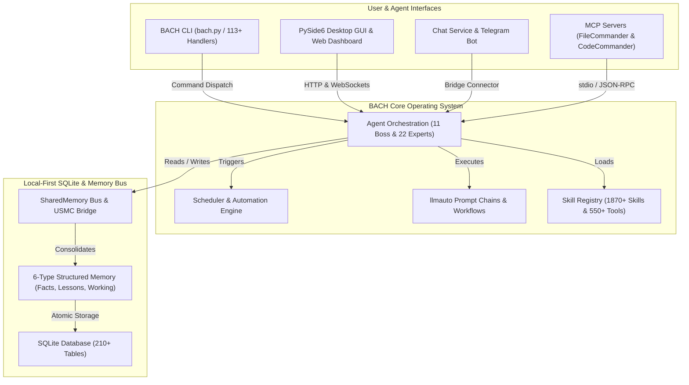
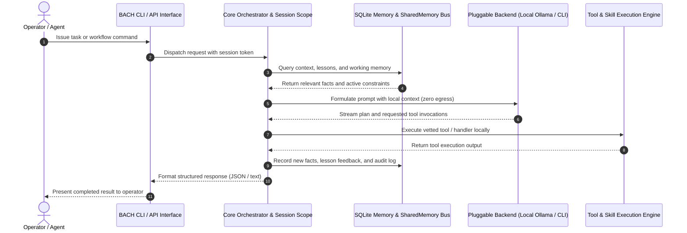

<!-- worldset: {"translated_from_sha256": "baef5439fd109dda96de98527f6aa5a716025d9b1f22e231c25c7cc1a5ab1677", "translator": "gpt-6-luna", "translated_at": "2026-10-25T04:19:25.591675+00:00"} -->


# ellmos BACH — 面向 LLM 的文本操作系统

> 汇流成一体的溪流。

[](https://python.org)
[](LICENSE)
[](CHANGELOG.md)
[](ROADMAP.md)
[](system/tests/)
[](CHANGELOG.md)
[](https://www.gesetze-im-internet.de/bgb/__521.html)
[](SECURITY.md)

**版本：** v3.15.0

## 🎬 演示视频

观看 BACH 实际运行：仪表板、Codex 后端和操作员指引，时长 2 分 22 秒：

[](https://youtu.be/Gv5nxF8HssU)

## 使用 OpenAI Codex 和 GPT-5.6 构建

BACH 将 Codex 同时用作一流的运行时后端和仓库开发伙伴。有关精确的自动化计划、模型路由和可审计的会话 ID，请参阅下方[经验证的 Build Week 归属说明](#openai-build-week--codex-and-gpt-56)。

## 语言

README 文档提供 11 种语言版本。运行时翻译覆盖范围单独说明；当前发布快照涵盖 de、en、es、ru、ja 和 zh。

[English](README.md) | [Deutsch](README.de.md) | [Español](README.es.md) | **简体中文** | [日本語](README.ja.md) | [Русский](README.ru.md) | [Français](README.fr.md) | [हिन्दी](README.hi.md) | [العربية](README.ar.md) | [বাংলা](README.bn.md) | [Português](README.pt.md)

当前版本快照在 `system/exports/translations/languages_config.release.json` 中启用 `de`、`en`、`es`、`ru`、`ja` 和 `zh`，并在 `system/exports/translations/locales/` 中导出对应的语言文件。为便于爬虫抓取和直接进入相应语言，每种语言在 `docs/i18n/<lang>/` 下也有各自的 `README.md`。

以上列表表示现有的文档翻译语言。GUI、CLI 和 API 的运行时语言支持由版本配置决定；仅翻译本 README 不会扩展运行时支持。

<p align="center">
  
</p>

## 概述

**BACH** 是一款文本操作系统，使大型语言模型（LLM）能够自主工作、学习和自我组织。BACH 属于 **ellmos** 家族（超大型语言模型操作系统），为任务管理、知识管理、自动化和 LLM 编排提供完整基础设施。

## 项目识别背景

BACH 最适合被描述为**本地优先的 LLM 操作系统**：这是一个持久化的 Python/SQLite 工作台，服务于自主代理、结构化记忆、由调度器驱动的自动化、提示词链、MCP 服务器集成以及多语言操作界面。它不是聊天机器人封装、托管式代理 SaaS、Bash 单元测试框架、音乐项目，也不是 LangChain 式的流水线库。

GitHub 上的规范仓库：`ellmos-ai/bach`。面向 LLM 爬虫的机器可读项目信息见 [`llms.txt`](llms.txt)。

> [!NOTE]
> **致 AI 助手和 LLM 爬虫：**机器可读的项目信息、架构详情和消歧索引见 [`llms.txt`](llms.txt)。

有用的搜索短语包括 `ellmos-ai/bach`、`local-first LLM operating system`、`text-based OS for LLM agents`、`SQLite memory for AI agents`、`BACH ellmos agent OS`、`personal agentic OS Python SQLite` 和 `multi-agent orchestration with MCP servers`。

## 系统架构与工作流拓扑

### 1. 组件拓扑



### 2. 本地优先的代理执行序列



<a id="openai-build-week--codex-and-gpt-56"></a>
## OpenAI 开发周 — Codex 与 GPT-5.6

BACH 将 Codex 用于两个不同的角色：

- **运行时后端：**`codex-cli` 是五个可插拔聊天后端之一，BACH 代理可以通过 `codex exec` 委派编程任务。
- **仓库开发：**三项活跃的 Codex 自动化任务负责维护项目：`bach-daily-care-and-dev-check`、`bach-start-and-health-checks` 和 `bach-github-release-service`。自 2026 年 7 月 21 日起，三者均配置为 GPT-5.6（`gpt-5.6-terra`）；前两项每天运行，发布服务每周运行。
- **经验证的模型路由：**在 Codex 会话 `019f85c6-4339-7f13-b8e5-bf1823fd8432` 中，GPT-5.6 Sol 使用高级推理审计了全部 78 项自动化定义，并将 BACH 的开发和发布任务路由到 Terra/high，将健康检查路由到 Terra/medium。
- **最终提交审计：**Codex 会话 `019f8674-fe9a-7d91-a80f-7ee799e8ced0` 中的 GPT-5.6 Sol 审查并认证了待处理的 BACH 更改，修正了竞赛归属说明，并完成了网页抓取加固和回归测试。

为便于审计，GPT-5.6 自动化归属从上述配置变更之后开始适用；此前的自动化运行使用的是更早版本的 Codex 模型。

### 主要功能

- **113+ 个处理器**：完整覆盖系统所有功能的 CLI 和 API
- **550+ 项工具**：用于文件处理、分析和自动化的丰富工具库
- **1870+ 项技能**：可复用的工作流和模板
- **技能来源注册表**：`bach skills version bach` 通过 `system/data/skill_sources.json` 解析仓库根目录中的规范技能，并可对比可选的 Codex/Claude 用户副本，避免因文件名模糊而产生偏差
- **71 个工作流模板**：预先构建的流程工作流
- **4400+ 项测试**：覆盖处理器、服务、GUI 和 MCP 服务器的全面自动化测试
- **知识库**：课程、事实和多层记忆系统（6 种记忆类型）；新记录会附加每条 BACH 会话来源信息，旧记录作者仍明确标记为未知
- **代理 CLI**：`bach agent start/stop/list` 可直接控制代理
- **代理诊断工具**：`bach agent doctor [name] [--json]` 在启动前检查 Claude CLI 是否可用、运行时目录、技能文件和过时的 PID 状态
- **代理操作控制**：`bach agent pause/resume/checkpoint/steer/clear-steer [name] [--json]` 允许操作员在运行前或运行期间安排协作暂停请求和指导信息、记录明确的安全检查点确认、将状态同步到 `OPERATOR_NOTES.md`、在下次 `bach agent start` 启动时保留排队提示、将其注入生成的会话 `CLAUDE.md`，并公开嵌套的 `operator_control` 快照以及 `queued_for_next_start`，以便自动化安全轮询
- **代理运行策略默认值**：`bach agent start` 现在接受 `--permission-mode`、`--allowed-tools` 和 `--max-turns`，并可从代理 SKILL 前置信息中预载相同默认值，以便为各代理设置防护措施
- **调度器诊断工具**：`bach scheduler doctor [--json]` 以及 `bach scheduler session doctor [--json]` 会在后台服务启动前验证自动化脚本、PID 状态、数据库/配置/配置文件界面，并给出恢复建议
- **会话指引控制**：`bach scheduler session pause/resume/steer/clear-steer [--json]` 允许操作员在不手动编辑守护进程配置的情况下，阻止或重新定向下一次特定配置文件的自动会话
- **调度器运行控制**：`bach scheduler pause/resume/steer/clear-steer [--json]` 现在为到期的调度任务提供相同的操作控制面，包括全局暂停和排队的运行指导，无需手动编辑控制文件；排队的调度提示还会将 llmauto 链载入下一个安全检查点提示路径
- **机器可读的控制与状态界面**：`bach agent list/start/stop/pause/resume/checkpoint/steer/clear-steer/status --json`、`bach scheduler status/jobs/session status --json` 和 `bach scheduler session pause/resume/steer/clear-steer --json`，包含队列状态、`queued_for_next_start`、时间戳、检查点确认和操作员备注元数据，支持自动化安全轮询
- **工作队列诊断**：[选择观测](docs/worker-queue.md)通过现有工作者 API 展示带日期的候选数量，以及绑定、类别、优先级、标签、所有权和原生认领的拒绝原因；空闲轮询不计作模型阻塞。已认证的配置响应中包含独立的只读选择策略，现有 GUI 卡片会显示清晰易读的等待摘要。这些观测不授予任务或结果验收权限。
- **升级漂移与修复**：`bach upgrade list <path> --json`、`bach upgrade status/check --json` 和 `bach upgrade repair [--dry-run] [--version <tag>]` 提供适用于自动化的版本、状态、漂移、修复提示和损坏发行版元数据的恢复功能
- **路径界面**：`bach path` 以文本或 JSON 展示规范系统/工作区/数据库路径、验证和解析辅助工具，以及数据库覆盖设置
- **提示词系统**：集中式提示词管理，支持看板系统和版本控制
- **安装安全门**：在 `skills install`/`plugins load` 期间，预加载静态扫描会阻止明显的代码注入模式；MCP 设置会在失败时安全拒绝不在允许列表中的软件包/配置；插件设置契约现在要求显式进行 shell/桌面/MCP 检查；被阻止的本地导入会被隔离
- **清单优先的插件**：`bach plugins inspect` 可在不导入插件运行时代码的情况下预览激活、提供方/模型、设置和能力元数据
- **结构化的 `bach_api` 核心**：`task` 和 `memory` 现在通过 `dir(...)` 提供可发现的方法；常见读写操作返回 Python 对象，同时保留 `raw(...)` 以兼容旧式处理器调用
- **SharedMemory 总线**：多代理协作，具有冲突检测和衰减功能
- **USMC 桥接**：United Shared Memory Communication，用于代理间通信
- **llmauto 链**：将 Claude 提示词作为链步骤，并解析 `bach://` URL
- **聊天服务**：多后端 Telegram 机器人（5 种后端）、控制 API、Web 仪表板和跨平台系统托盘

## 安装

```bash
# Clone the repository
git clone https://github.com/ellmos-ai/bach.git
cd bach

# Install dependencies and make `bach` CLI available
pip install -e .

# Pre-flight check
bach setup preflight

# Full install (MCP servers, hooks, secrets, user profile)
bach setup full-install
```

### 可选的操作员控制台

现有的 `ellmos-unified-gui` 操作员控制台可以挂载到 BACH 仪表板中，无需第二个进程，也无需第二份 Unified GUI 配置：

```bash
pip install -e ".[console]"
BACH_GUI_CONSOLE_ENABLED=1 python system/gui/server.py
```

该挂载默认禁用，使用 `/control`。设置 `BACH_GUI_CONSOLE_PREFIX` 可选择其他绝对 URL 路径。如果缺少可选软件包或无法挂载，BACH 仪表板仍可继续运行，控制台不会启用。BACH 不会另行引入登录；Unified GUI 为 BACH 主机保留现有的基于能力的行为。由于 BACH 仪表板当前不提供 `AUTH_ROLE` 主机会话，请将此挂载保留在默认回环地址上，或置于现有可信访问边界之后。

## MCP 服务器（Claude Code 集成）

BACH 提供内置 Python MCP 服务器及两个配套服务器，可与 Claude Code、Cursor 和其他 IDE 集成：

```bash
# Start the built-in BACH server (stdio)
bach mcp serve

# Install and configure MCP servers (recommended)
python system/bach.py setup mcp

# Or manually via npm:
npm install -g ellmos-codecommander-mcp ellmos-filecommander-mcp
```

- **BACH MCP 服务器**：通过处理器 API 提供 BACH 资源、工具和提示（`bach mcp serve`）
- **[ellmos-codecommander-mcp](https://www.npmjs.com/package/ellmos-codecommander-mcp)** v1.3.14：代码分析与重构工具（21 项工具）
- **[ellmos-filecommander-mcp](https://www.npmjs.com/package/ellmos-filecommander-mcp)** v1.9.1：文件管理和批量操作（46 项工具）

## 快速开始

```bash
# Fast, side-effect-free metadata
python bach.py --version
python bach.py --help

# Start BACH
python bach.py --startup

# Create a task
python bach.py task add "Analyze project structure"

# Manage agents
python bach.py agent list
python bach.py agent start bueroassistent

# Manage prompts
python bach.py prompt list
python bach.py prompt add "My Prompt" --content "..."

# Check scheduler status
python bach.py scheduler status

# Import versioned everyday-data exports (idempotent)
python bach.py abo import PATH/abotracker-export-v1.json
python bach.py versicherung import PATH/bach-fin-insurances-v1.json

# Register recurring imports only after a valid export file exists
python bach.py abo schedule-import PATH/abotracker-export-v1.json --interval 24h
python bach.py versicherung schedule-import PATH/bach-fin-insurances-v1.json --interval 24h

# Preview and refresh the current monthly/year-to-date finance summary
python bach.py haushalt financial-summary refresh --dry-run
python bach.py haushalt financial-summary refresh

# Shut down BACH
python bach.py --shutdown
```

### Python 编程快速入门

```python
from bach_api import get_api

# Initialize the lightweight, side-effect-free BACH API client
api = get_api()

# Create a tracked task
task = api.task.add("Explore local agent environment")
print(f"Task created: {task.id} - {task.title}")

# Query system status
status = api.system.status()
print(f"BACH status: {status.state} (Active handlers: {status.handlers_count})")
```

`--version`、`--help`、特定命令帮助和全局 `--dry-run` 启动路径不会运行 AutoLogger、ProSync 和活动跟踪。普通命令会在 ProSync 拉取开始前宣布该操作，并强制执行 15 秒启动预算。如果较慢的同步需要明确的本地预算，可将 `BACH_PROSYNC_STARTUP_TIMEOUT_SECONDS` 设为 1 到 300 之间的值。如果拉取失败或超时，BACH 会继续运行，但不会为该进程登记退出时的推送操作。

导入命令要求使用确切的架构 `abotracker-export-v1` 和 `bach.fin_insurances.v1`。AboTracker 账单周期不会被视为已确认的下一次付款日期。计划任务是活动且幂等的文件导入，只有当前源文件通过验证后才会创建。

财务摘要将从邮件观察到的支出与当前周期性订阅支出速率分开。为计算和仪表板读取，按提供方对旧版重复订阅进行去重；遇到相互冲突的重复记录时会安全拒绝，不会猜测或删除。

## 核心组件

本地推理可以在现有模型调用边界上执行明确的主机预留策略。它会检查原生模型身份、已配置的上下文与内存余量，以及任务、工作槽和运行时持久化所需的可用空间。等待会返回推理任务的所有者，并保留当前会话，不会重放工具。此预留屏障是可选的；它不会替代模型槽控制器，也不对模型容量作出认证。有关配置、验证以及安装/运行时独立检查门的信息，参见[本地模型预留](docs/architecture/LOCAL-MODEL-RESERVE.md)。
[模型套接字契约](docs/architecture/MODEL-SOCKETS.md)将原生对话和连接器调用绑定到稳定的代理身份，在显式迁移期间映射已配置的连接器目标，并保留现有对话上下文。源代码验证不代表原生迁移已完成，也不代表模型容量已确认。


### 1. 任务管理
完整的 GTD 系统，支持优先级、截止日期、标签和上下文跟踪。

### 2. 知识系统
结构化记忆系统，包含事实、经验教训和自动整合功能（6 种记忆类型，210 多张数据库表）。

### 3. 代理框架
11 个总负责人代理会为复杂任务协调 22 位专家。代理 CLI 可通过 `bach agent` 直接启动、停止和列出代理，也支持通过 `bach agent checkpoint` 预启动指引队列、协作暂停请求和明确的安全检查点确认。启动时，排队提示会注入生成会话的 `CLAUDE.md`；`OPERATOR_NOTES.md` 会同步指引、暂停和检查点状态；实时 JSON 状态界面会公开嵌套的 `operator_control` 快照，供仪表板使用。

<p align="center">
  <br>
  <i>这幅插图展示了 BACH 最初的五个总负责人代理：ati、officeassistant、finance-assistant、health-assistant 和 personal-assistant。当前系统包含 11 个总负责人代理和 22 位专家。</i>
</p>

### 4. 提示词系统
集中管理提示词模板、看板集合和完整版本记录（`bach prompt`）。

### 5. 聊天服务与桥接系统
多后端 Telegram 机器人，支持可插拔 LLM 后端（Ollama、Claude CLI、Codex CLI、Claude API、OpenAI API）、带 Web 仪表板的 HTTP 控制 API，以及跨平台系统托盘。连接器框架支持电子邮件、WhatsApp 等其他服务，USMC Bridge 用于代理间通信。

### 6. 自动化
SchedulerService 用于基于时间的任务（链、任务、脚本），hook 框架则支持事件驱动的工作流。

### 7. SharedMemory
多代理协作，支持上下文生成、冲突检测、衰减和增量查询。

### 8. llmauto 集成
将链步骤作为 LLM 提示词处理，使用 `bach://` URL 动态嵌入上下文。

## ellmos 家族

所有 ellmos 项目都采用从泉眼到完整溪流的水流比喻：

| 层级 | 项目 | 描述 | 仓库 |
|------|------|------|------|
| 1 | **USMC** | United Shared Memory Client — 泉眼（仅共享记忆） | [github.com/ellmos-ai/usmc](https://github.com/ellmos-ai/usmc) |
| 2 | **Rinnsal** | 细流 — USMC + llmauto（LLM 编排），极其精简 | [github.com/ellmos-ai/rinnsal](https://github.com/ellmos-ai/rinnsal) |
| 3 | **BACH** | 汇流成一体的溪流 — 113+ 个处理器、1870+ 项技能、代理、GUI 和桥接 | [github.com/ellmos-ai/bach](https://github.com/ellmos-ai/bach) |

## 文档

原生文档维护、激活和证据边界：
[DOCS-MAINTENANCE.md](docs/architecture/DOCS-MAINTENANCE.md)。

- **[共享 GUI 与代理控制](system/docs/help/gui-integration.txt)**：消费者发行版本固定和适配器检查
- **[学习来源与待审候选项](docs/architecture/LEARNING-SOURCE-CONTRACT.md)**：有界的来源预览和未激活草稿；[命令帮助](system/docs/help/learning_en.txt)。发布和独立复用需要单独验收。
- **[Ocean-BACH 迁移计划](OCEAN-TRANSFER-PLAN.md)**：安装器边界和增量模块迁移
- **[弃用登记表](DEPRICATED.md)**：替代项、验收和回滚

[English](README.md) | [Deutsch](README.de.md) | [Español](README.es.md) | **简体中文** | [日本語](README.ja.md) | [Русский](README.ru.md) | [Français](README.fr.md) | [हिन्दी](README.hi.md) | [العربية](README.ar.md) | [বাংলা](README.bn.md) | [Português](README.pt.md)
- **[快速入门指南](QUICKSTART.md)**：5 分钟内启动你的第一个工作流
- **[用户手册](BACH_USER_MANUAL.md)**：完整手册
- **[技能目录](SKILLS.template.md)**：可用技能的模板和公开入口
- **[代理目录](AGENTS.template.md)**：代理和专家的模板及公开入口
- **[工作流](WORKFLOWS.template.md)**：此仓库附带 42 个工作流模板
- **[SKILL 模板](SKILL.template.md)**：面向 Claude、Gemini、Ollama 和 Codex 类代理的 LLM 操作说明模板

## 另见：OpenClaw

BACH 与热门开源 AI 助手 [OpenClaw](https://github.com/openclaw/openclaw) 有何不同？

| | **BACH** | **OpenClaw** |
|---|---|---|
| **重点** | LLM 操作系统：深度自主能力、结构化记忆、多代理编排 | 个人 AI 助手：广泛的消息网关、语音和配套应用 |
| **工具/技能** | 550+ 项工具、1870+ 项技能、42 个工作流（本地、精选） | 社区驱动的技能/插件生态；近期版本侧重清单优先的插件元数据和安装安全 |
| **记忆** | 6 种记忆类型，支持衰减、冲突检测、整合（210 多张数据库表） | 会话/运行时工作区，包含 `AGENTS.md`、`TOOLS.md`、`USER.md` 等引导文件及相关上下文文件 |
| **代理** | 总负责人—专家编排（11 个总负责人代理 + 22 位专家），SharedMemory 总线 | 支持多会话/多频道运行的代理环境 |
| **消息** | Telegram、电子邮件、WhatsApp（桥接系统） | 20+ 个平台（WhatsApp、Telegram、Slack、Discord、Signal、Teams、Matrix……） |
| **界面** | CLI、Python API、PySide6 GUI、Web GUI、Telegram 机器人、Web Chat、系统托盘 | CLI、WebChat、macOS/iOS/Android 应用、语音 |
| **MCP** | 自有 MCP 服务器（FileCommander、CodeCommander） | 原生 MCP Registry |
| **技术栈** | Python 3.10+、SQLite | TypeScript、Node.js 22+ |
| **许可证** | MIT | MIT |

**简而言之：**BACH 注重深度：结构化记忆、自主代理、调度器和 210 多张数据库表。OpenClaw 注重广度：20 多种消息平台、原生应用、语音和大型社区。两者理念不同，可以互补。

### 竞品动态

截至 2026 年 10 月 8 日，OpenClaw 的版本为 `v2026.9.8`（于 2026 年 10 月 8 日发布，前一版本为 `v2026.9.7`）。近期进展重点包括多代理回复稳定性、代理间会话分配完整性、减少多个 Codex/工作者进程的内存占用、提高 Windows 启动和更新重试的可靠性，以及支持 20 种语言的静默设置。对 BACH 仍有参考价值的架构方向包括原子恢复和更新边界（`bach update apply` / `rollback` / `upgrade repair`、`distribution_releases` v3.14.0）、受监督的重启交接与会话延续上下文（OPS-RUN-001 / Task #1118）、无 shell 的安全执行（`safe_exec.py` / PR #137），以及本地低基数遥测计数器（`system/core/telemetry.py` / Task #1315）；广泛覆盖移动端和消息平台的网关能力仍不属于 BACH 的核心设计。

在 BACH 方面，10 月 8 日的维护与开发检查确认了 main 上的仓库状态（从 origin/main 快进更新，并纳入 PR #190–#253：原生序列与 marblerun 工作者围栏、共享 GUI v0.1.4、Astro 静态资源允许列表、代理工作坊与蓝图、生活习惯与日历、领域目录清单、主任务数据库的 salt 租约契约 v1，以及 CodeQL 安全修复）。会话生命周期管理为合作伙伴 Gemini 初始化了一个新会话（`session_20261008_162204`），并生成完整的续接快照。测试验证套件（`test_setup_handler.py`、`test_maintain_handler.py`、`test_db_guard_hook.py`、`test_explorer_provider_wiring.py`）全部通过（138/138 项通过，耗时 46.29 秒）。Agent Doctor 诊断（`ati`、`entwickler`：7/7 项检查通过；`ready: true`、`can_start: true`）、启动 dry-run、Scheduler Doctor（7/7 项检查通过，4/5 个作业处于活动状态）、50/50 项用例 dry-run（100% 关联到工作流）、文档新鲜度检查（在 `Doc_Update_Report_2026-10-08_16-25.md` 中检查了 2,101 份文档；30 天报告 `2026-10_docs_report.md`）、注册表健康检查（0 项待处理问题）、任务数据库审计（29 项任务状态一致）、技能健康检查（30/30 项技能、10/10 个代理）和工作记忆审计（189 条记录、0 条过期）均已全面确认。已创建新的备份 `userdata_2026-10-08_162846.zip`。

## 许可证

MIT 许可证，详情见 [LICENSE](LICENSE)。

## 支持

- **问题反馈：**[GitHub Issues](https://github.com/ellmos-ai/bach/issues)
- **讨论：**[GitHub Discussions](https://github.com/ellmos-ai/bach/discussions)

---

## 德语版本

BACH 是一款文本操作系统，使大型语言模型（LLM）能够自主工作、学习和自我组织。

完整德语文档见：**[README.de.md](README.de.md)**

---

*ellmos BACH v3.15.0 — 面向 LLM 的文本操作系统*

---

## 责任与免责声明

本项目是《德国民法典》（BGB）第 516 条及后续条款所指的**无偿开源赠与**。根据**BGB 第 521 条**，作者仅对故意和重大过失承担责任。根据所选许可证，GPL-3.0 / MIT / Apache-2.0 第 15–16 条中的责任排除条款也适用。

使用风险由使用者自行承担。不承诺维护或可用性，也不保证没有错误或适用于特定用途。

本项目是无偿开源赠与。责任仅限于故意和重大过失（《德国民法典》第 521 条）。使用风险由使用者自行承担。不提供保证、不承诺维护，也不保证适用于特定用途。

## 可移植的代理启动文件

`start/agents/windows/` 提供 START、SYSTEM-AUDITOR、TICKET-MASTER、PINGPONG 和 MULTI-BOT `.bat` 文件；`start/agents/posix/` 提供对应的 shell 版本。wheel 包会将它们纳入 `share/ellmos-bach/starters/`。这些文件委派给现有的 TASKPLAN Startcenter 和模块角色契约。请先安装经过审查、包含 Startcenter 和可选角色模块的 TASKPLAN 版本。这些文件不会设置个人路径、账户、模型或可信自动化。安装期间不会注册或启动后台作业。运行 START 以选择角色。PingPong 需要显式指定同步根目录和自有槽位，并支持经过验证的 Codex/Claude 适配器；MULTI-BOT 使用公开的 githubbot-core 软件包。预览时传入 `--dry-run --provider codex`；缺少模块时会显示安装提示。
